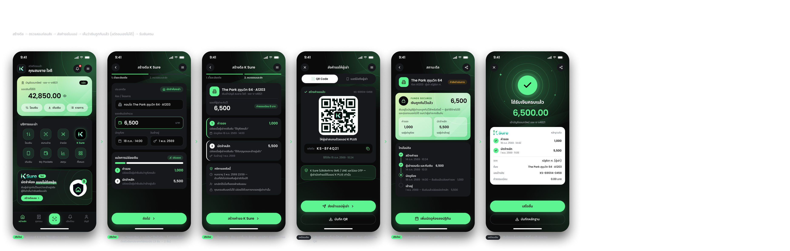
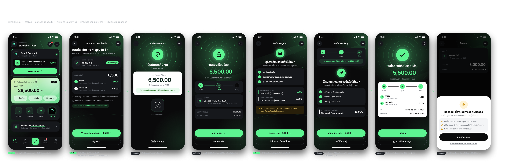

<div align="center">


### มัดจำห้อง แบบไม่ต้องลุ้น

**KBTG Kampus Hackathon 2026 (Intern Edition)** · Track: Software Engineering & Quality

`Prototype only · No real funds` — ทุกยอดเงิน ทุกบัญชี และทุกการยืนยันตัวตนในโปรเจกต์นี้เป็นการจำลอง

</div>

---

## 💡 โปรเจกต์นี้คืออะไร

**โจทย์:** ออกแบบฟีเจอร์บน Mobile Banking เพื่อช่วย **First Jobber** บริหารเงินและรับมือ **Scam / Fraud**

**ปัญหา:** เด็กจบใหม่ที่หาห้องเช่ามักถูกขอให้ "โอนมัดจำก่อนดูห้อง" — ห้องไม่มีจริง, คนโพสต์ไม่ใช่เจ้าของ, โอนแล้วติดต่อไม่ได้

**K Sure** เปลี่ยน "โอนมัดจำ" เป็น **"กันเงินไว้ในบัญชีตัวเอง"**

| | ทำงานอย่างไร |
|---|---|
| 🔒 **กันเงิน ไม่ใช่โอน** | ผู้เช่ากันเงินไว้ในบัญชีตัวเอง — ใช้จ่ายไม่ได้ชั่วคราว แต่ยังเป็นของผู้เช่า |
| 👀 **ผู้ให้เช่าเห็นหลักฐาน** | ผู้ให้เช่าเห็นสถานะ **Funds Secured** → มั่นใจว่าผู้เช่าจริงจัง โดยไม่ต้องให้โอนก่อน |
| 🪜 **ปล่อยเงิน 2 ขั้น** | ค่าจองปล่อยเมื่อ "ได้ดูห้องแล้ว" · มัดจำหลักปล่อยเมื่อ "ได้รับกุญแจและเข้าอยู่แล้ว" — **ผู้เช่าเป็นคนกดเท่านั้น** |
| ⏰ **คืนอัตโนมัติ** | เลยวันหมดอายุ → ส่วนที่ยังไม่ปล่อยคืนผู้เช่าเอง |
| ✅ **ความเชื่อถือจากข้อมูลธนาคาร** | ป้าย "ชื่อตรงบัญชี" แทนการเชื่อรูปห้องที่ปลอมได้ |
| 🛑 **Anti-scam: เตือนเมื่อถูกขอเงินนอกดีล (T8)** | ถ้าผู้เช่ากำลังโอนเงินตรงไปหาคู่ดีลที่ยังไม่จบ (เช่น "ค่าส่วนกลางล่วงหน้า") แอปเด้งเตือน **"หยุดก่อน! นี่อาจเป็นการขอเงินนอกดีล"** — ตรงกับมุกที่มิจฉาชีพใช้บ่อยที่สุด |

---

## 📱 หน้าจอ

| ผู้ให้เช่า (Landlord) | ผู้เช่า (Tenant) |
|---|---|
| **L1** หน้าหลัก · **L2** สร้างดีล · **L3** ตรวจสอบก่อนส่ง · **L4** ส่งคำขอ (QR) · **L5** สถานะดีล (Funds Secured) · **L6** ได้รับเงินครบ | **T1** หน้าหลัก (ได้รับคำขอ) · **T2** ตรวจสอบดีล · **T3** ยืนยันด้วย Face ID (จำลอง) · **T4** กันเงินสำเร็จ · **T5** ยืนยันดูห้อง · **T6** ยืนยันเข้าอยู่ · **T7** ปล่อยเงินสำเร็จ · **T8** เตือนขอเงินนอกดีล |




---

## 🧱 Tech stack

| ส่วน | เทคโนโลยี |
|---|---|
| Frontend | Next.js (App Router, เวอร์ชันล่าสุด) · TypeScript · Tailwind CSS v4 · Axios · TanStack Query · Zustand · motion · lucide-react |
| Backend | Go · Fiber · pgx · sqlc · goose |
| Database | PostgreSQL (Docker) |
| Test | Go test · Vitest · Playwright |

**เวอร์ชันที่ติดตั้งจริง (Frontend · 16 ต.ค. 2569):** Node 24.21 · Next.js 16.4.2 (Turbopack, `cacheComponents`) · React 19.3 · TypeScript 5.9 · Tailwind CSS 4.3 · motion 14.3 · TanStack Query 5.104 · Zustand 5.0 · Axios 1.20 · zod 4.6 · Vitest 5.0
**เวอร์ชันที่ติดตั้งจริง (Backend · 16 ต.ค. 2569):** Go 1.27 · Fiber v3.6.1 · pgx v5.11 · goose v3.29 · sqlc v1.31.1 · air v1.67.4 · PostgreSQL 18 (`postgres:18-alpine`) · Adminer 6.1.2 · Docker Compose v5.5

---

## 📂 โครงสร้าง repo

```text
.
├── README.md
├── docs/                    เอกสารออกแบบทั้งหมด (อ่านตามลำดับเลข)
│   ├── 01-user-flow.md      flow ทั้งสองฝั่ง, ตาราง หน้าจอ↔state↔API, หน้าจอที่ต้องออกแบบเพิ่ม, สคริปต์เดโม
│   ├── 02-ui-spec.md        design tokens, layout มือถือ, รูปแบบเงิน/วันที่, components, animation spec
│   ├── 03-architecture.md   stack, โครงโฟลเดอร์ frontend/backend, docker-compose, env
│   ├── 04-database.md       ERD, enums, DDL, seed, transaction ของแต่ละ action
│   ├── 05-api.md            endpoint, DTO, error codes, polling
│   ├── 06-roadmap.md        แผนทำงาน Phase 0 → 10 พร้อม Definition of Done
│   ├── 07-assets.md         รายการ asset ที่ต้องหา
│   ├── design/              รูป mockup อ้างอิง (ทั้งชุด + ทีละหน้าจอ)
│   └── reference/           สเปกระบบต้นฉบับ (DealSafe POC)
├── assets/                  ← วางโลโก้/ไอคอน/ภาพที่หามาได้ที่นี่ (มี README บอกในแต่ละโฟลเดอร์)
├── frontend/                Next.js (npm run dev)
├── backend/                 Go Fiber API — cmd/api, internal/{config,server,handler,domain,repository,platform}, migrations/, api/openapi.yaml
├── docker-compose.yml       postgres + api (+ adminer)
└── Makefile                 คำสั่งลัด (make help)
```

---

## 🚀 Getting started

> ตอนนี้ frontend ใช้ mock data (`NEXT_PUBLIC_USE_MOCK=true`) — backend มี login เดโม, `/me`, `/home`, แจ้งเตือน และ `/demo/reset` แล้ว และ API ของดีลครบ (สร้าง/ส่งคำเชิญ/กันเงิน/ปล่อยเงิน) — รอต่อกับหน้าจอใน Phase 7

### สิ่งที่ต้องติดตั้ง
- Node.js LTS ล่าสุด + npm
- Go stable ล่าสุด
- Docker Desktop

### รัน

```bash
# 1) ตั้งค่า env (ไม่บังคับสำหรับ backend — docker compose มีค่าเริ่มต้นให้)
cp .env.example .env
cp frontend/.env.local.example frontend/.env.local

# 2) Database + API (Docker) — api รัน migration + seed เองตอน start
make up                       # postgres :5432 · api :8080 · adminer :8081
curl localhost:8080/api/v1/readyz   # {"status":"ready"}

# ลองล็อกอินเดโม + ดูข้อมูล (cookie เก็บไว้นอก repo — ข้างในเป็น JWT ห้าม commit)
curl -c /tmp/ksure.jar -H 'content-type: application/json' -d '{"username":"tenant"}' localhost:8080/api/v1/auth/demo-login
curl -b /tmp/ksure.jar -X POST 'localhost:8080/api/v1/demo/reset?scenario=funds_locked'
curl -b /tmp/ksure.jar localhost:8080/api/v1/home

# 3) Frontend
cd frontend && npm install && npm run dev   # http://localhost:3000
#    หน้า dev: /dev/components (แคตตาล็อก) · /dev/overlay?screen=L1 (วาง mockup ทับ)
#    ตรวจ: npm run lint · npm run typecheck · npm test · npm run build
```

### เปิดบนมือถือ
- มือถือและคอมอยู่ Wi-Fi เดียวกัน → เปิด `http://<IP คอม>:3000`
- ถ้าจะใช้สแกน QR ด้วยกล้อง ต้องเป็น HTTPS → `npm run dev -- --experimental-https` หรือใช้ tunnel (`cloudflared`)

### บัญชีเดโม

| Username | Role | ชื่อ | ยอดเริ่มต้น |
|---|---|---|---|
| `landlord` | ผู้ให้เช่า | สมชาย ใจดี | 42,850.00 |
| `tenant` | ผู้เช่า | ณัฐธิดา ศรีสุข | 28,500.00 |

### คำสั่งที่ใช้บ่อย (`make help` ดูทั้งหมด)

| คำสั่ง | ทำอะไร |
|---|---|
| `make up` / `make down` | เปิด/ปิด db + api + adminer |
| `make logs` | ดู log ของ api (JSON) |
| `make migrate` / `make migrate-down` | goose up / down ทีละ version |
| `make seed` | ล้างดีลทั้งหมด แล้วใส่ข้อมูลเดโมตั้งต้นใหม่ |
| `make db-reset` | ล้าง schema ทั้งหมด + migrate + seed ใหม่ |
| `make test` | go test ทั้ง backend รวม integration กับ Postgres (DB `ksure_test` แยก) · frontend: `cd frontend && npm test` |
| `make sqlc` | generate Go code จาก `backend/internal/repository/queries` |
| `make dev` | รัน api บนเครื่องแบบ hot reload (air) — ปิด container api ก่อน (`docker compose stop api`) |
| `make tools` | ติดตั้ง goose / sqlc / air |

Adminer: http://localhost:8081 · server `db` · user `ksure` · password `ksure_dev_only` · database `ksure`

---

## 🗺️ แผนงาน (สรุป)

| Phase | งาน | สถานะ |
|---|---|---|
| 0 | เอกสารออกแบบ + ดึงค่าจาก Figma + หา asset | ✅ |
| 1 | Frontend foundation (tokens, ฟอนต์, layout, component พื้นฐาน) | 🟡 เหลือทดสอบบนมือถือจริง |
| 2 | **หน้าจอทั้ง 14 หน้าแบบ static ด้วย mock data — เทียบ mockup ให้เป๊ะ** | ✅ ([ภาพเทียบ](docs/design/compare/)) |
| 3 | อนิเมชัน (success rings, Face ID, stepper, bottom sheet …) | 🟡 เหลือทดสอบบนมือถือจริง |
| 4 | Backend foundation (Fiber, Postgres, migration, seed) | ✅ |
| 5 | Auth เดโม + Home API | ✅ |
| 6 | Deal core: state machine, ledger, idempotency + tests | ✅ |
| 7 | เชื่อม Frontend ↔ API + polling real-time | ⬜ |
| 8 | Flow ทางเลือก (ปฏิเสธ, ยกเลิก, หมดอายุ, T8 โอนนอกดีล) + หน้าจอ D* | ⬜ |
| 9 | E2E, PWA, HTTPS บนมือถือ, ซ้อมเดโม | ⬜ |
| 10 | (ภายหลัง) AWS ตามสเปกต้นฉบับ | ⬜ |

รายละเอียดและ checklist: [docs/06-roadmap.md](docs/06-roadmap.md)

---

## 🔐 หลักความปลอดภัย (แม้เป็น Prototype)

- ไม่มีเงินจริง ไม่เชื่อมธนาคารจริง ไม่ขอ PIN / OTP / เลขบัญชีเต็ม / ข้อมูลใบหน้า — Face ID และ PIN เป็นอนิเมชันจำลองเท่านั้น
- เงินเก็บเป็นสตางค์ (integer) · ทุก action อยู่ใน DB transaction เดียว · ledger แบบ append-only · ปล่อยเงินซ้ำไม่ได้ (unique constraint + idempotency key)
- Server เป็นผู้ตัดสิน state เสมอ · ตรวจ role และความเป็นคู่ดีลทุก request
- Invite token เก็บเฉพาะ hash และหมดอายุใน 24 ชม.

---

## 📚 เอกสารอ้างอิง

- สเปกระบบต้นฉบับ: [docs/reference/poc-system-spec.th.md](docs/reference/poc-system-spec.th.md)
- ดีไซน์: [docs/design/](docs/design/)
