<div align="center">


<br />

**ระบบกันเงินมัดจำอย่างปลอดภัย เพื่อลดความเสี่ยงการหลอกลวงในการจองเช่าที่พัก**

_Safer rental deposits — the tenant holds the money until the room is real._

**KBTG Kampus Hackathon 2026 · Intern Edition**

**Track: Software Engineering & Quality**

<br />


</div>

> K Sure เป็น **ต้นแบบ (prototype)** ที่พัฒนาขึ้นสำหรับงาน Hackathon เท่านั้น ยอดเงิน บัญชี และการยืนยันตัวตนทั้งหมดเป็น **ข้อมูลจำลอง** ไม่มีการทำธุรกรรมทางการเงินจริง

---

## สารบัญ

- [สรุปโครงการ](#สรุปโครงการ)
- [ปัญหาที่ต้องการแก้](#ปัญหาที่ต้องการแก้)
- [แนวทางของ K Sure](#แนวทางของ-k-sure)
- [ฟีเจอร์หลัก](#ฟีเจอร์หลัก)
- [ขั้นตอนการใช้งาน](#ขั้นตอนการใช้งาน)
- [หน้าจอของระบบ](#หน้าจอของระบบ)
- [สถาปัตยกรรมระบบ](#สถาปัตยกรรมระบบ)
- [เทคโนโลยีที่ใช้](#เทคโนโลยีที่ใช้)
- [จุดเด่นด้านวิศวกรรม](#จุดเด่นด้านวิศวกรรม)
- [การติดตั้งและใช้งาน](#การติดตั้งและใช้งาน)
- [การทดสอบและตรวจสอบคุณภาพ](#การทดสอบและตรวจสอบคุณภาพ)
- [โครงสร้างโปรเจกต์](#โครงสร้างโปรเจกต์)
- [เอกสารประกอบ](#เอกสารประกอบ)
- [ข้อจำกัดและแนวทางต่อยอด](#ข้อจำกัดและแนวทางต่อยอด)

---

## สรุปโครงการ

| หัวข้อ | รายละเอียด |
| --- | --- |
| **ชื่อโครงการ** | K Sure |
| **การแข่งขัน** | KBTG Kampus Hackathon 2026 (Intern Edition) |
| **Track** | Software Engineering & Quality |
| **ประเภท** | Web application ต้นแบบ (Mobile-first, รองรับ PWA) |
| **กลุ่มผู้ใช้** | ผู้เช่าที่พัก (Tenant) และผู้ให้เช่า (Landlord) |
| **ปัญหาหลัก** | การหลอกลวงให้โอนเงินมัดจำล่วงหน้าก่อนได้เห็นหรือเข้าอยู่ที่พักจริง |
| **แนวคิด** | เปลี่ยนจาก "โอนเงินออกไปก่อน" เป็น "กันเงินไว้ในบัญชีของผู้เช่า" แล้วปล่อยเงินตามขั้นตอนเมื่อผู้เช่ายืนยัน |
| **ขอบเขตที่ส่งมอบ** | UI ครบทั้งสองบทบาท, Backend API, ฐานข้อมูล, ระบบทดสอบอัตโนมัติ และชุด deploy บนคลาวด์ |

---

## ปัญหาที่ต้องการแก้

การจองหอพัก คอนโด หรือห้องเช่าผ่านช่องทางออนไลน์ มักกำหนดให้ผู้เช่า **โอนเงินจองหรือเงินมัดจำล่วงหน้า** ก่อนจะได้เห็นห้องจริง ทำให้เกิดความเสี่ยงหลายรูปแบบ

- 🏚️ **ห้องไม่มีอยู่จริง** หรือผู้ประกาศไม่ใช่เจ้าของที่แท้จริง
- 💸 **โอนแล้วติดต่อไม่ได้** เงินออกจากบัญชีไปแล้วและติดตามคืนได้ยาก
- 🔁 **ถูกเร่งให้โอนนอกระบบ** ผ่านการพูดคุยส่วนตัว โดยไม่มีหลักฐานหรือเงื่อนไขรองรับ

ผู้เช่าจึงต้องเลือกระหว่าง "เสี่ยงโอนก่อน" หรือ "เสียโอกาสได้ห้อง" ขณะที่ผู้ให้เช่าที่สุจริตก็ต้องการหลักประกันว่าผู้เช่าตั้งใจจองจริง

---

## แนวทางของ K Sure

K Sure ทำหน้าที่เป็นตัวกลางที่ **สร้างความเชื่อมั่นให้ทั้งสองฝ่าย** โดยไม่ต้องให้เงินออกจากมือผู้เช่าก่อนเวลา

| ผู้เช่าได้อะไร | ผู้ให้เช่าได้อะไร |
| --- | --- |
| เงินยังอยู่ในบัญชีตนเอง เพียงแต่ถูกกันไว้ | เห็นสถานะการกันเงินแบบเรียลไทม์ มั่นใจว่าผู้เช่าจองจริง |
| ควบคุมการปล่อยเงินเองทุกขั้นตอน | ได้รับเงินทันทีเมื่อผู้เช่ายืนยันแต่ละขั้น |
| ได้เงินคืนอัตโนมัติหากดีลหมดอายุหรือถูกยกเลิก | มีขั้นตอนที่ชัดเจนและตรวจสอบย้อนหลังได้ |

---

## ฟีเจอร์หลัก

| ฟีเจอร์ | คำอธิบาย |
| --- | --- |
| 🔒 **กันเงินแทนการโอน** | ผู้เช่ากันยอดเงินจองและเงินมัดจำไว้ในบัญชีของตนเอง แทนการโอนออกไปล่วงหน้า |
| 🪜 **ปล่อยเงินเป็นงวดตามเหตุการณ์จริง** | ปล่อยเงินจองเมื่อ "ดูห้องแล้ว" และปล่อยเงินมัดจำเมื่อ "เข้าอยู่แล้ว" |
| ↩️ **คืนเงินอัตโนมัติ** | เงินที่ยังไม่ถูกปล่อยจะคืนผู้เช่าเมื่อดีลหมดอายุหรือถูกยกเลิก |
| ⚠️ **เตือนก่อนโอนนอกดีล** | ระบบแจ้งเตือนเมื่อผู้เช่าพยายามโอนเงินตรงไปยังคู่ดีลที่กำลังมีดีลค้างอยู่ |
| 📷 **เชิญผ่าน QR / รหัสเชิญ** | ผู้ให้เช่าแชร์ QR code ให้ผู้เช่าสแกนเพื่อเปิดดีลได้ทันที |
| 🔔 **การแจ้งเตือนและใบยืนยัน** | ทั้งสองฝ่ายได้รับแจ้งเมื่อสถานะเปลี่ยน พร้อมหลักฐานการทำรายการ |
| 🧾 **Ledger จำลอง** | ทุกการเปลี่ยนสถานะและรายการเงินบันทึกผ่าน API และ ledger เพื่อการตรวจสอบย้อนหลัง |

---

## ขั้นตอนการใช้งาน

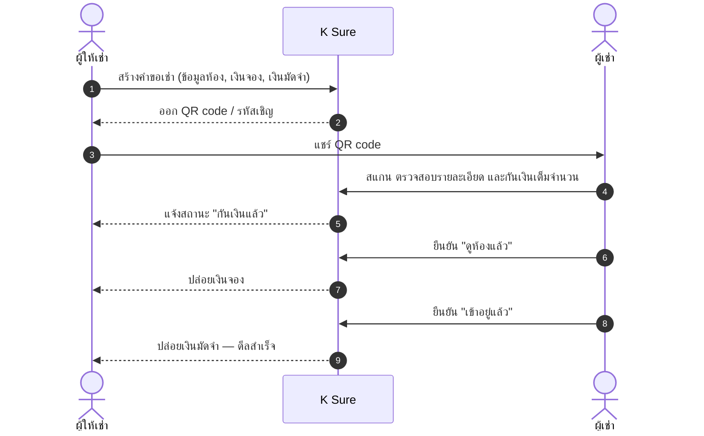

### สถานะของดีล

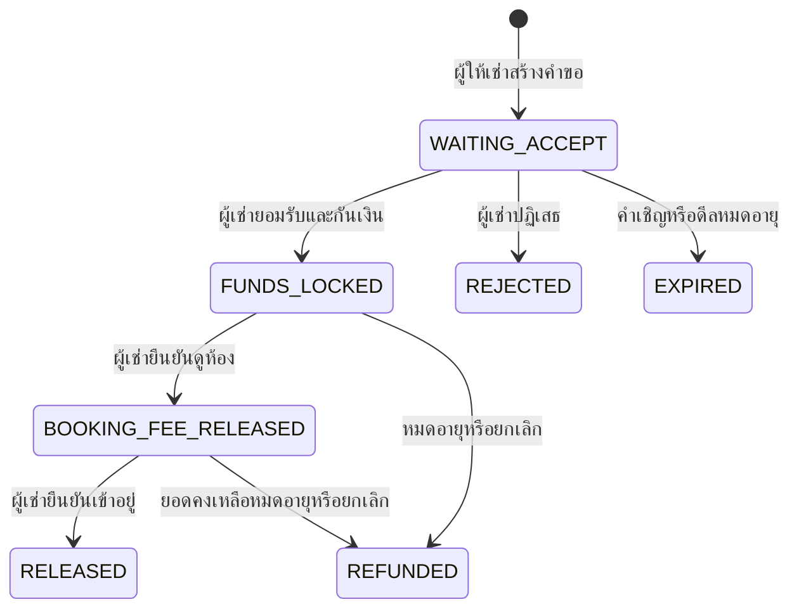

> ทุกการเปลี่ยนสถานะถูกตรวจสอบที่ฝั่งเซิร์ฟเวอร์ทั้ง **บทบาท สถานะ ความเป็นเจ้าของ และเวอร์ชันของคำขอ** — ผู้ให้เช่าไม่สามารถปล่อยเงินของผู้เช่าได้เอง

---

## หน้าจอของระบบ

ระบบประกอบด้วย 14 หน้าจอหลัก แยกตามบทบาทผู้ใช้

| ผู้ให้เช่า (Landlord) | ผู้เช่า (Tenant) |
| --- | --- |
| **L1** หน้าหลัก | **T1** หน้าหลัก |
| **L2** สร้างดีล | **T2** ตรวจสอบรายละเอียด |
| **L3** ตรวจสอบ | **T3** ยืนยันตัวตน (จำลอง) |
| **L4** ส่งคำขอ / แชร์ QR | **T4** กันเงิน |
| **L5** ติดตามสถานะ | **T5** ยืนยันดูห้อง |
| **L6** ดีลสำเร็จ | **T6** ยืนยันเข้าอยู่ |
| | **T7** ดีลสำเร็จ |
| | **T8** เตือนการโอนนอกดีล |

<details open>
<summary><b>เส้นทางผู้ให้เช่า</b></summary>

<table>
  <tr>
    <td align="center">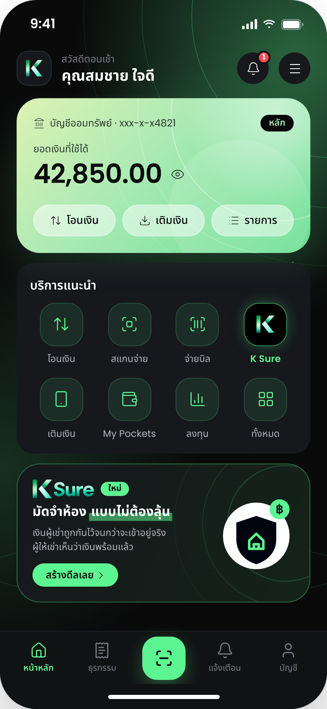<br /><b>L1</b> หน้าหลัก</td>
    <td align="center">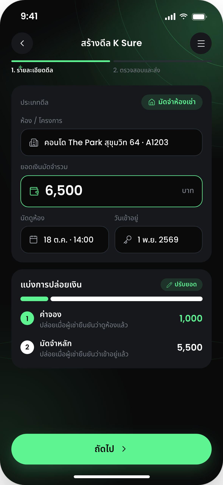<br /><b>L2</b> สร้างดีล</td>
    <td align="center">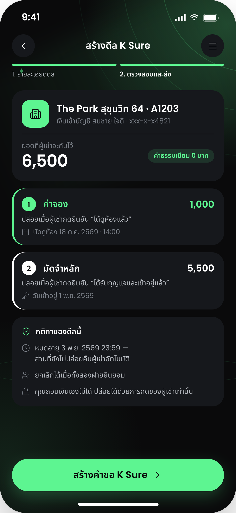<br /><b>L3</b> ตรวจสอบ</td>
  </tr>
  <tr>
    <td align="center">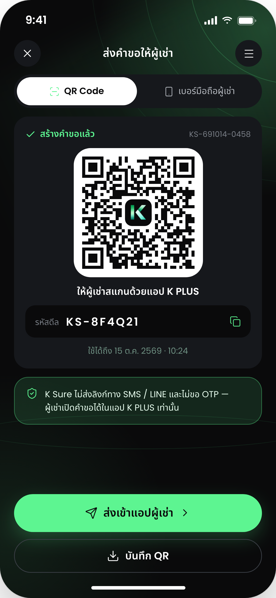<br /><b>L4</b> ส่งคำขอ / แชร์ QR</td>
    <td align="center">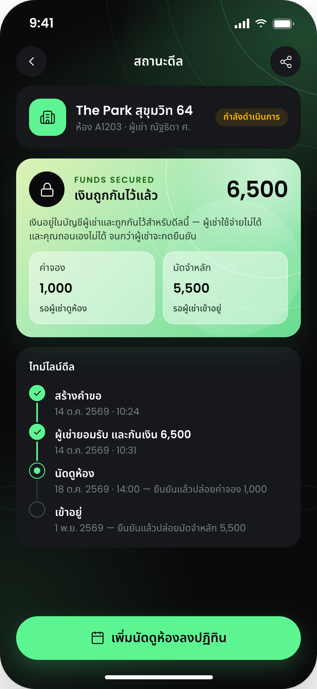<br /><b>L5</b> ติดตามสถานะ</td>
    <td align="center">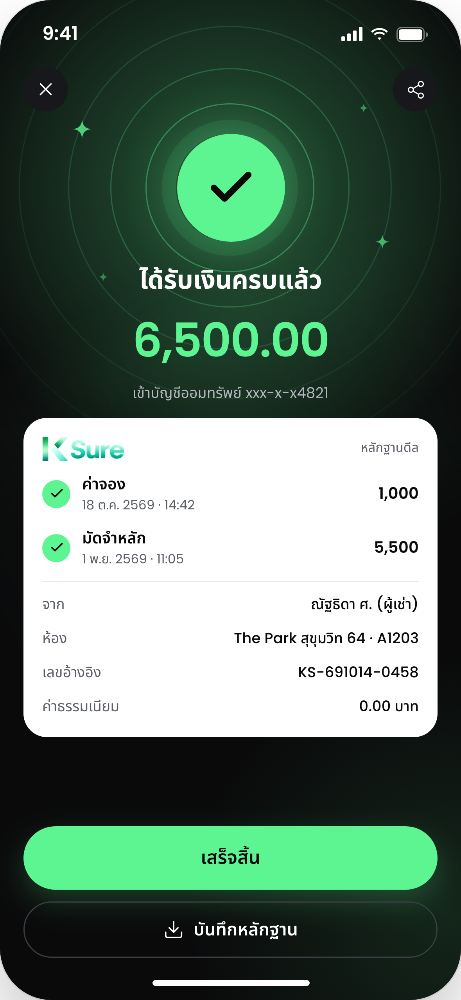<br /><b>L6</b> ดีลสำเร็จ</td>
  </tr>
</table>

</details>

<details open>
<summary><b>เส้นทางผู้เช่า</b></summary>

<table>
  <tr>
    <td align="center">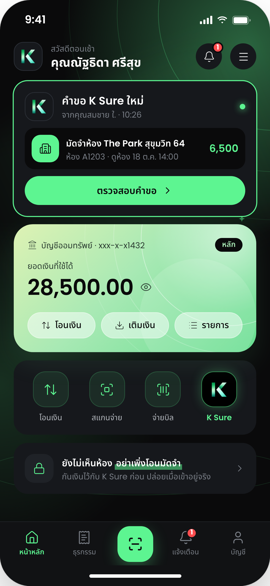<br /><b>T1</b> หน้าหลัก</td>
    <td align="center">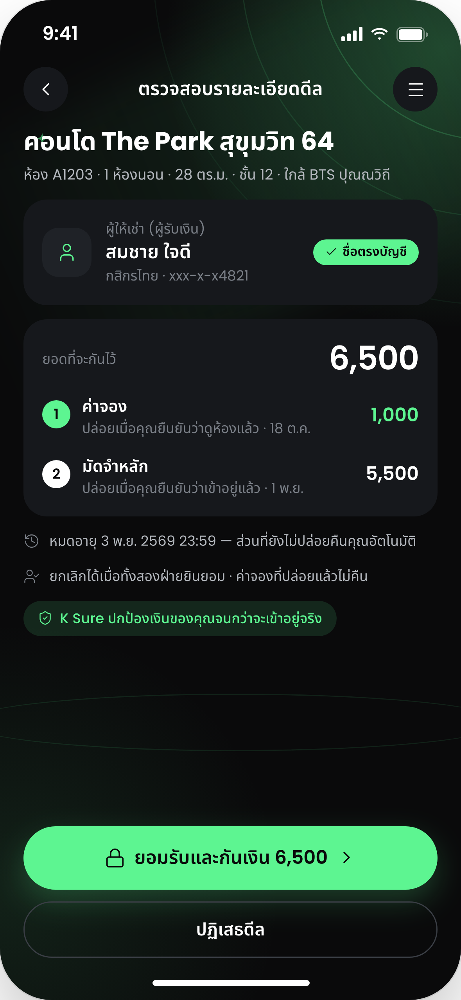<br /><b>T2</b> ตรวจสอบรายละเอียด</td>
    <td align="center">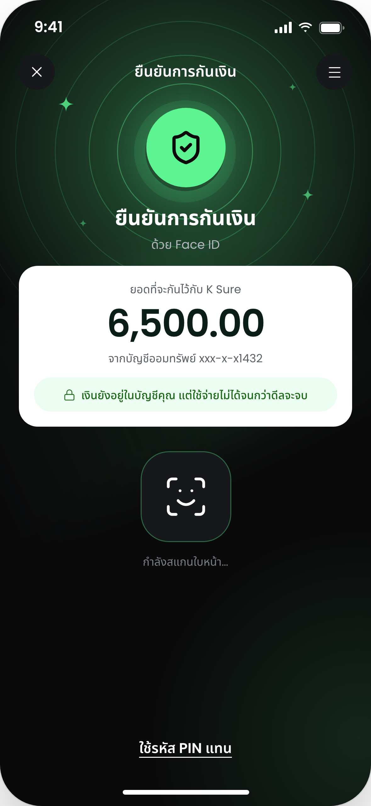<br /><b>T3</b> ยืนยันตัวตน (จำลอง)</td>
    <td align="center">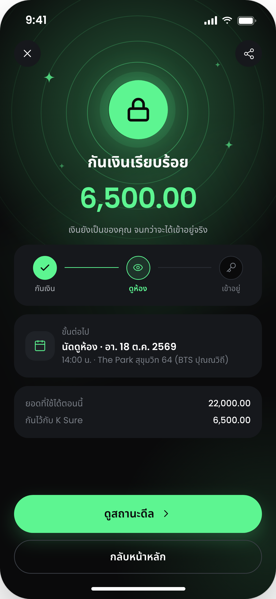<br /><b>T4</b> กันเงิน</td>
  </tr>
  <tr>
    <td align="center">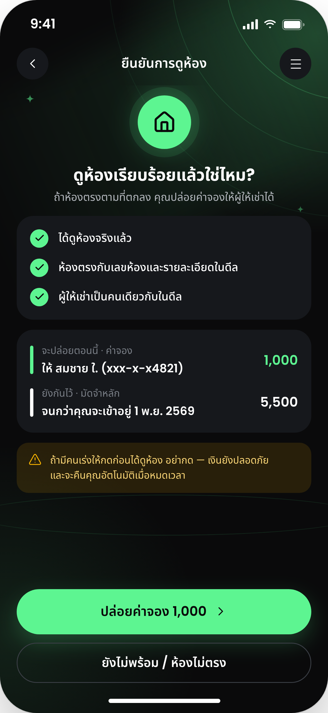<br /><b>T5</b> ยืนยันดูห้อง</td>
    <td align="center">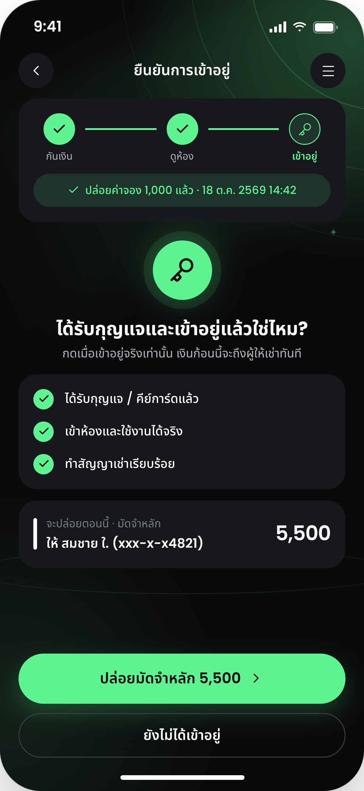<br /><b>T6</b> ยืนยันเข้าอยู่</td>
    <td align="center">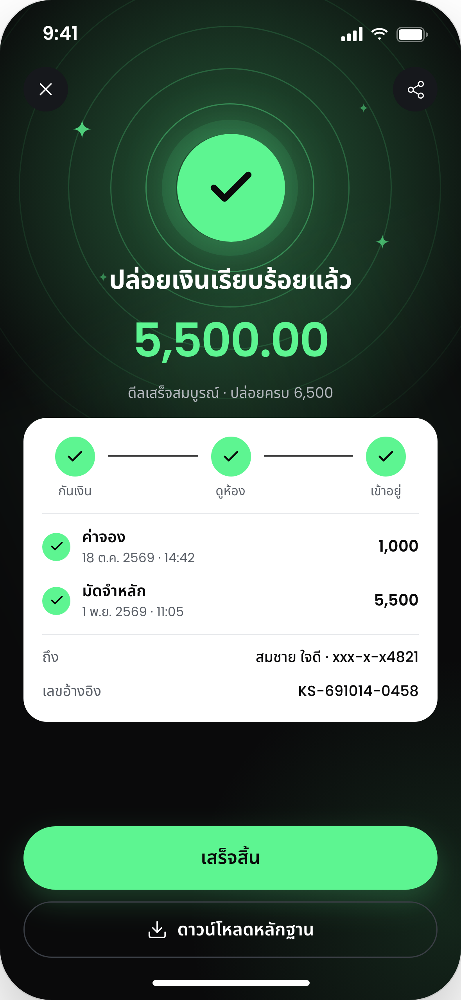<br /><b>T7</b> ดีลสำเร็จ</td>
    <td align="center">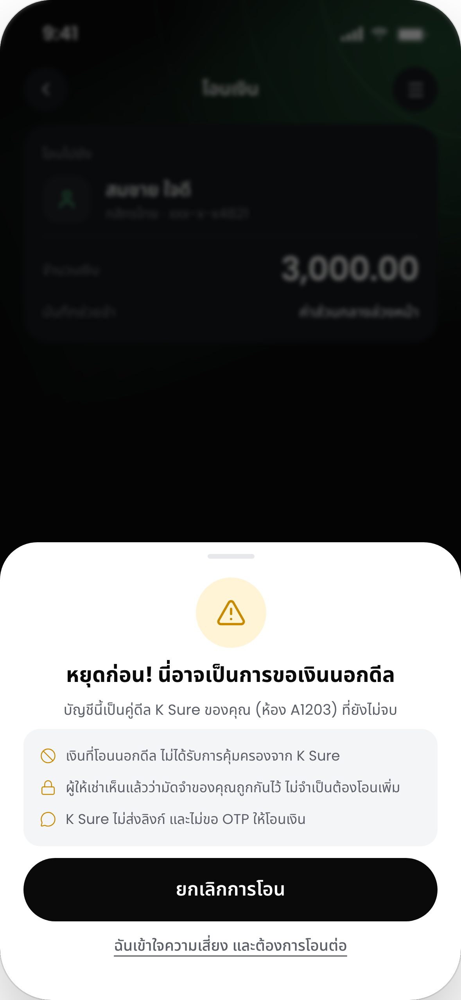<br /><b>T8</b> เตือนการโอนนอกดีล</td>
  </tr>
</table>

</details>

ภาพด้านบนแคปจากแอปจริงด้วย `frontend/scripts/capture-screens.mjs` (ข้อมูลจำลอง) · ภาพอ้างอิงจาก Figma อยู่ที่ [docs/design](docs/design/README.md)

---

## สถาปัตยกรรมระบบ

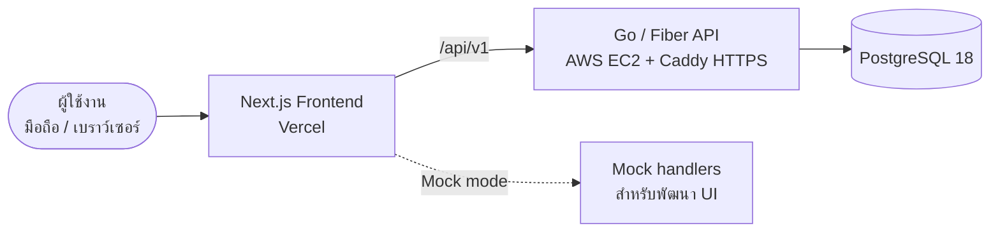

| ส่วนประกอบ | หน้าที่ |
| --- | --- |
| **Frontend** | หน้าจอทั้งหมด การแสดงผลแบบ responsive, PWA, สแกน QR และโหมดข้อมูลจำลอง |
| **Backend API** | ยืนยันตัวตน กฎทางธุรกิจ state machine ของดีล และ ledger จำลอง |
| **Database** | เก็บผู้ใช้ ดีล รายการเงิน การแจ้งเตือน และ idempotency key |
| **Infrastructure** | Docker Compose สำหรับพัฒนาในเครื่อง, Terraform + EC2 + Caddy สำหรับเดโม |

---

## เทคโนโลยีที่ใช้

| ส่วน | เทคโนโลยี |
| --- | --- |
| **Frontend** | Next.js 16, React 19, TypeScript, Tailwind CSS 4, TanStack Query |
| **Backend** | Go, Fiber v3, pgx, sqlc, goose (migrations) |
| **Database** | PostgreSQL 18 |
| **API Contract** | OpenAPI ([`backend/api/openapi.yaml`](backend/api/openapi.yaml)) |
| **Testing** | Playwright (E2E + visual regression), Go integration tests |
| **Infrastructure** | Docker Compose, Terraform, AWS EC2, Caddy, Vercel |
| **Design** | Figma |

---

## จุดเด่นด้านวิศวกรรม

- **State machine ที่เข้มงวด** — ทุกการเปลี่ยนสถานะของดีลถูกควบคุมและตรวจสอบสิทธิ์ที่ฝั่งเซิร์ฟเวอร์
- **Idempotency** — การกดยืนยันซ้ำจะได้ผลลัพธ์เดิม ไม่เกิดรายการเงินซ้ำซ้อน
- **Optimistic concurrency** — ป้องกันการแก้ไขข้อมูลชนกันด้วยการตรวจเวอร์ชันของคำขอ
- **Ledger จำลอง** — รายการเงินทุกรายการตรวจสอบย้อนหลังได้
- **Type-safe data access** — ใช้ sqlc สร้างโค้ดจาก SQL โดยตรง ลดข้อผิดพลาดตอน runtime
- **Visual regression testing** — เปรียบเทียบหน้าจอจริงทั้ง 14 หน้ากับดีไซน์จาก Figma ที่ขนาด 393×852
- **พร้อม deploy** — มี Infrastructure as Code สำหรับเปิดเดโมบนคลาวด์ได้ซ้ำ

---

## การติดตั้งและใช้งาน

### สิ่งที่ต้องมี

- Node.js 24+
- Go 1.27+
- Docker Desktop

### รันระบบทั้งหมด

```bash
git clone https://github.com/suphanatchanlek30/KBTG-Kampus-Hackathon-2026-Intern-Edition.git
cd KBTG-Kampus-Hackathon-2026-Intern-Edition

cp .env.example .env
cp frontend/.env.local.example frontend/.env.local

make up

cd frontend
npm install
npm run dev
```

| บริการ | URL |
| --- | --- |
| Web application | `http://localhost:3000` |
| API health check | `http://localhost:8080/api/v1/readyz` |

### โหมดข้อมูล

กำหนดค่าในไฟล์ `frontend/.env.local`

```env
# โหมด UI อย่างเดียว ไม่ต้องใช้ backend
NEXT_PUBLIC_USE_MOCK=true

# โหมดเชื่อมต่อ API จริง (ต้องรัน `make up` ก่อน)
# NEXT_PUBLIC_USE_MOCK=false
```

> [!TIP]
> **เดโมสองเครื่อง:** ใช้โหมด API แล้วเลือกบัญชีคนละบทบาท (ผู้ให้เช่า / ผู้เช่า) ที่หน้า `/login`

### สแกน QR บนมือถือ

หน้า `/scan` เปิดได้จากปุ่มกลางของหน้าหลัก กล้องของเบราว์เซอร์ต้องทำงานบน HTTPS หรือ `localhost` สำหรับอุปกรณ์จริงให้ใช้ `npm run dev -- --experimental-https` หรือใช้ tunnel

---

## การทดสอบและตรวจสอบคุณภาพ

```bash
# Frontend
cd frontend
npm test                 # Unit tests
npm run lint             # ตรวจคุณภาพโค้ด
npm run typecheck        # ตรวจ type
npm run format:check     # ตรวจรูปแบบโค้ด
npm run test:visual      # Visual regression เทียบกับ Figma

# End-to-end (ต้องรัน `make up` และเปิด frontend ในโหมด API)
npm run test:e2e

# Backend integration tests
cd ..
make test
```

`npm run test:visual` ตรวจทั้ง 14 หน้าจอที่ขนาด 393×852 เทียบกับ Figma overlay — ใช้ `npm run test:visual:update` เฉพาะเมื่อตรวจ baseline ใหม่ด้วยตาแล้วเท่านั้น

---

## โครงสร้างโปรเจกต์

```text
.
├── frontend/   Next.js application และ Playwright tests
├── backend/    Go API, migrations, OpenAPI contract และ integration tests
├── infra/      Terraform สำหรับ deploy บน AWS EC2
├── deploy/     Docker Compose และ Caddy สำหรับเครื่อง EC2
├── docs/       เอกสารผลิตภัณฑ์ UI สถาปัตยกรรม ฐานข้อมูล และ API
├── assets/     Design assets ต้นฉบับ (โลโก้ ไอคอน ฟอนต์)
└── scripts/    สคริปต์ช่วยงานพัฒนา
```

---

## เอกสารประกอบ

| เอกสาร | เนื้อหา |
| --- | --- |
| [การทำงานของผลิตภัณฑ์](docs/01-user-flow.md) | บทบาท สถานะ และเส้นทางผู้ใช้ |
| [คู่มือ UI](docs/02-ui-spec.md) | ระบบออกแบบและการแสดงผลบนหลายขนาดจอ |
| [สถาปัตยกรรม](docs/03-architecture.md) | ส่วนประกอบระบบและการพัฒนาในเครื่อง |
| [โมเดลข้อมูล](docs/04-database.md) | สถานะ ledger และกติกาของ transaction |
| [API](docs/05-api.md) | HTTP contract และการจัดการ error |
| [สถานะงาน](docs/06-roadmap.md) | สิ่งที่ส่งมอบแล้วและงานถัดไป |
| [Assets](docs/07-assets.md) | ที่มาและวิธีใช้งาน asset |
| [Deploy บน EC2](infra/README.md) | Terraform, domain, Vercel และการเปิดปิดเครื่อง |

---

## ข้อจำกัดและแนวทางต่อยอด

### ข้อจำกัดของต้นแบบ

- ไม่มีเงินจริง ไม่มีการเชื่อมต่อธนาคารจริง และไม่มีการยืนยันตัวตนจริง
- Face ID และ PIN เป็นการจำลองบน UI เท่านั้น
- ชื่อและภาพลักษณ์ต้องได้รับอนุมัติก่อนนำไปใช้ในงานสาธารณะ
- ชุด deploy บน EC2 เหมาะกับการเดโมระยะสั้น และต้องสำรองฐานข้อมูลเอง

### หากต่อยอดสู่การใช้งานจริง

- เชื่อมต่อระบบธนาคารและการกันวงเงินจริง
- ยืนยันตัวตนผ่านระบบ e-KYC
- ระบบตรวจจับและจัดการกรณีทุจริต (fraud operations)
- Security review, monitoring, data retention และ incident response
- การขออนุญาตตามข้อกำหนดของหน่วยงานกำกับดูแล

---

<div align="center">

**K Sure** — พัฒนาขึ้นสำหรับ KBTG Kampus Hackathon 2026 (Intern Edition) · Track Software Engineering & Quality

โปรเจกต์นี้เป็นต้นแบบเพื่อการสาธิตเท่านั้น **ห้ามใช้ทำธุรกรรมทางการเงินจริง**

</div>
