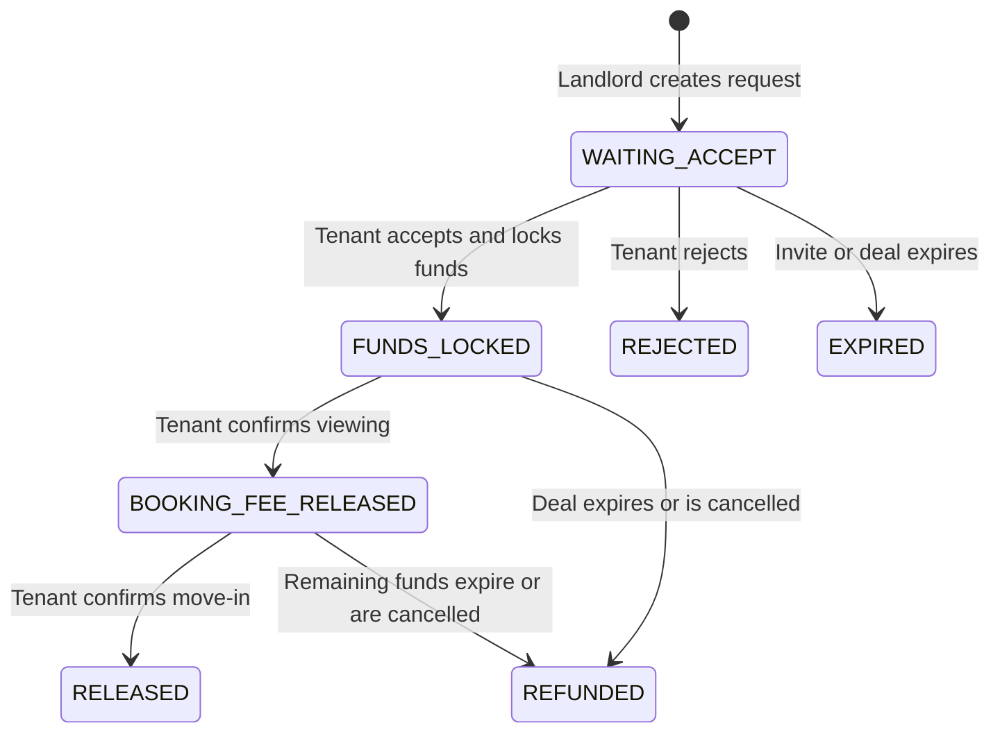

# Product Flow

K Sure is a prototype that demonstrates a safer rental-reservation flow. A tenant holds funds in the prototype, then releases each amount only after the relevant milestone. No real banking transaction occurs.

## Roles

| Role | Responsibility |
| --- | --- |
| Landlord | Creates a rental request, shares its invite, and follows the progress. |
| Tenant | Reviews the request, locks funds, and releases each tranche. |

## Deal lifecycle

The server validates role, state, ownership, and request version for every transition. The landlord cannot release tenant funds.

## Main journey

1. The landlord creates a request with property details, a booking fee, and a main deposit.
2. The landlord shares the QR code or invite code with the tenant.
3. The tenant opens the invite, reviews the details, and locks the full amount.
4. After the viewing, the tenant releases the booking fee.
5. After move-in, the tenant releases the main deposit.
6. The deal is completed when all tranches are released. Outstanding held funds are returned when the deal expires or is cancelled.

## Supporting journeys

| Journey | Expected behavior |
| --- | --- |
| Invalid or expired invite | Show the unavailable state; do not expose deal details. |
| Rejected request | Close the deal without locking funds. |
| Direct transfer to an active counterparty | Show the off-deal transfer warning before the simulated transfer. |
| Repeated submission | Reuse the idempotency key and return the original result. |
| Concurrent update | Refetch the deal after a version conflict. |

## Screens

| Area | Screens |
| --- | --- |
| Landlord | Home, create request, review, share invite, deal status, completion. |
| Tenant | Home, invite review, lock funds, locked confirmation, viewing confirmation, move-in confirmation, completion. |
| Shared | Login, notifications, transfer warning, QR scanner, unavailable states. |

Reference images are in [`docs/design/screens/`](./design/screens/). The running app remains the source of truth for navigation and copy.
