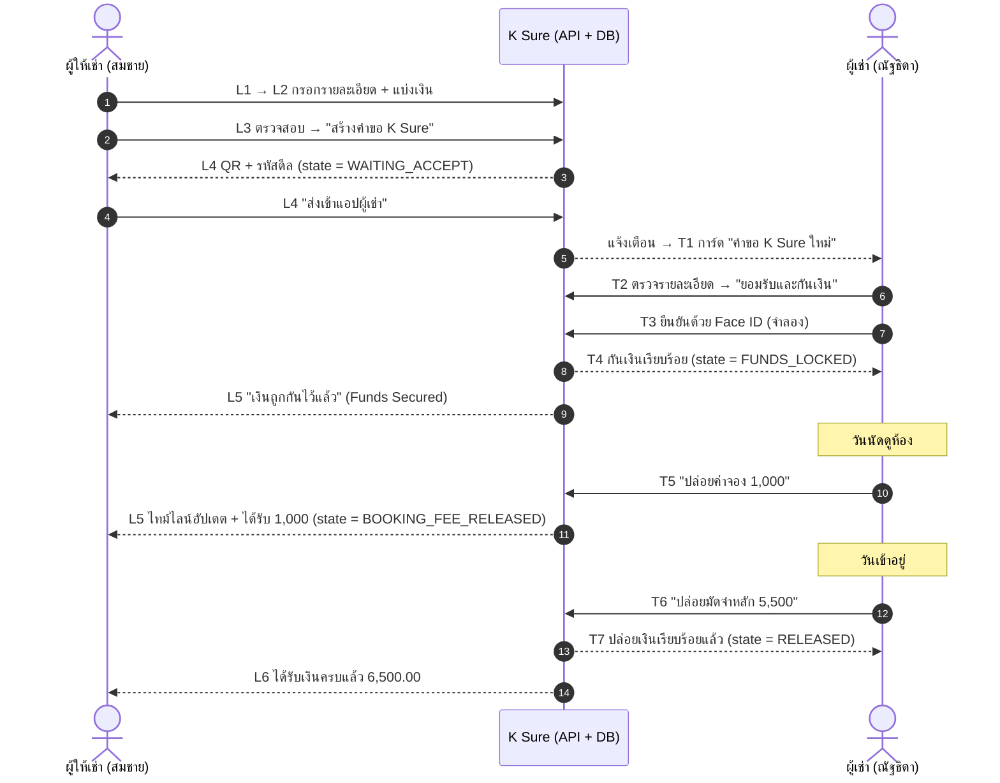
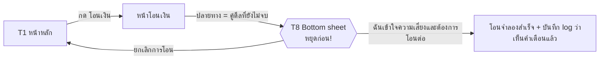

# 01 · User Flow (ทำความเข้าใจ flow ทั้งหมด)

> เอกสารนี้อธิบาย **flow การใช้งานจริง** ของ K Sure ทั้งฝั่งผู้ให้เช่าและผู้เช่า แบบหน้าจอต่อหน้าจอ
> ใช้รหัสหน้าจอ **L1–L6** (ผู้ให้เช่า), **T1–T8** (ผู้เช่า) และ **D0–D12** (หน้าจอที่ต้องออกแบบเพิ่ม) เป็นตัวอ้างอิงในทุกเอกสาร
>
> - ชื่อ state, ตาราง และ event → นิยามไว้ที่ [04-database.md](./04-database.md) ที่เดียว
> - endpoint → นิยามไว้ที่ [05-api.md](./05-api.md) ที่เดียว
> - หน้าตา/ขนาด/อนิเมชันของแต่ละหน้าจอ → [02-ui-spec.md](./02-ui-spec.md)
> - รูปอ้างอิงทุกหน้าจอ → [`docs/design/screens/`](./design/screens/)

---

## 1. แนวคิดของผลิตภัณฑ์ (สรุปใน 30 วินาที)

**ปัญหา:** First Jobber ที่หาห้องเช่ามักถูกขอให้ "โอนมัดจำก่อนดูห้อง" แล้วโดนหลอก (ห้องไม่มีจริง / คนโพสต์ไม่ใช่เจ้าของ / โอนแล้วติดต่อไม่ได้)

**ทางแก้ K Sure:** ผู้เช่า **ไม่ต้องโอนเงิน** แต่ **กันเงินไว้ในบัญชีตัวเอง** (hold) ผ่านแอปธนาคาร
- ผู้ให้เช่า **เห็นหลักฐาน** ว่าเงินถูกกันไว้จริง (Funds Secured) → มั่นใจว่าผู้เช่าไม่ได้หลอกจองเล่น
- เงินถูกปล่อย **เป็น 2 ก้อน** และ **ปล่อยได้ด้วยการกดของผู้เช่าเท่านั้น**
  1. **ค่าจอง** (เช่น 1,000) → ปล่อยเมื่อผู้เช่ากด "ได้ดูห้องแล้ว"
  2. **มัดจำหลัก** (เช่น 5,500) → ปล่อยเมื่อผู้เช่ากด "ได้รับกุญแจและเข้าอยู่แล้ว"
- ถ้าเลยวันหมดอายุ → ส่วนที่ยังไม่ปล่อย **คืนผู้เช่าอัตโนมัติ**
- **Anti-scam (T8):** ถ้าผู้เช่าพยายามโอนเงินตรงไปหาคู่ดีลที่ดีลยังไม่จบ → แอปเด้งเตือน "หยุดก่อน! นี่อาจเป็นการขอเงินนอกดีล"

> ทุกอย่างเป็น **การจำลอง** — ไม่มีเงินจริง ไม่มีการเรียกธนาคารจริง ไม่มี Face ID / PIN จริง

---

## 2. ตัวละครและข้อมูลเดโม (ใช้ค่าตรงกับ mockup เป๊ะ)

| | ผู้ให้เช่า (Landlord) | ผู้เช่า (Tenant) |
|---|---|---|
| ชื่อเต็ม | สมชาย ใจดี | ณัฐธิดา ศรีสุข |
| ชื่อย่อ | สมชาย ใ. | ณัฐธิดา ศ. |
| บัญชี | ออมทรัพย์ · กสิกรไทย · `xxx-x-x4821` | ออมทรัพย์ · `xxx-x-x1432` |
| ยอดเงินเริ่มต้น | 42,850.00 | 28,500.00 |

| ข้อมูลดีลตัวอย่าง | ค่า |
|---|---|
| ห้อง | คอนโด The Park สุขุมวิท 64 · A1203 (1 ห้องนอน · 28 ตร.ม. · ชั้น 12 · ใกล้ BTS ปุณณวิถี) |
| ยอดรวม | 6,500 = ค่าจอง 1,000 + มัดจำหลัก 5,500 · ค่าธรรมเนียม 0 บาท |
| เลขอ้างอิง | `KS-691014-0458` (KS-ปีพ.ศ.2หลัก/เดือน/วัน-ลำดับ) |
| รหัสดีล (แชร์) | `KS-8F4Q21` |
| สร้างคำขอ | 14 ต.ค. 2569 · 10:24 (ส่งเข้าแอปผู้เช่า 10:26) |
| QR ใช้ได้ถึง | 15 ต.ค. 2569 · 10:24 (24 ชม.) |
| ผู้เช่ายอมรับ + กันเงิน | 14 ต.ค. 2569 · 10:31 |
| นัดดูห้อง | อา. 18 ต.ค. 2569 · 14:00 → ปล่อยค่าจองจริงตอน 14:42 |
| วันเข้าอยู่ | 1 พ.ย. 2569 → ปล่อยมัดจำหลักตอน 11:05 |
| ดีลหมดอายุ | 3 พ.ย. 2569 · 23:59 |

---

## 3. ภาพรวม Flow ทั้งสองฝั่ง (เวลาจริงคู่กัน)

### Flow ทางเลือก (Anti-scam)

---

## 4. Flow ผู้ให้เช่า (Landlord) ทีละหน้าจอ

> สร้างดีล → ตรวจสอบก่อนส่ง → ส่งคำขอในแอป → เห็นว่าเงินถูกกันแล้ว (แต่ถอนเองไม่ได้) → รับเงินครบ

### L1 · หน้าหลัก K PLUS — [รูป](./design/screens/L1.png)
- **เห็นอะไร:** ทักทาย "สวัสดีตอนเช้า คุณสมชาย ใจดี", การ์ดยอดเงิน (42,850.00, ปุ่มตา ซ่อน/แสดงยอด), ปุ่ม โอนเงิน/เติมเงิน/รายการ, บริการแนะนำ 8 ช่อง (K Sure ไฮไลต์เขียว), แบนเนอร์ K Sure "มัดจำห้อง แบบไม่ต้องลุ้น" + ปุ่ม "สร้างดีลเลย", Bottom nav 5 ปุ่ม
- **ทำอะไรได้:**
  - "สร้างดีลเลย" หรือไอคอน K Sure → **L2**
  - กระดิ่ง → **D7** รายการแจ้งเตือน
  - ถ้ามีดีลค้างอยู่ → **D9** การ์ดดีลที่กำลังดำเนินการ → **L5**
- **คำทักทายเปลี่ยนตามเวลา:** ตอนเช้า / ตอนบ่าย / ตอนเย็น

### L2 · สร้างดีล (ขั้น 1/2 "รายละเอียดดีล") — [รูป](./design/screens/L2.png)
- **กรอก:** ประเภทดีล (fix = "มัดจำห้องเช่า"), ห้อง/โครงการ (เลือกจากห้องของผู้ให้เช่า), ยอดเงินมัดจำรวม, วันเวลานัดดูห้อง, วันเข้าอยู่
- **แบ่งการปล่อยเงิน:** ค่าจอง (ปล่อยเมื่อดูห้อง) + มัดจำหลัก (ปล่อยเมื่อเข้าอยู่) — แถบสีแสดงสัดส่วน; ปุ่ม "ปรับยอด" แก้ค่าจองได้ → มัดจำหลัก = ยอดรวม − ค่าจอง (คำนวณอัตโนมัติ)
- **Validation:** ยอดรวม > 0, ค่าจอง ≥ 1 และ < ยอดรวม, นัดดูห้อง > ตอนนี้, วันเข้าอยู่ ≥ วันนัดดูห้อง
- **ยังไม่เรียก API** (เก็บใน client state) → "ถัดไป" → **L3**

### L3 · ตรวจสอบก่อนส่ง (ขั้น 2/2) — [รูป](./design/screens/L3.png)
- **สรุป:** ห้อง + เงินเข้าบัญชีใคร, ยอดที่ผู้เช่าจะกันไว้ 6,500 + badge ค่าธรรมเนียม 0 บาท, การ์ดก้อนที่ 1 (ไฮไลต์ขอบเขียว) / ก้อนที่ 2 (ขอบขาว), **กติกาของดีลนี้** (วันหมดอายุ, ยกเลิกได้เมื่อทั้งสองฝ่ายยินยอม, ผู้ให้เช่าถอนเองไม่ได้)
- "สร้างคำขอ K Sure" → **สร้างดีลจริง** (state → `WAITING_ACCEPT`, ออกรหัสเชิญ) → **L4**
- ปุ่มย้อนกลับ → L2 (ข้อมูลยังอยู่)

### L4 · ส่งคำขอให้ผู้เช่า — [รูป](./design/screens/L4.png)
- **แท็บ QR Code:** "สร้างคำขอแล้ว" + เลขอ้างอิง, QR (มีโลโก้ K กลาง), "ให้ผู้เช่าสแกนด้วยแอป …", รหัสดีล `KS-8F4Q21` + ปุ่มคัดลอก, "ใช้ได้ถึง 15 ต.ค. 2569 · 10:24"
- **แท็บ เบอร์มือถือผู้เช่า:** กรอกเบอร์ → ค้นหาผู้ใช้เดโม → ส่งเข้าแอป (**D10** — ต้องออกแบบเพิ่ม)
- **กล่องเตือน:** "K Sure ไม่ส่งลิงก์ทาง SMS / LINE และไม่ขอ OTP — ผู้เช่าเปิดคำขอได้ในแอปเท่านั้น"
- "ส่งเข้าแอปผู้เช่า" → สร้าง notification ให้ผู้เช่า → ไป **L5**
- "บันทึก QR" → ดาวน์โหลด PNG ของการ์ด QR
- ปุ่ม X → L5

### L5 · สถานะดีล — [รูป](./design/screens/L5.png) (ภาพนี้คือ state `FUNDS_LOCKED`)
- **หัว:** ห้อง + ผู้เช่า + badge สถานะ
- **การ์ด Funds Secured (เขียวมิ้นต์):** "เงินถูกกันไว้แล้ว 6,500" + คำอธิบาย + 2 กล่อง ค่าจอง/มัดจำหลัก พร้อมสถานะย่อย (รอผู้เช่าดูห้อง / รอผู้เช่าเข้าอยู่ / ได้รับแล้ว)
- **ไทม์ไลน์ดีล:** สร้างคำขอ ✓ → ผู้เช่ายอมรับ และกันเงิน ✓ → นัดดูห้อง (กำลังอยู่ขั้นนี้ = วงกลมมีจุด) → เข้าอยู่ (ยังไม่ถึง = วงกลมเปล่า)
- **ปุ่มหลัก:** "เพิ่มนัดดูห้องลงปฏิทิน" → ดาวน์โหลด `.ics` (ถ้าผ่านนัดดูห้องแล้ว เปลี่ยนเป็น "เพิ่มวันเข้าอยู่ลงปฏิทิน")
- **ผู้ให้เช่าไม่มีปุ่มปล่อยเงิน** — ต้องรอผู้เช่ากดเท่านั้น
- **อัปเดตอัตโนมัติ** (polling ทุก 3 วิ) เมื่อผู้เช่ากดอะไร หน้านี้เปลี่ยนเองพร้อมอนิเมชัน
- state ต่างๆ ของหน้านี้ → ดูตาราง §6
- เมนู ≡ → **D11** ขอยกเลิกดีล
- เมื่อ state = `RELEASED` → ไป **L6** อัตโนมัติ (หรือแสดงปุ่ม "ดูหลักฐาน")

### L6 · ได้รับเงินครบ — [รูป](./design/screens/L6.png)
- วงกลมเช็คถูก + วงแหวนอนิเมชัน, "ได้รับเงินครบแล้ว 6,500.00", "เข้าบัญชีออมทรัพย์ xxx-x-x4821"
- **การ์ดหลักฐานดีล (สีขาว):** โลโก้ K Sure, ค่าจอง (วันเวลา) 1,000, มัดจำหลัก 5,500, จาก, ห้อง, เลขอ้างอิง, ค่าธรรมเนียม 0.00 บาท
- "เสร็จสิ้น" → L1 · "บันทึกหลักฐาน" → ดาวน์โหลด PNG ของการ์ด · ปุ่มแชร์ → Web Share API

---

## 5. Flow ผู้เช่า (Tenant) ทีละหน้าจอ

> รับคำขอในแอป → ตรวจดีล → กันเงินด้วย Face ID → ดูห้องแล้ว ปล่อยค่าจอง → เข้าอยู่จริง ปล่อยมัดจำหลัก → แจ้งเตือนขอเงินนอกดีล

### T1 · หน้าหลัก (ได้รับคำขอในแอป) — [รูป](./design/screens/T1.png)
- **การ์ดคำขอใหม่ (ขอบเขียวเรืองแสง):** "คำขอ K Sure ใหม่ · จากคุณสมชาย ใ. · 10:26", ห้อง + ยอด 6,500 → "ตรวจสอบคำขอ" → **T2**
- การ์ดยอดเงิน 28,500.00, บริการ 4 ช่อง, แบนเนอร์ความรู้ "ยังไม่เห็นห้อง อย่าเพิ่งโอนมัดจำ"
- กระดิ่งมี badge จำนวนแจ้งเตือน · bottom nav "แจ้งเตือน" ก็มี badge
- ปุ่มสแกนตรงกลาง → **D12** สแกน QR ของผู้ให้เช่า → **T2**
- "โอนเงิน" → หน้าโอนเงิน (ใช้เดโม **T8**)
- ถ้ามีดีลที่กันเงินแล้ว การ์ดคำขอเปลี่ยนเป็นการ์ดดีลที่กำลังดำเนินการ (**D9**) → **D8**

### T2 · ตรวจสอบรายละเอียดดีล — [รูป](./design/screens/T2.png)
- ชื่อห้องใหญ่ + รายละเอียดห้อง
- **ผู้ให้เช่า (ผู้รับเงิน):** สมชาย ใจดี · กสิกรไทย · xxx-x-x4821 + badge **"✓ ชื่อตรงบัญชี"** (ความเชื่อถือมาจากข้อมูลธนาคาร แทนรูปห้อง)
- ยอดที่จะกันไว้ 6,500 + แบ่ง 2 ก้อน
- กติกา: หมดอายุ 3 พ.ย. 2569 23:59 ส่วนที่ไม่ปล่อยคืนอัตโนมัติ / ยกเลิกได้เมื่อทั้งสองฝ่ายยินยอม · ค่าจองที่ปล่อยแล้วไม่คืน / chip "K Sure ปกป้องเงินของคุณจนกว่าจะเข้าอยู่จริง"
- "🔒 ยอมรับและกันเงิน 6,500" → **T3**
- "ปฏิเสธดีล" → ยืนยันใน sheet → state `REJECTED` → **D3**
- ถ้าคำเชิญหมดอายุ/ไม่ถูกต้อง → **D6**

### T3 · ยืนยันกันเงินด้วย Face ID — [รูป](./design/screens/T3.png)
- ไอคอนโล่ในวงแหวน, "ยืนยันการกันเงิน ด้วย Face ID", การ์ดขาว "ยอดที่จะกันไว้กับ K Sure 6,500.00 จากบัญชีออมทรัพย์ xxx-x-x1432" + "เงินยังอยู่ในบัญชีคุณ แต่ใช้จ่ายไม่ได้จนกว่าดีลจะจบ"
- กรอบสแกนหน้า + "กำลังสแกนใบหน้า…" → **จำลอง** ~1.8 วิ (ไม่เปิดกล้อง ไม่เก็บข้อมูลชีวมิติ) → สำเร็จ → เรียก API กันเงิน → **T4**
- "ใช้รหัส PIN แทน" → **D2** PIN pad จำลอง
- X → กลับ T2 (ยังไม่กันเงิน)

### T4 · กันเงินสำเร็จ — [รูป](./design/screens/T4.png)
- โลโก้ K Sure, ไอคอนกุญแจล็อกในวงแหวน, "กันเงินเรียบร้อย 6,500.00", "เงินยังเป็นของคุณ จนกว่าจะได้เข้าอยู่จริง"
- Stepper 3 ขั้น: กันเงิน ✓ → **ดูห้อง** (current) → เข้าอยู่
- การ์ด "ขั้นต่อไป · นัดดูห้อง · อา. 18 ต.ค. 2569 · 14:00 น. · The Park สุขุมวิท 64 (BTS ปุณณวิถี)"
- ยอดที่ใช้ได้ตอนนี้ 22,000.00 / กันไว้กับ K Sure 6,500.00
- "ดูสถานะดีล" → **D8** · "กลับหน้าหลัก" → T1

### T5 · ยืนยันว่าดูห้องแล้ว — [รูป](./design/screens/T5.png)
- ไอคอนบ้าน, "ดูห้องเรียบร้อยแล้วใช่ไหม?"
- **เช็กลิสต์ 3 ข้อ** (ต้องติ๊กครบก่อนปุ่มจะกดได้): ได้ดูห้องจริงแล้ว / ห้องตรงกับเลขห้องและรายละเอียดในดีล / ผู้ให้เช่าเป็นคนเดียวกับในดีล
- จะปล่อยตอนนี้ · ค่าจอง ให้ สมชาย ใ. 1,000 / ยังกันไว้ · มัดจำหลัก 5,500 จนกว่าจะเข้าอยู่ 1 พ.ย. 2569
- กล่องเตือนสีเหลือง: "ถ้ามีคนเร่งให้กดก่อนได้ดูห้อง อย่ากด — เงินยังปลอดภัย และจะคืนคุณอัตโนมัติเมื่อหมดเวลา"
- "ปล่อยค่าจอง 1,000" → API → state `BOOKING_FEE_RELEASED` → toast สำเร็จ → **D8** (หรือ T6 เมื่อถึงวันเข้าอยู่)
- "ยังไม่พร้อม / ห้องไม่ตรง" → **D4** sheet ทางเลือก

### T6 · ยืนยันว่าเข้าอยู่แล้ว — [รูป](./design/screens/T6.png)
- Stepper: กันเงิน ✓ · ดูห้อง ✓ · **เข้าอยู่** (current) + แถบ "✓ ปล่อยค่าจอง 1,000 แล้ว · 18 ต.ค. 2569 14:42"
- ไอคอนกุญแจ, "ได้รับกุญแจและเข้าอยู่แล้วใช่ไหม?", "กดเมื่อเข้าอยู่จริงเท่านั้น เงินก้อนนี้จะถึงผู้ให้เช่าทันที"
- เช็กลิสต์ 3 ข้อ: ได้รับกุญแจ/คีย์การ์ดแล้ว / เข้าห้องและใช้งานได้จริง / ทำสัญญาเช่าเรียบร้อย
- จะปล่อยตอนนี้ · มัดจำหลัก ให้ สมชาย ใ. 5,500
- "ปล่อยมัดจำหลัก 5,500" → API → state `RELEASED` → **T7**
- "ยังไม่ได้เข้าอยู่" → **D5** sheet

### T7 · ปล่อยเงินสำเร็จ — [รูป](./design/screens/T7.png)
- วงกลมเช็คถูก + วงแหวน, "ปล่อยเงินเรียบร้อยแล้ว 5,500.00", "ดีลเสร็จสมบูรณ์ · ปล่อยครบ 6,500"
- การ์ดขาว: stepper 3 ขั้นครบ, ค่าจอง/มัดจำหลัก พร้อมวันเวลา, ถึง สมชาย ใจดี · xxx-x-x4821, เลขอ้างอิง
- "เสร็จสิ้น" → T1 · "ดาวน์โหลดหลักฐาน" → PNG

### T8 · เตือนเมื่อถูกขอเงินนอกดีล — [รูป](./design/screens/T8.png)
- พื้นหลัง: หน้าโอนเงิน (โอนไปยัง สมชาย ใจดี · กสิกรไทย · xxx-x-x4821, 3,000.00, บันทึกช่วยจำ "ค่าส่วนกลางล่วงหน้า") หรี่ลง
- **Bottom sheet สีขาว:** ไอคอนเตือน, "หยุดก่อน! นี่อาจเป็นการขอเงินนอกดีล", "บัญชีนี้เป็นคู่ดีล K Sure ของคุณ (ห้อง A1203) ที่ยังไม่จบ"
  - 🚫 เงินที่โอนนอกดีล ไม่ได้รับการคุ้มครองจาก K Sure
  - 🔒 ผู้ให้เช่าเห็นแล้วว่ามัดจำของคุณถูกกันไว้ ไม่จำเป็นต้องโอนเพิ่ม
  - 💬 K Sure ไม่ส่งลิงก์ และไม่ขอ OTP ให้โอนเงิน
- "ยกเลิกการโอน" (ปุ่มดำ) → กลับ T1
- "ฉันเข้าใจความเสี่ยง และต้องการโอนต่อ" (ลิงก์) → โอนจำลอง + บันทึกว่าผู้ใช้เห็นคำเตือนแล้ว
- **เงื่อนไขเด้ง:** บัญชีปลายทางเป็นคู่ดีลของผู้โอน และดีลอยู่ใน state ที่ยังไม่จบ (`WAITING_ACCEPT`, `FUNDS_LOCKED`, `BOOKING_FEE_RELEASED`)

---

## 6. ตารางหลัก: หน้าจอ ↔ State ↔ API ↔ ใครทำต่อ ↔ Event ที่บันทึก

> state / event type ดูนิยามที่ [04-database.md §2](./04-database.md#2-enums) · endpoint ดูที่ [05-api.md](./05-api.md)

| # | หน้าจอ | State ก่อน | Action / API | State หลัง | ใครทำขั้นต่อไป | `deal_events` | `ledger_events` |
|---|---|---|---|---|---|---|---|
| 1 | L2 → L3 | – | (client only) | – | ผู้ให้เช่า | – | – |
| 2 | L3 "สร้างคำขอ" | – | `POST /deals` | `WAITING_ACCEPT` | ผู้ให้เช่า (ส่งคำขอ) | `DEAL_CREATED` | – |
| 3 | L4 "ส่งเข้าแอปผู้เช่า" | `WAITING_ACCEPT` | `POST /deals/{id}/invite/send` | `WAITING_ACCEPT` | ผู้เช่า | `INVITE_SENT` | – |
| 4 | T1 → T2 | `WAITING_ACCEPT` | `GET /invites/{codeOrToken}` | `WAITING_ACCEPT` | ผู้เช่า | – | – |
| 5 | T2 "ปฏิเสธดีล" | `WAITING_ACCEPT` | `POST /deals/{id}/reject` | `REJECTED` | – (จบ) | `DEAL_REJECTED` | – |
| 6 | T3 สแกนผ่าน | `WAITING_ACCEPT` | `POST /deals/{id}/lock` | `FUNDS_LOCKED` | ผู้เช่า (ไปดูห้อง) | `DEAL_ACCEPTED`, `FUNDS_LOCKED` | `HOLD` 6,500 |
| 7 | T5 "ปล่อยค่าจอง" | `FUNDS_LOCKED` | `POST /deals/{id}/confirm-viewing` | `BOOKING_FEE_RELEASED` | ผู้เช่า (รอเข้าอยู่) | `VIEWING_CONFIRMED`, `BOOKING_FEE_RELEASED` | `RELEASE_BOOKING_FEE` 1,000 |
| 8 | T6 "ปล่อยมัดจำหลัก" | `BOOKING_FEE_RELEASED` | `POST /deals/{id}/confirm-move-in` | `RELEASED` | – (จบ) | `MOVE_IN_CONFIRMED`, `MAIN_DEPOSIT_RELEASED` | `RELEASE_MAIN_DEPOSIT` 5,500 |
| 9 | D11 ขอยกเลิก (ฝ่ายแรก) | `FUNDS_LOCKED` / `BOOKING_FEE_RELEASED` | `POST /deals/{id}/cancel` | เหมือนเดิม | อีกฝ่าย (ยินยอม) | `CANCEL_REQUESTED` | – |
| 10 | D11 ยินยอมยกเลิก (ฝ่ายที่สอง) | `FUNDS_LOCKED` / `BOOKING_FEE_RELEASED` | `POST /deals/{id}/cancel` | `REFUNDED` | – (จบ) | `DEAL_CANCELLED`, `FUNDS_REFUNDED` | `REFUND` ยอดที่ยังไม่ปล่อย |
| 11 | (ระบบ) คำเชิญหมดอายุ | `WAITING_ACCEPT` | expiry worker | `EXPIRED` | – (จบ) | `DEAL_EXPIRED` | – |
| 12 | (ระบบ) ดีลหมดอายุ | `FUNDS_LOCKED` / `BOOKING_FEE_RELEASED` | expiry worker | `REFUNDED` | – (จบ) | `DEAL_EXPIRED`, `FUNDS_REFUNDED` | `REFUND` ยอดที่ยังไม่ปล่อย |
| 13 | D4 "ห้องไม่ตรง" | `FUNDS_LOCKED` | `POST /deals/{id}/report-issue` | เหมือนเดิม (`has_open_issue = true`) | Support (นอกเดโม) | `ISSUE_REPORTED` | – |
| 14 | T8 โอนเงิน | – | `POST /transfers/precheck` → `POST /transfers` | – | ผู้เช่า | – (บันทึกใน `transfers`) | – |

### ⚠️ ทำไมบางปุ่ม "กดครั้งเดียวได้ 2 transition"

สเปกต้นฉบับมี state ระหว่างทาง `VIEWING_CONFIRMED` และ `MOVE_IN_CONFIRMED` แต่ใน UI ผู้เช่ากดปุ่มเดียว ("ปล่อยค่าจอง" / "ปล่อยมัดจำหลัก") ดังนั้น API จะทำ **2 transition ภายใน DB transaction เดียว**:

- `confirm-viewing`: `FUNDS_LOCKED → VIEWING_CONFIRMED → BOOKING_FEE_RELEASED` (เขียน 2 deal_events + 1 ledger event)
- `confirm-move-in`: `BOOKING_FEE_RELEASED → MOVE_IN_CONFIRMED → RELEASED`
- `lock`: รวม "ยอมรับ" + "กันเงิน" เป็น `WAITING_ACCEPT → FUNDS_LOCKED` (ตรงกับสเปก: "ผู้เช่ายอมรับ + จำลองการกันเงิน")
- ยกเลิก/หมดอายุที่มีเงินกันอยู่: `→ CANCELLED/EXPIRED → REFUNDED` ใน transaction เดียว

state ระหว่างทางจึง **อยู่ใน enum** (ตรงสเปก) และ **ปรากฏใน `deal_events`** แต่ค่าใน `deals.state` ที่ commit แล้วจะไม่ค้างอยู่ที่ state เหล่านั้น — ไม่ขัดกับ state diagram ของสเปก

`DRAFT` ก็เช่นกัน: ร่างดีล L2–L3 อยู่ฝั่ง client (ยังไม่บันทึก DB) ดีลถูกสร้างครั้งแรกเป็น `WAITING_ACCEPT` ทันที

### สิ่งที่แต่ละหน้าจอแสดงตาม state

| State | L5 (ผู้ให้เช่า) badge / การ์ด / ปุ่ม | ผู้เช่า (D8 / ปลายทาง) |
|---|---|---|
| `WAITING_ACCEPT` | badge "รอผู้เช่ายอมรับ" (เทา) · การ์ดเทา "รอผู้เช่ากันเงิน" (**D1**) · ปุ่ม "แสดง QR อีกครั้ง" → L4 | T1 การ์ดคำขอใหม่ → T2 |
| `FUNDS_LOCKED` | badge "กำลังดำเนินการ" (เหลือง) · Funds Secured · ไทม์ไลน์ current = นัดดูห้อง · "เพิ่มนัดดูห้องลงปฏิทิน" | D8 ปุ่ม "ยืนยันว่าดูห้องแล้ว" → T5 |
| `BOOKING_FEE_RELEASED` | badge "กำลังดำเนินการ" · กล่องค่าจอง = "ได้รับแล้ว ✓" · current = เข้าอยู่ · "เพิ่มวันเข้าอยู่ลงปฏิทิน" | D8 ปุ่ม "ยืนยันการเข้าอยู่" → T6 |
| `RELEASED` | → L6 | → T7 |
| `REJECTED` | **D3** "ผู้เช่าปฏิเสธดีล" | D3 |
| `EXPIRED` (ยังไม่กันเงิน) | **D3** "คำขอหมดอายุ" + ปุ่ม "สร้างคำขอใหม่" | D3 |
| `REFUNDED` | **D3** "ดีลถูกยกเลิก/หมดอายุ · คืนเงิน x บาทให้ผู้เช่าแล้ว" | D3 "คืนเงิน x บาทเข้าบัญชีคุณแล้ว" |
| `has_open_issue` | แถบ "Support required · Demo does not adjudicate" | แถบเดียวกัน |

---

## 7. หน้าจอที่ **ไม่มีใน mockup** (ต้องออกแบบเพิ่มให้เข้าชุด — ⚠️ รอผู้ใช้อนุมัติ)

> หน้าจอเหล่านี้จำเป็นต่อการทำงานจริง แต่ไม่อยู่ในดีไซน์ จะ **ประกอบจาก component และ token เดียวกับ mockup** (ไม่คิดสไตล์ใหม่) ถ้าคุณมีดีไซน์ให้ ส่งมาแทนได้เลย

| รหัส | หน้าจอ | ใช้เมื่อ | ประกอบจาก |
|---|---|---|---|
| **D0** | หน้าเลือกบัญชีเดโม / ล็อกอิน | เปิดแอปครั้งแรก, สลับ role | การ์ด card + ปุ่ม primary 2 ปุ่ม (ผู้ให้เช่า / ผู้เช่า) + ป้าย "Prototype only · No real funds" |
| **D1** | L5 ก่อนผู้เช่ายอมรับ | state `WAITING_ACCEPT` | layout L5 แต่การ์ด Funds Secured เป็นสีเทา (card2) "รอผู้เช่ากันเงิน" |
| **D2** | PIN pad จำลอง | T3 "ใช้รหัส PIN แทน" | พื้นหลัง T3 + จุด 6 หลัก + keypad · **รับเลขอะไรก็ได้ 6 หลัก ไม่ส่งไป server ไม่เก็บ** |
| **D3** | หน้าผลลัพธ์ (ปฏิเสธ / หมดอายุ / ยกเลิก / คืนเงิน) | state จบแบบไม่สำเร็จ | layout L6/T7 แต่วงกลมเป็นสี muted/warn + ไอคอน X / นาฬิกา / ลูกศรวน |
| **D4** | Sheet "ยังไม่พร้อม / ห้องไม่ตรง" | T5 ปุ่มรอง | bottom sheet แบบ T8 (แต่ธีมมืด) 2 ตัวเลือก: "ยังไม่ได้ไปดูห้อง (กลับไปก่อน)" / "ห้องไม่ตรงกับดีล → แจ้งปัญหา" |
| **D5** | Sheet "ยังไม่ได้เข้าอยู่" | T6 ปุ่มรอง | ข้อความ "เงินยังกันไว้ จะคืนอัตโนมัติถ้าเลย 3 พ.ย. 2569 23:59" + ปุ่ม "เข้าใจแล้ว" |
| **D6** | คำเชิญหมดอายุ / ไม่ถูกต้อง | เปิด T2 ด้วยรหัสที่ใช้ไม่ได้ | layout D3 |
| **D7** | รายการแจ้งเตือน | กระดิ่ง / bottom nav | list ของ card แบบการ์ดคำขอใน T1 |
| **D8** | สถานะดีลฝั่งผู้เช่า | T4 "ดูสถานะดีล" | layout L5 เปลี่ยนข้อความเป็นมุมผู้เช่า + ปุ่มหลักตาม state |
| **D9** | การ์ดดีลที่กำลังดำเนินการบนหน้าหลัก | มีดีล active | สไตล์การ์ดคำขอใน T1 (เพิ่มเหนือการ์ดยอดเงินใน L1 / แทนการ์ดคำขอใน T1) |
| **D10** | แท็บ "เบอร์มือถือผู้เช่า" ใน L4 | เลือกแท็บที่ 2 | input เบอร์ + ผลการค้นหา (ชื่อย่อ + "✓ ชื่อตรงบัญชี") |
| **D11** | Sheet ขอยกเลิกดีล | ลิงก์ "ขอยกเลิกดีล" ใต้ไทม์ไลน์ L5/D8 (Phase 8 — ไม่ใช้เมนู ≡ เพราะ L5 ใน mockup ใช้ไอคอนแชร์) | bottom sheet ยืนยัน + สถานะ "รออีกฝ่ายยินยอม" |
| **D12** | สแกน QR | ปุ่มสแกนตรงกลาง bottom nav | กล้องเต็มจอ + กรอบสแกน + ช่องกรอกรหัสดีลด้วยมือ (fallback) |

---

## 8. Route map (หน้าจอ → URL)

| URL | หน้าจอ |
|---|---|
| `/login` | D0 |
| `/home` | L1 (landlord) / T1 (tenant) — เลือกตาม role |
| `/deals/new` | L2 |
| `/deals/new/review` | L3 |
| `/deals/[id]/share` | L4 (+ D10) |
| `/deals/[id]` | L5 / D1 (landlord) · D8 (tenant) |
| `/deals/[id]/complete` | L6 (landlord) · T7 (tenant) |
| `/deals/[id]/result` | D3 |
| `/invites/[code]` | T2 / D6 |
| `/deals/[id]/lock` | T3 (+ D2 ผ่าน `?method=pin`) |
| `/deals/[id]/locked` | T4 |
| `/deals/[id]/confirm-viewing` | T5 (+ D4) |
| `/deals/[id]/confirm-move-in` | T6 (+ D5) |
| `/transfer` | หน้าโอนเงิน + T8 |
| `/notifications` | D7 |
| `/scan` | D12 |

**Guard:** route ฝั่ง landlord (`/deals/new*`, `/deals/[id]/share`) ผู้เช่าเข้าไม่ได้ → redirect `/home` · route ยืนยันของผู้เช่า (`lock`, `confirm-*`) ผู้ให้เช่าเข้าไม่ได้ · ถ้า state ไม่ตรงกับหน้า → redirect ไปหน้าที่ถูกต้องตาม state (เช่น เปิด T5 ตอนที่ปล่อยค่าจองไปแล้ว → D8)

---

## 9. สคริปต์เดโมบนเวที (2 เครื่อง ~3 นาที)

1. **เครื่อง A (ผู้ให้เช่า)** เปิดบนโปรเจกเตอร์ · **เครื่อง B (ผู้เช่า)** เป็นมือถือจริง
2. A: L1 → "สร้างดีลเลย" → L2 กรอก (ค่า default ตรง mockup) → L3 → L4 แสดง QR
3. B: กดปุ่มสแกน → สแกน QR บนจอ → T2 (หรือ A กด "ส่งเข้าแอปผู้เช่า" → B เห็นการ์ดใน T1)
4. B: "ยอมรับและกันเงิน" → T3 Face ID (จำลอง) → T4 ✨
5. A: L5 เปลี่ยนเป็น **Funds Secured** เองแบบ real-time ← จุดว้าวที่ 1
6. B: กดโอนเงินหาสมชาย 3,000 "ค่าส่วนกลางล่วงหน้า" → **T8 เด้งเตือน** ← จุดว้าวที่ 2 (anti-scam)
7. B: T5 ติ๊กเช็กลิสต์ → ปล่อยค่าจอง → A เห็นไทม์ไลน์ขยับ
8. B: T6 → ปล่อยมัดจำหลัก → B เห็น T7 · A เห็น L6 "ได้รับเงินครบแล้ว" พร้อมอนิเมชัน ← จุดว้าวที่ 3
9. (สำรอง) ใช้ Demo tools: รีเซ็ตข้อมูล / เร่งเวลาให้ดีลหมดอายุ เพื่อโชว์การคืนเงินอัตโนมัติ
