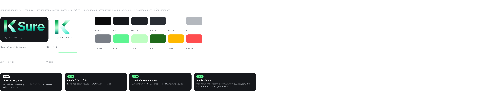

# 02 · UI Spec (ให้เหมือนดีไซน์เป๊ะ)

> เป้าหมาย: หน้าจอ L1–L6, T1–T8 ต้อง **วางทับรูปอ้างอิงแล้วตรงกัน** บนเฟรม **393×852** (iPhone 15/16)
> **แหล่งความจริง:** Figma [UI-KBTG](https://www.figma.com/design/KLFeKqPDsAOhGLcbfrjT7N/UI-KBTG?node-id=29-2) เฟรม **K Sure UI v3-final** (node `29:2`) — ห้ามใช้เฟรม "K Sure UI v3" อีก 4 อัน (เป็นเวอร์ชันเก่า)
> - รูปอ้างอิง 2x: [`design/screens/`](./design/screens/) · Foundations: [`design/foundations.png`](./design/foundations.png)
> - **ค่าละเอียดทุก element ต่อหน้าจอ** (ขนาด, ตำแหน่ง, สี, padding/gap, ฟอนต์, เงา): [`design/figma-spec/L1.md` … `T8.md`](./design/figma-spec/) — **ใช้ไฟล์นี้ตอนทำแต่ละหน้า**
> - ค่าในเอกสารนี้ดึงจาก Figma แล้ว (16 ต.ค. 2569)



---

## 1. Design tokens

### 1.1 สี (จาก Foundations)

| Token | Hex | ใช้ที่ |
|---|---|---|
| `bg` | `#0A0A0B` | พื้นหลังแอป |
| `card` | `#16181C` | การ์ดหลัก (ไทม์ไลน์, ฟอร์ม, กติกา) |
| `card2` | `#1F2227` | input, ปุ่มวงกลมบน header, ช่องบริการ, การ์ดซ้อน |
| `line` | `#2A2E35` | เส้นแบ่ง, ขอบ input, เส้น stepper ที่ยังไม่ถึง |
| `white` | `#FFFFFF` | ตัวอักษรหลัก, การ์ดหลักฐาน, bottom sheet T8 |
| `gray` | `#B4B8BE` | ข้อความรอง |
| `muted` | `#7A7F87` | caption, label, วันที่ในไทม์ไลน์ |
| `neon` | `#5DF591` | ปุ่มหลัก, ไอคอน active, ยอดเงิน success, ขอบไฮไลต์ |
| `mint` | `#BEFEC2` | gradient การ์ดยอดเงิน / Funds Secured |
| `parsley` | `#1F6A1A` | ตัวอักษรเขียวเข้มบนพื้นมิ้นต์ ("FUNDS SECURED"), เงาเขียว |
| `warn` | `#FFB800` | badge "กำลังดำเนินการ", กล่องเตือน T5, ไอคอนเตือน T8 |
| `danger` | `#FF4D4F` | badge แจ้งเตือน (จุดแดงบนกระดิ่ง), error |

**สีเพิ่มเติมที่พบใน Figma (ไม่อยู่ใน palette แต่ใช้จริง)**

| Token | Hex | ใช้ที่ |
|---|---|---|
| `nav` | `#111214` | พื้น bottom nav (ขอบบน `#1E2024` 1px) |
| `stroke` | `#3A3E45` | ขอบปุ่มรอง (secondary) |
| `ink-2` | `#5B6068` | ข้อความรองบนการ์ดขาว ("หลักฐานดีล", label ใบเสร็จ) |
| `ink-mint` | `#2A3B30` | ข้อความบนการ์ดมิ้นต์ (ยอดเงิน, label) |
| `divider-light` | `#E6E8EB` | เส้นแบ่งในการ์ดขาว |
| `sheet-list` | `#F4F5F7` | พื้นกล่องรายการใน bottom sheet T8 |
| `warn-soft` | `#FFF4D6` | วงกลมพื้นไอคอนเตือน T8 · ขอบไอคอน `#C98A00` |
| `warn-text` | `#FFD978` | ข้อความในกล่องเตือนเหลือง T5 |

**สีโปร่งแสงที่ใช้บ่อย** (จาก Figma)

| ค่า | ใช้ที่ |
|---|---|
| `#5DF591` 9–12% | พื้น chip/badge เขียว, กล่องเตือน L4 (`/12` + ขอบ `/35`) |
| `#5DF591` 18–24% | ขอบวงแหวน, ขอบ chip |
| `#FFB800` 12% | พื้นกล่องเตือน T5, badge "กำลังดำเนินการ" |
| `#FFFFFF` 45–50% | กล่องย่อยบนการ์ดมิ้นต์ (ค่าจอง/มัดจำหลัก ใน L5), ขอบ battery |
| `#FFFFFF` 8% | เส้นขอบ 1px รอบเฟรมโทรศัพท์ (spread 1) |
| `#000000` 60% | backdrop bottom sheet T8 |

**Gradient (ค่าจริงจาก Figma)**

| ชื่อ | CSS | ใช้ที่ |
|---|---|---|
| `grad-mint` | `linear-gradient(135deg, #DEF2B4 0%, #A8E9B4 45%, #67DD90 100%)` + เงา `0 16px 36px rgb(103 221 144 / .10)` | การ์ดยอดเงิน L1/T1 (r28), การ์ด Funds Secured L5 (r20) |
| `grad-request` | `linear-gradient(~110deg, #16181C 0%, #14231A 100%)` + ขอบ 1px `#5DF591/35%` | การ์ดแบนเนอร์ K Sure L1 (r28) |
| `glow-hero` | `radial-gradient(circle, rgb(93 245 145 / .34), transparent 70%)` วงกลม ⌀500 ที่ (−54, −90) | หลังวงกลม success (L6, T7, T4, T3) |
| `glow-bottom` | `radial-gradient(circle, rgb(93 245 145 / .10–.12), transparent 70%)` ⌀440 ที่ (160, 560) | แสงเขียวล่างขวาทุกหน้า |
| `sweep` | `linear-gradient(90deg, transparent, rgb(93 245 145 / .08) 50%, transparent)` 480×220 | แถบแสงเฉียงพาดกลางจอ (ทุกหน้า) |

> ระดับความเข้มของ radial glow ต่างกันตามหน้า (`.10 / .12 / .16 / .26 / .34 / .38`) — ดูค่าของแต่ละหน้าใน `figma-spec/<screen>.md` บรรทัด `vector · 500×500` และ `440×440`

**เส้นโค้งตกแต่ง:** เป็น vector ในแต่ละหน้า (วงแหวน stroke 1px `#5DF591` 5–38%) — ทำด้วย SVG/CSS `border-radius: 50%` ตามขนาดใน figma-spec ได้เลย ไม่ต้องหาไฟล์เพิ่ม

**เงา (ค่าจริง)**

| ชื่อ | ค่า | ใช้ที่ |
|---|---|---|
| `shadow-cta` | `0 10px 26px rgb(93 245 145 / .22)` | ปุ่มหลัก |
| `shadow-hero` | `0 0 50px rgb(93 245 145 / .35), 0 0 0 12px rgb(93 245 145 / .10)` | วงกลม success ⌀92 |
| `shadow-mint` | `0 16px 36px rgb(103 221 144 / .10)` | การ์ดมิ้นต์ |
| `shadow-phone` | `0 30px 60px rgb(0 0 0 / .60), 0 0 0 1px rgb(255 255 255 / .08)` | กรอบโทรศัพท์ (desktop เท่านั้น) |
| `accent-left` | `inset 3px 0 0 #5DF591` (หรือ `#FFFFFF`) | การ์ดก้อนเงิน L3 (แถบซ้าย) |

### 1.2 Typography

ฟอนต์: **Poppins** (ตัวเลข/อังกฤษ) + **Noto Sans Thai** (ไทย) — โหลดผ่าน `next/font/google` ตั้ง `font-family: Poppins, "Noto Sans Thai", sans-serif` ให้ตัวเลขเป็น Poppins อัตโนมัติ

ค่าจริงจาก Figma (ขนาด / น้ำหนัก / line-height px / letter-spacing px):

| Token | ค่า | ตัวอย่างที่ใช้ |
|---|---|---|
| `amount-hero` | 40 / 600 / 48 / −1 · `tabular-nums` | 6,500.00 (L6, T3, T4) · 5,500.00 (T7) |
| `amount-balance` | 32 / 600 / 41.6 / −0.5 | 42,850.00 (L1) · 28,500.00 (T1) |
| `amount-lg` | 28 / 600 / 35 / −0.5 | 6,500 (L3, L5, T2) · 3,000.00 (T8) |
| `amount-input` | 24 / 600 / 34.8 / −0.3 | ช่องยอดเงิน L2 |
| `amount-md` | 22 / 600 / 27.5 / −0.5 | 5,500 (T6) |
| `title` | 22 / 700 / 29.7 / −0.2 | "ได้รับเงินครบแล้ว", "คอนโด The Park สุขุมวิท 64", "กันเงินเรียบร้อย" |
| `title-sm` | 20 / 700 / 27 / −0.2 | "ดูห้องเรียบร้อยแล้วใช่ไหม?" (T5, T6) |
| `greeting-name` | 18 / 700 / 23.4 | "คุณสมชาย ใจดี" |
| `sheet-title` | 18 / 700 / 26.1 | "หยุดก่อน! นี่อาจเป็นการขอเงินนอกดีล" (T8) |
| `promo-title` | 16 / 700 / 22.4 | "มัดจำห้อง แบบไม่ต้องลุ้น" (L1) |
| `header` / `button` / `amount-row` | 16 / 600 / 23.2 | ชื่อหน้า "สร้างดีล K Sure", ปุ่มหลัก "ถัดไป", ยอด 1,000/5,500 |
| `code` | 16 / 600 / 23.2 / **+2** | KS-8F4Q21 (L4) |
| `section` | 15 / 600 / 21.8 | "บริการแนะนำ", "ค่าจอง", ปุ่มรอง "บันทึก QR" |
| `body-strong` | 14 / 600 / 20.3 | "ค่าจอง" (L2/T2), "ตรวจสอบคำขอ" |
| `input` | 14 / 500 / 20.3 | ค่าในช่องกรอก L2 |
| `row-title` | 13.5 / 600 / 19.6 | ไทม์ไลน์ L5, รายการใบเสร็จ |
| `check-item` | 13.5 / 500 / 19.6 | เช็กลิสต์ T5/T6 |
| `card-title` | 13 / 600 / 18.9 | "กติกาของดีลนี้", "ไทม์ไลน์ดีล" |
| `body` | 13 / 400 / 18.9–20.1 | คำอธิบายใต้หัวเรื่อง |
| `meta` | 12.5 / 400–500 / 18.1 | ค่าในใบเสร็จ, "เข้าบัญชีออมทรัพย์…" |
| `caption` | 12 / 400 / 17.4 (18 เมื่อเป็นย่อหน้ากติกา) | label, คำอธิบายแถว |
| `service-label` | 11.5 / 400 / 16.7 | ชื่อช่องบริการ L1/T1 |
| `badge` | 11 / 600 / 15.9 | "กำลังดำเนินการ", "ชื่อตรงบัญชี", "ปรับยอด", "หลัก" |
| `micro` | 11 / 400 / 15.9 | วันที่ใบเสร็จ, label stepper |
| `eyebrow` | 10.5 / 600 / 15.2 / **+1.2** | "FUNDS SECURED" |
| `nav-label` | 10.5 / 400 (active 600) / 15.2 | bottom nav |
| `count` | 10 / 700 / 14.5 | ตัวเลข badge แจ้งเตือน, chip "ใหม่" |

> ✅ **ไม่แสดงสัญลักษณ์ ฿** (ยืนยันแล้ว 16 ต.ค. 2569) — ใน Figma ข้อความยอดเงินพิมพ์เป็น `฿6,500` แต่ให้แสดงแค่ตัวเลข `6,500` ตามภาพ · ยอดเงินใช้ฟอนต์ Poppins ตามตาราง (ไม่ต้องใช้ Arimo)

**Highlight ใต้ข้อความ** (เช่น "แบบไม่ต้องลุ้น" ใน L1, "อย่าเพิ่งโอนมัดจำ" ใน T1, "รายละเอียดดีล" ใน foundations): แถบสี `neon/40`–`parsley` สูง ~40% ของตัวอักษร อยู่ครึ่งล่าง → `background: linear-gradient(transparent 55%, rgb(93 245 145 / .45) 55%)`

### 1.3 Spacing / Radius / Size (ค่าจริงจาก Figma)

| Token | ค่า | ใช้ที่ |
|---|---|---|
| เฟรม | 393 × 852 · radius 44 (desktop frame) | |
| ระยะขอบจอ (gutter) | **20px** → เนื้อหากว้าง 353px | ทุกหน้า |
| Status bar (desktop เท่านั้น) | สูง 50 · padding 8/28/0/36 | |
| App header | สูง 52 · ปุ่มวงกลม **38×38 r19 `#16181C`** · ไอคอน 17–18px stroke 1.42–1.65 | L2–L6, T2–T8 |
| การ์ดทั่วไป | **r20** · `#16181C` · padding **16** · gap 10 (บางใบ 13 หรือ 6) | |
| การ์ดก้อนเงิน (L3) | r20 · padding 14/16 · gap 4 · `inset 3px 0 0` neon/ขาว | |
| การ์ดยอดเงิน (L1/T1) | 353 × 187 · **r28** · `grad-mint` | |
| การ์ด Funds Secured (L5) | 353 × 222 · r20 · `grad-mint` | |
| การ์ดขาว (ใบเสร็จ L6/T7) | r20 · padding 16 · gap 10 | |
| แบนเนอร์ K Sure (L1) | 353 × 166 · r28 · `grad-request` | |
| ปุ่มหลัก | **353 × 54 · r100** · `shadow-cta` · gap ไอคอน 8 · ตัวอักษร 16/600 สี `#0A0A0B` | |
| ปุ่มรอง | **353 × 48 · r100** · ขอบ 1px `#3A3E45` | |
| ระยะปุ่มหลัก ↔ ปุ่มรอง | ปุ่มหลัก y=704 → ปุ่มรอง y=768 (ห่าง 10) | หน้าที่มี 2 ปุ่ม |
| ปุ่มหลักเดี่ยว | y=762 (ติดล่าง) | หน้าที่มีปุ่มเดียว |
| Footer area | สูง 68 · padding 8/20/6/20 · gap 10 | |
| Bottom nav | **393 × 64** · `#111214` · ขอบบน `#1E2024` · padding 0/8 | L1, T1 |
| วงกลม hero | **⌀92 r46** neon + `shadow-hero` · ไอคอน 44 (ถูก stroke 5.5 `#0A0A0B`) | L6, T3, T4, T7 |
| วงแหวน hero | ⌀ **144 / 204 / 276 / 360 / 460** · stroke 1.4/1.2/1/1/1 · opacity neon **.38 / .24 / .15 / .09 / .05** · จุดศูนย์กลาง (196, 160) | |
| ประกาย | 16px (`/80`) @(62,102) · 12px (`/65`) @(320,200) · 8px (`/50`) @(306,88) · 8px (`/45`) @(84,232) | หน้า success |
| radius ที่พบ | 2, 3, 4, 9–14, 16–20, 28, 30, 32, 42, 44, 46, 100 | ดู figma-spec ต่อหน้า |

> ⚠️ ค่าละเอียดอื่นๆ (เช่น ช่องบริการ, stepper, timeline, chip) **ดูที่ `docs/design/figma-spec/<screen>.md`** แต่ละบรรทัดมีขนาด ตำแหน่ง สี padding gap ฟอนต์ครบ

### 1.4 Tailwind v4 (CSS-first)

Tailwind v4 **ไม่ใช้ `tailwind.config.js`** แล้ว ให้ประกาศ token ใน `src/app/globals.css` ด้วย `@theme`
ใช้ **`@theme inline`** เพราะ font อ้างตัวแปรของ `next/font` (`--font-poppins`, `--font-noto-thai`) — และต้องใส่ class ตัวแปรฟอนต์ไว้ที่ `<html>` ใน `layout.tsx` เช่น `<html lang="th" className={`${poppins.variable} ${notoThai.variable}`}>`
(ดู `globals.css` ที่ `create-next-app` สร้างให้เป็นตัวอย่าง แล้วแทนที่ด้วยชุดนี้)

```css
@import "tailwindcss";

@theme inline {
  --color-bg: #0A0A0B;
  --color-card: #16181C;
  --color-card2: #1F2227;
  --color-line: #2A2E35;
  --color-gray: #B4B8BE;
  --color-muted: #7A7F87;
  --color-neon: #5DF591;
  --color-mint: #BEFEC2;
  --color-parsley: #1F6A1A;
  --color-warn: #FFB800;
  --color-danger: #FF4D4F;
  --color-nav: #111214;
  --color-stroke: #3A3E45;
  --color-ink-2: #5B6068;
  --color-ink-mint: #2A3B30;
  --color-divider-light: #E6E8EB;
  --color-sheet-list: #F4F5F7;
  --color-warn-soft: #FFF4D6;
  --color-warn-text: #FFD978;

  --font-sans: var(--font-poppins), var(--font-noto-thai), sans-serif;

  --radius-card: 20px;
  --radius-card-xl: 28px;
  --radius-icon-btn: 19px;

  --shadow-cta: 0 10px 26px rgb(93 245 145 / 0.22);
  --shadow-hero: 0 0 50px rgb(93 245 145 / 0.35), 0 0 0 12px rgb(93 245 145 / 0.10);
  --shadow-mint: 0 16px 36px rgb(103 221 144 / 0.10);

  --text-amount-hero: 40px;    --text-amount-hero--line-height: 48px;    --text-amount-hero--letter-spacing: -1px;    --text-amount-hero--font-weight: 600;
  --text-amount-balance: 32px; --text-amount-balance--line-height: 41.6px; --text-amount-balance--letter-spacing: -0.5px;
  --text-amount-lg: 28px;      --text-amount-lg--line-height: 35px;      --text-amount-lg--letter-spacing: -0.5px;
  --text-title: 22px;          --text-title--line-height: 29.7px;        --text-title--letter-spacing: -0.2px;        --text-title--font-weight: 700;
  /* ...เพิ่มให้ครบตามตาราง §1.2 */
}
```

แล้วใช้เป็น class ได้เลย เช่น `bg-card`, `text-neon`, `rounded-card`, `shadow-glow`, `text-display`

---

## 2. Layout / Responsive (มือถือเป็นหลัก)

| ขนาดจอ | พฤติกรรม |
|---|---|
| มือถือ (< 768px) | แอปเต็มจอ · ความสูง `100dvh` · `max-width: 430px` · ใช้ `env(safe-area-inset-top/bottom)` · **ไม่แสดง** status bar 9:41 และ home indicator ปลอม (OS มีให้แล้ว) |
| Desktop / โปรเจกเตอร์ (≥ 768px) | แสดง **กรอบโทรศัพท์** 393×852 radius 44 อยู่กลางจอ พื้นหลังดำ · แสดง status bar 9:41 + home indicator ปลอม เพื่อให้เหมือน mockup · ข้างกรอบมีป้าย "Prototype only · No real funds" + ปุ่มสลับ role (Demo tools) |

- ใส่ `<meta name="viewport" content="width=device-width, initial-scale=1, viewport-fit=cover">` และ `themeColor: #0A0A0B`
- ปุ่มหลักด้านล่าง **ติดล่างจอ** (sticky footer) + padding ล่าง = `max(16px, env(safe-area-inset-bottom))`
- เนื้อหาเลื่อนได้ แต่ header และ footer ไม่เลื่อน
- ห้ามมี horizontal scroll · ทดสอบที่ 360px (Android เล็ก), 390px (iPhone 14/15), 430px (Pro Max)
- PWA (ทำทีหลัง): `manifest.webmanifest`, `display: standalone` → เปิดจากหน้าโฮมแล้วเหมือนแอปจริง

---

## 3. การจัดรูปแบบข้อมูล (สำคัญมากต่อความ "เป๊ะ")

### 3.1 เงิน — มี 2 แบบ

| แบบ | ตัวอย่าง | ใช้ที่ |
|---|---|---|
| **ไม่มีทศนิยม** | `6,500` · `1,000` · `5,500` | L2, L3, L5, T1 การ์ดคำขอ, T2, T5, T6, ปุ่ม ("ยอมรับและกันเงิน 6,500", "ปล่อยค่าจอง 1,000"), แถวรายการในการ์ดหลักฐาน L6/T7, "ปล่อยครบ 6,500" |
| **2 ตำแหน่ง** | `6,500.00` · `42,850.00` | ยอด hero (L6, T3, T4, T7), ยอดเงินในการ์ดยอดเงิน, T4 แถว "ยอดที่ใช้ได้ตอนนี้ 22,000.00", T8 "3,000.00", L6 "ค่าธรรมเนียม 0.00 บาท" |

ข้อยกเว้น: L3 badge "ค่าธรรมเนียม 0 บาท" (ไม่มีทศนิยม)

```ts
// src/lib/format/money.ts — รับค่าเป็นสตางค์ (integer) เสมอ
export const formatBaht = (satang: number, decimals: 0 | 2 = 0) =>
  new Intl.NumberFormat("th-TH", { minimumFractionDigits: decimals, maximumFractionDigits: decimals })
    .format(satang / 100);
```

### 3.2 วันที่ — ปฏิทินพุทธ (พ.ศ.)

ใช้ `Intl.DateTimeFormat("th-TH-u-ca-buddhist", { timeZone: "Asia/Bangkok", ... })`

| รูปแบบ | ตัวอย่าง | ใช้ที่ |
|---|---|---|
| วัน เดือนย่อ ปี · เวลา | `18 ต.ค. 2569 · 14:00` | L3, L5 ไทม์ไลน์, L6/T7 แถวรายการ, L4 "ใช้ได้ถึง" |
| วัน เดือนย่อ · เวลา (ไม่มีปี) | `18 ต.ค. · 14:00` | L2 ช่องนัดดูห้อง |
| วัน เดือนย่อ ปี | `1 พ.ย. 2569` | L2 วันเข้าอยู่, T5 |
| วัน เดือนย่อ (สั้น) | `18 ต.ค.` · `1 พ.ย.` | T2 คำอธิบายแถว |
| วันในสัปดาห์ + วันที่ | `อา. 18 ต.ค. 2569` | T4 "นัดดูห้อง · อา. 18 ต.ค. 2569" |
| เวลา + น. | `14:00 น.` | T4 บรรทัดรอง |
| เวลาอย่างเดียว | `10:26` | T1 "จากคุณสมชาย ใ. · 10:26" |
| วันหมดอายุ | `3 พ.ย. 2569 23:59` | L3, T2 (ไม่มี ·) |

> ตัวคั่น `·` (U+00B7) มีช่องว่างทั้งสองข้าง

### 3.3 ข้อความอื่น
- เลขบัญชี: `xxx-x-x4821` (ปิดบังเสมอ ไม่เก็บเลขเต็ม)
- ชื่อย่อ: `สมชาย ใ.` = ชื่อ + พยัญชนะต้นนามสกุล + จุด
- รหัสดีล: `KS-8F4Q21` แสดงแบบ letter-spacing กว้าง (0.15em)

---

## 4. Component library

> อยู่ใน `src/components/ui/*` (ทั่วไป) และ `src/components/motion/*` (อนิเมชัน) — ดูโครงสร้างใน [03-architecture.md](./03-architecture.md)

| Component | Variants / Props | ใช้ในหน้าจอ |
|---|---|---|
| `PhoneFrame` | แสดงเฉพาะ desktop | ทั้งหมด |
| `StatusBar` / `HomeIndicator` | ปลอม 9:41 (desktop เท่านั้น) | ทั้งหมด |
| `AppHeader` | `left: back \| close` · `right: menu \| share \| none` · `title` · `transparent` | L2–L6, T2–T8 |
| `HomeHeader` | โลโก้ K + คำทักทาย + ชื่อ + กระดิ่ง (badge) + เมนู | L1, T1 |
| `BottomNav` | 5 แท็บ + ปุ่มสแกนกลาง · badge บนแจ้งเตือน | L1, T1 |
| `Button` | `primary` (neon, ดำ, glow) · `secondary` (ขอบ line) · `dark` (ดำบนพื้นขาว – T8) · `link` (ขีดเส้นใต้) · `iconLeft/iconRight` · `loading` | ทุกหน้า |
| `Card` | `default` (card) · `raised` (card2) · `mint` (grad-balance) · `white` (การ์ดหลักฐาน) · `outline-neon` (การ์ดคำขอ T1) | |
| `Badge` | `neon-soft` ("✓ ชื่อตรงบัญชี", "ค่าธรรมเนียม 0 บาท") · `warn-soft` ("กำลังดำเนินการ") · `dark` ("หลัก") · `new` ("ใหม่") · `count` (แดง) | |
| `BalanceCard` | ชื่อบัญชี, ยอด, ปุ่มตา, 3 action | L1, T1 |
| `ServiceGrid` / `ServiceTile` | `active` (K Sure) | L1, T1 |
| `PromoBanner` | K Sure banner + illustration โล่ | L1 |
| `TipBanner` | ไอคอนล็อก + ข้อความ highlight + chevron | T1 |
| `RequestCard` | การ์ดคำขอใหม่ / ดีล active (D9) | T1, L1 |
| `StepTabs` | 2 ขั้น (เส้นบนเขียว + label) | L2, L3 |
| `SplitBar` | แถบแบ่งสัดส่วน ค่าจอง/มัดจำ | L2 |
| `TrancheRow` | วงกลมเลข 1/2 + ชื่อ + คำอธิบาย + ยอด · `highlight` | L2, L3, T2 |
| `TrancheCard` | แบบการ์ดขอบซ้ายเขียว/ขาว | L3 |
| `RulesList` | ไอคอน + ข้อความ (นาฬิกา, คน, ล็อก) | L3, T2 |
| `SegmentedControl` | 2 แท็บ (QR / เบอร์) | L4 |
| `QrCard` | QR + โลโก้กลาง + เลขอ้างอิง | L4 |
| `CodeField` | label + รหัส + ปุ่มคัดลอก | L4 |
| `InfoNote` | `neon` (L4) · `warn` (T5) | L4, T5 |
| `FundsSecuredCard` | ล็อก + ยอด + 2 กล่องย่อย · `pending` (D1) | L5 |
| `Timeline` / `TimelineItem` | `done \| current \| upcoming` | L5 |
| `Stepper3` | กันเงิน / ดูห้อง / เข้าอยู่ · `done \| current \| upcoming` | T4, T6, T7 |
| `CheckList` | ติ๊กได้ (T5, T6) | T5, T6 |
| `ReleaseRow` | แถบซ้าย (neon/ขาว) + label + ชื่อ + ยอด | T5, T6 |
| `ReceiptCard` | การ์ดขาว + โลโก้ + รายการ + key/value | L6, T7 |
| `NextStepCard` | ไอคอนปฏิทิน + ขั้นต่อไป | T4 |
| `BottomSheet` | `light` (T8) · `dark` (D4/D5/D11) · drag handle | T8, D* |
| `Toast` | สำเร็จ / error | ทั้งหมด |
| `Skeleton` | ตอนโหลด | ทั้งหมด |
| `DemoBadge` | "Prototype only · No real funds" | D0, desktop frame · เปิด/ปิดด้วย `NEXT_PUBLIC_SHOW_DEMO_BADGE` |

**ไอคอน:** ใช้ `lucide-react` (stroke 2px ปลายมน ตรงกับสไตล์ mockup)

| ไอคอนใน mockup | lucide |
|---|---|
| กระดิ่ง / เมนู / ย้อนกลับ / ปิด / แชร์ | `Bell` / `Menu` / `ChevronLeft` / `X` / `Share2` |
| โอนเงิน / เติมเงิน / รายการ | `ArrowUpDown` / `Download` / `List` |
| สแกนจ่าย / จ่ายบิล / สแกน (nav) | `ScanLine` / `Barcode` / `Scan` |
| เติมเงินมือถือ / My Pockets / ลงทุน / ทั้งหมด | `Smartphone` / `Wallet` / `ChartColumn` / `LayoutGrid` |
| หน้าหลัก / ธุรกรรม / บัญชี | `House` / `ReceiptText` / `User` |
| ตึก (ห้อง) / บ้าน / กระเป๋าเงิน | `Building2` / `House` / `Wallet` |
| ปฏิทิน / กุญแจ / โล่ / ล็อก / ตา | `Calendar` / `KeyRound` / `ShieldCheck` / `Lock` / `Eye` |
| เช็ค / คัดลอก / ส่ง / เตือน | `Check` / `Copy` / `Send` / `TriangleAlert` |
| ห้าม / แชท / นาฬิกาวน / คนเช็ค / ดินสอ / ธนาคาร | `Ban` / `MessageCircle` / `History` / `UserCheck` / `Pencil` / `Landmark` |
| Face ID | `ScanFace` |

> ไอคอนพิเศษที่ lucide ไม่มี: **โลโก้ K**, **โล่+บ้าน+เหรียญ ฿** (แบนเนอร์ L1) → ใช้ SVG ใน `assets/` (ดู 07-assets)

---

## 5. Animation spec (ค่าจริงที่ต้องใช้)

> ไลบรารี: **`motion`** (ชื่อใหม่ของ Framer Motion, import จาก `motion/react`) + CSS keyframes สำหรับลูปเบาๆ
> ทุกอนิเมชันต้องรองรับ `prefers-reduced-motion: reduce` (ดู §5.9)
> easing มาตรฐาน: `easeOutExpo = [0.16, 1, 0.3, 1]`, `easeInOut = [0.65, 0, 0.35, 1]`

### 5.1 ⭐ Success Hero — "ได้รับเงินครบ" (L6, T7) และ T4 / T3

ลำดับเวลา (t = 0 เมื่อหน้าแสดง):

| t (วินาที) | องค์ประกอบ | อนิเมชัน |
|---|---|---|
| 0.00 | พื้นหลัง `grad-hero` | opacity 0 → 1, 0.6s, ease-out |
| 0.05–0.37 | วงแหวน 5 วง (⌀144/204/276/360/460, stroke neon opacity .38/.24/.15/.09/.05 — ค่าจริงจาก Figma) | scale 0.6 → 1, opacity 0 → ค่าเป้า, 0.6s `easeOutExpo`, **stagger 0.08s** จากวงในออกนอก |
| 0.10 | วงกลมหลัก ⌀92 สี neon | scale 0 → 1, spring `{ stiffness: 260, damping: 18 }` (เด้งเล็กน้อย) |
| 0.35 | เครื่องหมายถูก (SVG path, stroke 5px สีดำ) | `pathLength` 0 → 1, 0.45s `easeInOut` |
| 0.80 | เสร็จการวาดถูก | วงกลม scale 1 → 1.08 → 1 (0.25s) + **haptic** `navigator.vibrate?.([12, 40, 18])` |
| 0.40–1.20 | ประกาย ✦ 4 จุด (ขนาด/ตำแหน่งตาม §1.3) | opacity 0 → 1, scale 0.4 → 1, delay สุ่ม 0.4–1.2s แล้ว **twinkle loop**: opacity 1 → 0.3 → 1, duration 1.8–2.6s, infinite |
| 0.55 | หัวข้อ "ได้รับเงินครบแล้ว" | y 12 → 0, opacity 0 → 1, 0.4s `easeOutExpo` |
| 0.65 | ยอดเงิน `6,500.00` | **count-up** 0 → 6,500.00 ใน 1.0s ease-out (cubic) + `tabular-nums` (ตัวเลขไม่กระตุก) |
| 0.75 | บรรทัดรอง "เข้าบัญชีออมทรัพย์…" | fade-up เหมือนหัวข้อ |
| 0.85 | การ์ดหลักฐานสีขาว | y 40 → 0, opacity 0 → 1, spring `{ stiffness: 200, damping: 24 }` |
| 0.95+ | แถวในการ์ด | fade-up stagger 0.06s · ไอคอนถูกเขียวในแถว: scale 0 → 1 spring |
| 1.10 | ปุ่ม "เสร็จสิ้น" / "บันทึกหลักฐาน" | opacity 0 → 1, y 16 → 0, 0.35s |
| 1.20 → ∞ | **Ripple loop** | วงแหวนเพิ่ม 1 วงเริ่มที่ ⌀92: scale 1 → 3.2, opacity 0.35 → 0, 2.4s ease-out, infinite, repeatDelay 0.3s |
| 1.20 → ∞ | **Glow breathing** | วงกลมหลัก box-shadow `0 0 0 0 neon/0` ↔ `0 0 48px 8px neon/40`, 2.4s ease-in-out, infinite alternate |

**ความต่างตามหน้า**

| หน้า | ไอคอนกลาง | เพิ่มเติม |
|---|---|---|
| L6, T7 | ✓ (วาดเส้น) | ครบทุกอย่างตามตาราง |
| T4 | 🔒 `Lock` | แทนการวาดถูก: ห่วงกุญแจ (shackle) y −6 → 0 ใน 0.3s ที่ t=0.4 ("ล็อกลง") · โลโก้ K Sure บนสุด fade-in t=0 · stepper เริ่มที่ t=0.9 (§5.3) |
| T3 | 🛡 `ShieldCheck` | ไม่มี count-up · ripple loop ช้ากว่า (3.2s) ระหว่างสแกน (§5.2) |

### 5.2 Face ID จำลอง (T3)

| ช่วง | อนิเมชัน |
|---|---|
| 0 – 0.4s | การ์ดขาว slide-up (y 24 → 0) · กรอบสแกน scale 0.9 → 1 |
| 0.4 – 1.8s | **สแกน:** มุมทั้ง 4 ของกรอบ "หายใจ" scale 1 → 0.9 → 1 (1.2s loop) · เส้นสแกนแนวนอน neon/60 วิ่งบน→ล่าง 1.0s ease-in-out loop · ข้อความ "กำลังสแกนใบหน้า" + จุด … กระพริบทีละจุด (0.4s ต่อจุด) |
| 1.8s | **สำเร็จ:** ขอบกรอบเปลี่ยนเป็น neon (0.2s) · ไอคอนหน้าเปลี่ยนเป็น ✓ (crossfade + scale 0.6 → 1 spring) · vibrate 15ms · ข้อความเป็น "ยืนยันตัวตนสำเร็จ" |
| 1.8s | เรียก `POST /deals/{id}/lock` (ระหว่างรอ แสดง spinner เล็กใต้กรอบ ถ้าเกิน 600ms) |
| API สำเร็จ + ≥ 2.4s | `router.replace` → T4 |
| API ล้มเหลว | กรอบเป็นสี danger + เขย่า (x: 0, −8, 8, −6, 6, 0 ใน 0.4s) + toast error + ปุ่ม "ลองอีกครั้ง" |

> **ไม่เปิดกล้อง ไม่ใช้ WebAuthn ไม่เก็บข้อมูลใบหน้า** — เป็นอนิเมชันล้วน (ตามกติกาสเปก)

### 5.3 Stepper 3 ขั้น (T4, T6, T7)

- จุดที่ `done`: scale 0 → 1 spring `{ stiffness: 400, damping: 22 }` + ถูกวาดเส้น 0.3s · stagger 0.15s
- เส้นเชื่อม: `scaleX` 0 → 1 (`origin-left`), 0.5s `easeOutExpo` เริ่มหลังจุดซ้ายเสร็จ
- จุด `current`: ขอบ neon + ไอคอนเขียว + **pulse ring**: วงซ้อน scale 1 → 1.5, opacity 0.6 → 0, 1.6s ease-out infinite
- label ของ current เป็นสี neon ตัวหนา

### 5.4 ไทม์ไลน์ดีล (L5)

- รายการ fade-up stagger 0.08s
- เส้นแนวตั้งระหว่างจุด done: `scaleY` 0 → 1 (`origin-top`) 0.4s
- จุด current: pulse ring แบบ §5.3
- **เมื่อ state เปลี่ยนแบบ real-time (polling เจอ):** จุดที่เพิ่ง done → morph วงกลมว่าง → ถูกเขียว (scale 0.6 → 1.15 → 1, 0.4s) · ข้อความใหม่ไฮไลต์พื้น neon/10 แล้วจางออกใน 1.2s · การ์ด Funds Secured กล่องย่อยที่เปลี่ยนสถานะ flip ข้อความ (y 8 → 0)

### 5.5 Funds Secured card (L5) — ครั้งแรกหลังผู้เช่ากันเงิน

- การ์ด crossfade จากสีเทา (D1) → มิ้นต์ (0.5s)
- **Shimmer sweep:** แถบขาว 30% opacity เฉียง 20° วิ่ง translateX −120% → 120% 1.2s ease-in-out **ครั้งเดียว**
- ไอคอนล็อก: ห่วง y −4 → 0 + bounce เล็ก (spring)
- ยอด 6,500 count-up 0.8s

### 5.6 หน้าหลัก (L1, T1)

- การ์ดคำขอใหม่ (T1): ขอบเรืองแสง box-shadow `0 0 0 1px neon/40` ↔ `0 0 24px 2px neon/30` 2.4s infinite alternate · จุดเขียวมุมขวาบน `animate-ping`
- Badge แจ้งเตือน: เมื่อจำนวนเพิ่ม scale 0 → 1.25 → 1 spring + กระดิ่ง rotate [0, −14, 12, −8, 6, 0] 0.6s
- ปุ่มตา ซ่อนยอด: ตัวเลข → `••••••` crossfade + blur 4px → 0 (0.2s)
- การ์ดยอดเงินโหลดครั้งแรก: count-up 0.6s (เฉพาะครั้งแรกของ session)
- ช่องบริการ K Sure: ขอบ neon glow เบาๆ คงที่ (ไม่กระพริบ)

### 5.7 การเปลี่ยนหน้า (Page transitions)

App Router ทำ exit animation ยาก → ใช้ **enter-only** ผ่าน `src/app/(app)/template.tsx` (re-mount ทุกครั้งที่เปลี่ยน route)

| ประเภทหน้า | Enter |
|---|---|
| หน้า push (มีปุ่ม ←) L2, L3, L5, T2, T5, T6 | x 24 → 0, opacity 0 → 1, 0.28s `easeOutExpo` |
| หน้า modal (มีปุ่ม ×) L4, T3, T4, L6, T7 | y 24 → 0, opacity 0 → 1, 0.32s `easeOutExpo` |
| หน้าหลัก | opacity 0 → 1, 0.2s |

(ทางเลือกที่ดีกว่าภายหลัง: View Transitions API — ตรวจ support ของ Next เวอร์ชันที่ใช้ก่อน)

### 5.8 Micro-interactions

| องค์ประกอบ | อนิเมชัน |
|---|---|
| ปุ่มทุกปุ่ม | `whileTap: { scale: 0.97 }`, 0.12s · ปุ่มหลัก disabled: opacity 0.4 ไม่มี glow |
| ปุ่มหลักตอนโหลด | ข้อความ fade → spinner 18px · ความกว้างคงที่ |
| เช็กลิสต์ T5/T6 | กล่องติ๊ก: พื้น neon scale 0.6 → 1 spring + วาดถูก 0.2s · เมื่อครบ 3 ข้อ ปุ่มหลัก "ปลุก" (opacity 0.4 → 1 + glow fade-in 0.3s) |
| SplitBar L2 | ความกว้างเปลี่ยนด้วย spring `{ stiffness: 300, damping: 30 }` เมื่อแก้ยอด |
| StepTabs L2→L3 | เส้นเขียวขั้นที่ 2 `scaleX` 0 → 1 0.4s |
| QR L4 | QR scale 0.92 → 1 + opacity 0.35s · "✓ สร้างคำขอแล้ว" วาดถูก 0.3s |
| คัดลอกรหัส | ไอคอน `Copy` → `Check` (crossfade 0.15s) 1.5s แล้วกลับ + toast "คัดลอกแล้ว" |
| SegmentedControl | พื้นแท็บที่เลือกเลื่อนด้วย `layoutId` spring `{ stiffness: 500, damping: 35 }` |
| Bottom sheet (T8, D*) | backdrop opacity 0 → 0.6 (0.2s) + พื้นหลัง blur 2px · sheet y 100% → 0 spring `{ stiffness: 380, damping: 34 }` · ลากลงเกิน 120px หรือ velocity > 500 = ปิด · T8: ไอคอนเตือนเขย่า rotate [0, −8, 8, −6, 6, 0] 0.5s delay 0.25s + vibrate `[30, 60, 30]` |
| Toast | y −16 → 0 จากบน, อยู่ 2.5s, fade ออก |
| Skeleton | shimmer gradient เลื่อน 1.4s infinite บน `card2` |

### 5.9 Reduced motion

ถ้า `prefers-reduced-motion: reduce` (ใช้ `useReducedMotion()` ของ motion):
- ปิดลูปทั้งหมด (ripple, glow, twinkle, ping, pulse ring, shimmer)
- count-up → แสดงตัวเลขสุดท้ายทันที
- spring/slide → opacity 0 → 1 0.15s อย่างเดียว
- haptic ยังทำได้ (ไม่ใช่การเคลื่อนไหว)

---

## 6. Checklist ความเป๊ะ (ใช้ตรวจทุกหน้าจอ)

- [ ] เปิด Chrome DevTools ที่ 393×852 แล้ววางรูปจาก `docs/design/screens/` ทับ (ใช้ extension "PerfectPixel" หรือ `?overlay=L1` ที่ทำเองใน dev mode — ดู roadmap Phase 2)
- [ ] ข้อความภาษาไทยตรงทุกตัวอักษร (รวมช่องว่าง, `·`, เครื่องหมายคำพูด “ ”)
- [ ] รูปแบบเงิน .00 / ไม่มี .00 ตรงตาม §3.1
- [ ] วันที่เป็น พ.ศ. และรูปแบบตรงตาม §3.2
- [ ] สี token ตรง (ไม่ใช้ hex ลอยๆ นอก `@theme`)
- [ ] ระยะขอบ 20px, ปุ่มสูง 54px, radius ตรง
- [ ] ปุ่มหลักอยู่ตำแหน่งเดียวกับ mockup (ติดล่าง)
- [ ] อนิเมชันตาม §5 และปิดได้ด้วย reduced motion
- [ ] ทดสอบบนมือถือจริงอย่างน้อย 1 เครื่อง iOS + 1 เครื่อง Android
