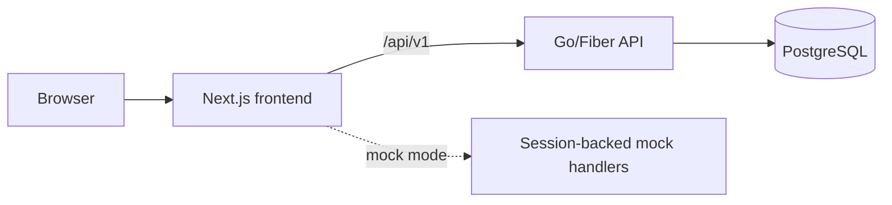

# Architecture

K Sure has a Next.js frontend and a Go/Fiber API backed by PostgreSQL. It supports local mock data for rapid UI work and the API for integrated flows.



## Responsibilities

| Area | Responsibility |
| --- | --- |
| `frontend/` | Routes, UI, formatting, client data access, mock mode, and browser tests. |
| `backend/` | HTTP handlers, authentication, domain rules, persistence, migrations, and API contract. |
| `backend/api/openapi.yaml` | Canonical API contract. |
| `docs/` | Product, operational, and design guidance. |
| `assets/` | Editable source assets and usage notes. |

## Local environments

| Mode | Frontend setting | Services |
| --- | --- | --- |
| Mock | `NEXT_PUBLIC_USE_MOCK=true` | Next.js only. |
| Integrated | `NEXT_PUBLIC_USE_MOCK=false` | Next.js, API, and PostgreSQL. |

Start the integrated stack from the repository root:

```bash
make up
cd frontend
npm run dev
```

The API is available at `http://localhost:8080/api/v1`; Adminer is available at `http://localhost:8081` when the tools profile is running.

## Boundaries

- The frontend maps API DTOs to presentation state and does not decide authorization or deal transitions.
- The API validates identity, role, state, idempotency, and optimistic-concurrency version before changing a deal.
- Migrations own schema changes. SQL queries are the source for generated repository code.
- Only the API accesses PostgreSQL in normal application flows.

## Operational notes

- The prototype uses demo authentication and simulated funds.
- Secrets belong in local environment files or deployment configuration, never source control.
- The QR scanner requires HTTPS or `localhost` in browsers that enforce secure camera access.
- The EC2 prototype deployment is documented in [infra/README.md](../infra/README.md). It runs Caddy, the API, and PostgreSQL on one encrypted EBS-backed instance.

See [the API guide](./05-api.md), [data model](./04-database.md), and [frontend README](../frontend/README.md) for implementation details.
