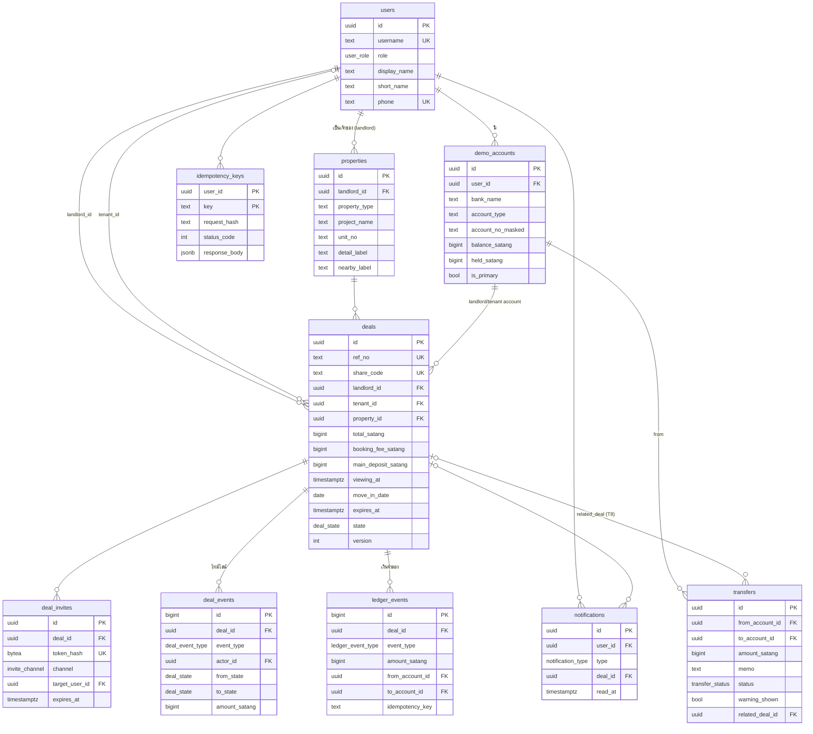

# 04 · Database Design (PostgreSQL)

> **เอกสารนี้คือที่นิยาม state, event type และตารางเพียงที่เดียว** — เอกสารอื่นลิงก์มาที่นี่
> หลักการ: เงินเป็น **สตางค์ (BIGINT)** · เวลาเป็น **`timestamptz`** (แสดงผลเป็น Asia/Bangkok) · ledger **append-only** · ทุก action อยู่ใน **transaction เดียว**

---

## 1. ERD



---

## 2. Enums

### `deal_state` (ตรงกับ state machine ในสเปก)

| ค่า | ความหมาย | ค้างใน `deals.state` ได้ไหม |
|---|---|---|
| `DRAFT` | ร่าง | ❌ (ร่างอยู่ฝั่ง client — สงวนไว้เผื่ออนาคต) |
| `WAITING_ACCEPT` | สร้างคำขอแล้ว รอผู้เช่า | ✅ |
| `REJECTED` | ผู้เช่าปฏิเสธ | ✅ (จบ) |
| `FUNDS_LOCKED` | ผู้เช่ายอมรับ + กันเงินแล้ว | ✅ |
| `VIEWING_CONFIRMED` | ผู้เช่ายืนยันดูห้อง | ❌ ผ่านทางใน transaction เดียวกับ `BOOKING_FEE_RELEASED` |
| `BOOKING_FEE_RELEASED` | ปล่อยค่าจองแล้ว | ✅ |
| `MOVE_IN_CONFIRMED` | ผู้เช่ายืนยันเข้าอยู่ | ❌ ผ่านทางใน transaction เดียวกับ `RELEASED` |
| `RELEASED` | ปล่อยครบ ดีลสำเร็จ | ✅ (จบ) |
| `EXPIRED` | หมดอายุ | ✅ เฉพาะกรณียังไม่มีเงินกัน (จบ) · ถ้ามีเงินกัน → ต่อไป `REFUNDED` ทันที |
| `CANCELLED` | ยกเลิกร่วมกัน | ❌ ต่อไป `REFUNDED` ทันที |
| `REFUNDED` | คืนยอดที่ยังไม่ปล่อยแล้ว | ✅ (จบ) |

> เหตุผลที่ state ❌ ยังอยู่ใน enum: ตรงตามสเปก และถูกบันทึกใน `deal_events.from_state/to_state` → ไทม์ไลน์/ audit ครบ (ดู [01-user-flow §6](./01-user-flow.md#️-ทำไมบางปุ่ม-กดครั้งเดียวได้-2-transition))

**Transition ที่อนุญาต** (implement ใน `backend/internal/service/statemachine.go`):

| จาก | Action | Actor | ไป (ตามลำดับใน tx เดียว) |
|---|---|---|---|
| – | `create` | LANDLORD | `WAITING_ACCEPT` |
| `WAITING_ACCEPT` | `reject` | TENANT | `REJECTED` |
| `WAITING_ACCEPT` | `lock` | TENANT | `FUNDS_LOCKED` |
| `FUNDS_LOCKED` | `confirm_viewing` | TENANT (= `deals.tenant_id`) | `VIEWING_CONFIRMED` → `BOOKING_FEE_RELEASED` |
| `BOOKING_FEE_RELEASED` | `confirm_move_in` | TENANT (= `deals.tenant_id`) | `MOVE_IN_CONFIRMED` → `RELEASED` |
| `FUNDS_LOCKED`, `BOOKING_FEE_RELEASED` | `cancel` (ฝ่ายที่ 2) | LANDLORD/TENANT ของดีล | `CANCELLED` → `REFUNDED` |
| `WAITING_ACCEPT` | `expire` | SYSTEM | `EXPIRED` |
| `FUNDS_LOCKED`, `BOOKING_FEE_RELEASED` | `expire` | SYSTEM | `EXPIRED` → `REFUNDED` |

ทุกอย่างนอกตารางนี้ → `409 DEAL_STATE_CONFLICT` และ **ไม่เขียน event ใดๆ**

### `deal_event_type` (ไทม์ไลน์ที่ผู้ใช้เห็น + audit)

`DEAL_CREATED`, `INVITE_SENT`, `DEAL_ACCEPTED`, `DEAL_REJECTED`, `FUNDS_LOCKED`, `VIEWING_CONFIRMED`, `BOOKING_FEE_RELEASED`, `MOVE_IN_CONFIRMED`, `MAIN_DEPOSIT_RELEASED`, `CANCEL_REQUESTED`, `DEAL_CANCELLED`, `DEAL_EXPIRED`, `FUNDS_REFUNDED`, `ISSUE_REPORTED`

### `ledger_event_type` (การเคลื่อนไหวของเงินจำลองเท่านั้น)

| ค่า | ผลต่อ `demo_accounts` |
|---|---|
| `HOLD` | ผู้เช่า: `held += total` |
| `RELEASE_BOOKING_FEE` | ผู้เช่า: `balance -= booking`, `held -= booking` · ผู้ให้เช่า: `balance += booking` |
| `RELEASE_MAIN_DEPOSIT` | ผู้เช่า: `balance -= main`, `held -= main` · ผู้ให้เช่า: `balance += main` |
| `REFUND` | ผู้เช่า: `held -= ยอดที่ยังไม่ปล่อย` (เงินไม่เคยออกจากบัญชี จึงแค่ปลดการกัน) |

> **ยอดที่ใช้ได้** = `balance_satang − held_satang` → T4 "ยอดที่ใช้ได้ตอนนี้ 22,000.00" = 28,500 − 6,500 ✓

### อื่นๆ

| Enum | ค่า |
|---|---|
| `user_role` | `LANDLORD`, `TENANT` |
| `invite_channel` | `QR`, `IN_APP`, `PHONE` |
| `notification_type` | `DEAL_INVITE`, `FUNDS_LOCKED`, `BOOKING_FEE_RELEASED`, `MAIN_DEPOSIT_RELEASED`, `DEAL_REJECTED`, `CANCEL_REQUESTED`, `DEAL_REFUNDED`, `DEAL_EXPIRED` |
| `transfer_status` | `COMPLETED_SIMULATED`, `CANCELLED_BY_USER` |

> หมายเหตุ: ในเอกสาร prototype นี้ผู้ใช้ 1 คนมี 1 role (ตรงกับสเปก) — ถ้าอยากให้คนเดียวเป็นได้ทั้งสองฝั่ง ค่อยแยกเป็นตาราง `user_roles` ทีหลัง

---

## 3. DDL (migration `0001_init.sql`)

```sql
-- +goose Up
CREATE EXTENSION IF NOT EXISTS pgcrypto;  -- gen_random_uuid()

CREATE TYPE user_role         AS ENUM ('LANDLORD','TENANT');
CREATE TYPE deal_state        AS ENUM ('DRAFT','WAITING_ACCEPT','REJECTED','FUNDS_LOCKED','VIEWING_CONFIRMED',
                                       'BOOKING_FEE_RELEASED','MOVE_IN_CONFIRMED','RELEASED','EXPIRED','CANCELLED','REFUNDED');
CREATE TYPE deal_event_type   AS ENUM ('DEAL_CREATED','INVITE_SENT','DEAL_ACCEPTED','DEAL_REJECTED','FUNDS_LOCKED',
                                       'VIEWING_CONFIRMED','BOOKING_FEE_RELEASED','MOVE_IN_CONFIRMED','MAIN_DEPOSIT_RELEASED',
                                       'CANCEL_REQUESTED','DEAL_CANCELLED','DEAL_EXPIRED','FUNDS_REFUNDED','ISSUE_REPORTED');
CREATE TYPE ledger_event_type AS ENUM ('HOLD','RELEASE_BOOKING_FEE','RELEASE_MAIN_DEPOSIT','REFUND');
CREATE TYPE invite_channel    AS ENUM ('QR','IN_APP','PHONE');
CREATE TYPE notification_type AS ENUM ('DEAL_INVITE','FUNDS_LOCKED','BOOKING_FEE_RELEASED','MAIN_DEPOSIT_RELEASED',
                                       'DEAL_REJECTED','CANCEL_REQUESTED','DEAL_REFUNDED','DEAL_EXPIRED');
CREATE TYPE transfer_status   AS ENUM ('COMPLETED_SIMULATED','CANCELLED_BY_USER');

-- ผู้ใช้เดโม (ไม่มี KYC จริง)
CREATE TABLE users (
  id            uuid PRIMARY KEY DEFAULT gen_random_uuid(),
  username      text NOT NULL UNIQUE,              -- 'landlord', 'tenant' (ใช้ตอน demo login)
  role          user_role NOT NULL,
  display_name  text NOT NULL,                     -- 'สมชาย ใจดี'
  short_name    text NOT NULL,                     -- 'สมชาย ใ.'
  phone         text UNIQUE,                       -- เบอร์สมมติ ใช้ค้นในแท็บ "เบอร์มือถือผู้เช่า"
  created_at    timestamptz NOT NULL DEFAULT now()
);

-- บัญชีธนาคารจำลอง (ไม่เก็บเลขบัญชีเต็ม)
CREATE TABLE demo_accounts (
  id                 uuid PRIMARY KEY DEFAULT gen_random_uuid(),
  user_id            uuid NOT NULL REFERENCES users(id),
  bank_name          text NOT NULL,                -- 'กสิกรไทย'
  account_type       text NOT NULL,                -- 'ออมทรัพย์'
  account_no_masked  text NOT NULL,                -- 'xxx-x-x4821'
  balance_satang     bigint NOT NULL CHECK (balance_satang >= 0),
  held_satang        bigint NOT NULL DEFAULT 0 CHECK (held_satang >= 0 AND held_satang <= balance_satang),
  is_primary         boolean NOT NULL DEFAULT true,
  created_at         timestamptz NOT NULL DEFAULT now(),
  updated_at         timestamptz NOT NULL DEFAULT now()
);
CREATE UNIQUE INDEX demo_accounts_one_primary ON demo_accounts(user_id) WHERE is_primary;

-- ห้อง (ไม่มีรูป ตาม UI v3)
CREATE TABLE properties (
  id             uuid PRIMARY KEY DEFAULT gen_random_uuid(),
  landlord_id    uuid NOT NULL REFERENCES users(id),
  property_type  text NOT NULL DEFAULT 'คอนโด',
  project_name   text NOT NULL,                    -- 'The Park สุขุมวิท 64'
  unit_no        text NOT NULL,                    -- 'A1203'
  detail_label   text NOT NULL,                    -- '1 ห้องนอน · 28 ตร.ม. · ชั้น 12'
  nearby_label   text,                             -- 'BTS ปุณณวิถี'
  created_at     timestamptz NOT NULL DEFAULT now(),
  UNIQUE (landlord_id, project_name, unit_no)
);

CREATE TABLE deals (
  id                          uuid PRIMARY KEY DEFAULT gen_random_uuid(),
  ref_no                      text NOT NULL UNIQUE,      -- 'KS-691014-0458'
  share_code                  text NOT NULL UNIQUE,      -- 'KS-8F4Q21'
  landlord_id                 uuid NOT NULL REFERENCES users(id),
  landlord_account_id         uuid NOT NULL REFERENCES demo_accounts(id),
  tenant_id                   uuid REFERENCES users(id), -- NULL จนกว่าผู้เช่าจะ lock (หรือถูกระบุตอนส่งเข้าแอป)
  tenant_account_id           uuid REFERENCES demo_accounts(id),
  property_id                 uuid NOT NULL REFERENCES properties(id),
  deal_type                   text NOT NULL DEFAULT 'RENTAL_DEPOSIT',
  currency                    char(3) NOT NULL DEFAULT 'THB',
  total_satang                bigint NOT NULL,
  booking_fee_satang          bigint NOT NULL CHECK (booking_fee_satang > 0),
  main_deposit_satang         bigint NOT NULL CHECK (main_deposit_satang > 0),
  fee_satang                  bigint NOT NULL DEFAULT 0 CHECK (fee_satang >= 0),
  viewing_at                  timestamptz NOT NULL,
  move_in_date                date NOT NULL,
  expires_at                  timestamptz NOT NULL,     -- '2026-11-03 23:59:59+07'
  state                       deal_state NOT NULL,
  version                     integer NOT NULL DEFAULT 1,
  landlord_cancel_requested_at timestamptz,
  tenant_cancel_requested_at   timestamptz,
  has_open_issue              boolean NOT NULL DEFAULT false,
  created_at                  timestamptz NOT NULL DEFAULT now(),
  updated_at                  timestamptz NOT NULL DEFAULT now(),
  CHECK (total_satang = booking_fee_satang + main_deposit_satang),
  CHECK (tenant_id IS NULL OR tenant_id <> landlord_id),
  CHECK (move_in_date >= (viewing_at AT TIME ZONE 'Asia/Bangkok')::date),
  CHECK (expires_at > viewing_at)
);
CREATE INDEX deals_landlord_idx ON deals(landlord_id, created_at DESC);
CREATE INDEX deals_tenant_idx   ON deals(tenant_id, created_at DESC);
CREATE INDEX deals_expiry_idx   ON deals(expires_at) WHERE state IN ('WAITING_ACCEPT','FUNDS_LOCKED','BOOKING_FEE_RELEASED');

-- คำเชิญ: เก็บเฉพาะ hash ของ token (ห้ามเก็บ token จริง)
CREATE TABLE deal_invites (
  id              uuid PRIMARY KEY DEFAULT gen_random_uuid(),
  deal_id         uuid NOT NULL REFERENCES deals(id),
  token_hash      bytea NOT NULL UNIQUE,            -- sha256(token)
  channel         invite_channel NOT NULL,
  target_user_id  uuid REFERENCES users(id),        -- ระบุเมื่อส่งเข้าแอป/เบอร์
  expires_at      timestamptz NOT NULL,             -- created + 24h → L4 "ใช้ได้ถึง 15 ต.ค. 2569 · 10:24"
  revoked_at      timestamptz,
  created_at      timestamptz NOT NULL DEFAULT now()
);
CREATE INDEX deal_invites_deal_idx ON deal_invites(deal_id);

-- ไทม์ไลน์ (ทุก action ที่ผู้ใช้เห็น)
CREATE TABLE deal_events (
  id             bigserial PRIMARY KEY,
  deal_id        uuid NOT NULL REFERENCES deals(id),
  event_type     deal_event_type NOT NULL,
  actor_id       uuid REFERENCES users(id),         -- NULL = SYSTEM (expiry worker)
  from_state     deal_state,
  to_state       deal_state,
  amount_satang  bigint,
  request_id     text,
  metadata       jsonb NOT NULL DEFAULT '{}',
  created_at     timestamptz NOT NULL DEFAULT now()
);
CREATE INDEX deal_events_deal_idx ON deal_events(deal_id, id);

-- Ledger จำลอง: append-only
CREATE TABLE ledger_events (
  id               bigserial PRIMARY KEY,
  deal_id          uuid NOT NULL REFERENCES deals(id),
  event_type       ledger_event_type NOT NULL,
  amount_satang    bigint NOT NULL CHECK (amount_satang > 0),
  from_account_id  uuid REFERENCES demo_accounts(id),
  to_account_id    uuid REFERENCES demo_accounts(id),
  actor_id         uuid REFERENCES users(id),
  idempotency_key  text NOT NULL,
  metadata         jsonb NOT NULL DEFAULT '{"simulated": true}',
  created_at       timestamptz NOT NULL DEFAULT now(),
  UNIQUE (deal_id, idempotency_key),
  UNIQUE (deal_id, event_type)          -- 🔒 ด่านสุดท้าย: แต่ละประเภทเกิดได้ครั้งเดียวต่อดีล → ปล่อยเงินซ้ำไม่ได้แน่นอน
);

-- กัน UPDATE/DELETE ledger (append-only)
-- +goose StatementBegin
CREATE FUNCTION forbid_ledger_mutation() RETURNS trigger AS $$
BEGIN RAISE EXCEPTION 'ledger_events is append-only'; END; $$ LANGUAGE plpgsql;
-- +goose StatementEnd
CREATE TRIGGER ledger_events_no_update BEFORE UPDATE OR DELETE ON ledger_events
  FOR EACH ROW EXECUTE FUNCTION forbid_ledger_mutation();

CREATE TABLE notifications (
  id          uuid PRIMARY KEY DEFAULT gen_random_uuid(),
  user_id     uuid NOT NULL REFERENCES users(id),
  type        notification_type NOT NULL,
  deal_id     uuid REFERENCES deals(id),
  title       text NOT NULL,                 -- 'คำขอ K Sure ใหม่'
  body        text NOT NULL,                 -- 'จากคุณสมชาย ใ.'
  read_at     timestamptz,
  created_at  timestamptz NOT NULL DEFAULT now()
);
CREATE INDEX notifications_unread_idx ON notifications(user_id, created_at DESC) WHERE read_at IS NULL;

-- การโอนจำลอง (สำหรับเดโม T8)
CREATE TABLE transfers (
  id                uuid PRIMARY KEY DEFAULT gen_random_uuid(),
  from_account_id   uuid NOT NULL REFERENCES demo_accounts(id),
  to_account_id     uuid NOT NULL REFERENCES demo_accounts(id),
  amount_satang     bigint NOT NULL CHECK (amount_satang > 0),
  memo              text,                     -- 'ค่าส่วนกลางล่วงหน้า'
  status            transfer_status NOT NULL,
  warning_shown     boolean NOT NULL DEFAULT false,
  related_deal_id   uuid REFERENCES deals(id),
  created_at        timestamptz NOT NULL DEFAULT now()
);

-- Idempotency
CREATE TABLE idempotency_keys (
  user_id        uuid NOT NULL REFERENCES users(id),
  key            text NOT NULL,
  method_path    text NOT NULL,              -- 'POST /api/v1/deals/{id}/confirm-viewing'
  request_hash   text NOT NULL,              -- sha256(body) → ถ้า key เดิมแต่ body ต่าง = IDEMPOTENCY_CONFLICT
  status_code    integer NOT NULL,
  response_body  jsonb NOT NULL,
  created_at     timestamptz NOT NULL DEFAULT now(),
  PRIMARY KEY (user_id, key)
);

-- เลขอ้างอิงรายวัน KS-YYMMDD-NNNN (YY = พ.ศ. 2 หลัก)
CREATE TABLE ref_counters (
  day       date PRIMARY KEY,
  last_seq  integer NOT NULL
);

-- +goose Down
DROP TABLE IF EXISTS ref_counters, idempotency_keys, transfers, notifications, ledger_events,
  deal_events, deal_invites, deals, properties, demo_accounts, users CASCADE;
DROP FUNCTION IF EXISTS forbid_ledger_mutation();
DROP TYPE IF EXISTS transfer_status, notification_type, invite_channel, ledger_event_type,
  deal_event_type, deal_state, user_role;
```

> `audit_logs` (actor, action, request_id) ในสเปก — ช่วง prototype ใช้ `deal_events.request_id` + log JSON ของ API แทน ถ้าจำเป็นค่อยเพิ่มตารางใน Phase 9

---

## 4. รูปแบบรหัส

| รหัส | รูปแบบ | วิธีสร้าง |
|---|---|---|
| `ref_no` | `KS-691014-0458` | `KS-` + ปี พ.ศ. 2 หลัก + เดือน + วัน (เวลาไทย) + `-` + ลำดับ 4 หลักของวันนั้น (`INSERT ... ON CONFLICT (day) DO UPDATE SET last_seq = ref_counters.last_seq + 1 RETURNING last_seq`) |
| `share_code` | `KS-8F4Q21` | `KS-` + 6 ตัวจาก `23456789ABCDEFGHJKLMNPQRSTUVWXYZ` (ตัด 0/O/1/I ที่อ่านสับสน) ด้วย `crypto/rand` · ชนกัน → สุ่มใหม่ |
| invite token (ใน QR) | 32 bytes base64url | `crypto/rand` · DB เก็บ `sha256` · QR = `https://<host>/invites/<token>` |

> ⚠️ รหัสใน mockup `KS-8F4Q21` มีเลข 1 — ใน seed ให้ **ใส่ค่าตรงๆ** ตาม mockup ส่วนดีลใหม่ใช้ alphabet ข้างบน

---

## 5. Seed data (migration `0002_seed_demo.sql`) — ค่าตรง mockup

```sql
-- +goose Up
INSERT INTO users (id, username, role, display_name, short_name, phone) VALUES
  ('00000000-0000-0000-0000-00000000a001', 'landlord', 'LANDLORD', 'สมชาย ใจดี',     'สมชาย ใ.',   '0810004821'),
  ('00000000-0000-0000-0000-00000000b001', 'tenant',   'TENANT',   'ณัฐธิดา ศรีสุข', 'ณัฐธิดา ศ.', '0890001432');

INSERT INTO demo_accounts (id, user_id, bank_name, account_type, account_no_masked, balance_satang) VALUES
  ('00000000-0000-0000-0000-0000000aa001', '00000000-0000-0000-0000-00000000a001', 'กสิกรไทย', 'ออมทรัพย์', 'xxx-x-x4821', 4285000),
  ('00000000-0000-0000-0000-0000000bb001', '00000000-0000-0000-0000-00000000b001', 'กสิกรไทย', 'ออมทรัพย์', 'xxx-x-x1432', 2850000);

INSERT INTO properties (landlord_id, property_type, project_name, unit_no, detail_label, nearby_label) VALUES
  ('00000000-0000-0000-0000-00000000a001', 'คอนโด', 'The Park สุขุมวิท 64', 'A1203',
   '1 ห้องนอน · 28 ตร.ม. · ชั้น 12', 'BTS ปุณณวิถี');
```

**ค่าเริ่มต้นฟอร์ม L2** (เก็บใน frontend fixtures, ไม่ใช่ DB): ยอดรวม 6,500 · ค่าจอง 1,000 · นัดดูห้อง = วันอาทิตย์ถัดไป 14:00 · วันเข้าอยู่ = วันที่ 1 ของเดือนถัดไป · หมดอายุ = วันเข้าอยู่ + 2 วัน 23:59

### Demo scenarios (ใช้กับ `POST /demo/reset?scenario=...`)

ช่วยให้กระโดดไปทดสอบ/เดโมหน้าไหนก็ได้ทันที

> ⚠️ **วันที่ใน scenario ต้องคำนวณจาก `now()` — ห้าม hard-code วันที่ของ mockup**
> ถ้าใส่ 14–15 ต.ค. 2569 ตรงๆ expiry worker จะเปลี่ยนดีลเป็น `EXPIRED`/`REFUNDED` ภายใน 30 วินาทีหลัง seed (เพราะคำเชิญหมดอายุ 15 ต.ค. และดีลหมดอายุ 3 พ.ย.)
> - **Frontend `mocks/fixtures.ts`** ใช้ค่าตรง mockup เป๊ะ (ไว้เทียบ pixel อย่างเดียว ไม่มี worker)
> - **DB scenario** คงเวลาของวันและระยะห่างตาม mockup แต่ยึดวันนี้: สร้างคำขอ = วันนี้ 10:24 (ถ้าเลยแล้วใช้ `now() − 7 นาที`) · คำเชิญ = +24 ชม. · ยอมรับ = +7 นาที · นัดดูห้อง = วันอาทิตย์ถัดไป 14:00 · วันเข้าอยู่ = วันที่ 1 ของเดือนถัดไป (ต้องหลังวันดูห้อง) · หมดอายุ = วันเข้าอยู่ + 2 วัน 23:59:59
> - ทางเลือกเสริม: env `DEMO_FROZEN_NOW=2026-10-14T10:31:00+07:00` ให้ทั้ง worker และ validation อ่านเวลาจาก clock เดียวกัน (ทำ `Clock` interface ใน Go แทนการเรียก `time.Now()` ตรงๆ — test ง่ายขึ้นด้วย)
>
> - scenario ที่ "ดูห้อง/เข้าอยู่แล้ว" (`booking_released`, `released`) ยังคงวันนัดในอนาคต (ดีลไม่หมดอายุ) แต่ประทับเวลาการยืนยันเป็น `now − 2 นาที` / `now − 1 นาที` เพื่อให้ทุกเหตุการณ์อยู่ในอดีตและเรียงลำดับถูก — โค้ด: `backend/internal/service/demo_service.go` (`ComputeDemoTimes`)
>
> **วิธีล้างข้อมูล:** ใช้ `TRUNCATE ledger_events, deal_events, deal_invites, notifications, transfers, idempotency_keys, deals, ref_counters RESTART IDENTITY CASCADE` แล้ว reset ยอด `demo_accounts` กลับค่าเริ่มต้น — **ห้ามใช้ `DELETE`** กับ `ledger_events` เพราะ trigger append-only จะ raise error (`TRUNCATE` ไม่เรียก row-level trigger) · integration test teardown ใช้วิธีเดียวกัน

| scenario | ผลลัพธ์ | หน้าที่ทดสอบ |
|---|---|---|
| `fresh` | มีแค่ users/accounts/properties ยอดเริ่มต้น | L1, D0 |
| `waiting_accept` | ดีลตัวอย่าง (`KS-691014-0458`) state `WAITING_ACCEPT` + notification ให้ผู้เช่า | L4, D1, T1, T2 |
| `funds_locked` | + HOLD 6,500 (ผู้เช่าใช้ได้ 22,000.00) | L5 (ตาม mockup), T4, T5, T8 |
| `booking_released` | + ปล่อยค่าจอง 1,000 | T6, L5 |
| `released` | ปล่อยครบ | L6, T7 |

---

## 6. Transaction ของแต่ละ action

> ทุก action: `BEGIN` → ตรวจ idempotency → `SELECT ... FOR UPDATE` ดีล → ตรวจ actor/state/version/วันหมดอายุ → เขียน → `COMMIT`
> ถ้า `UPDATE deals ... WHERE id = $1 AND version = $2` ได้ 0 แถว → `409 VERSION_MISMATCH`

### 6.1 `lock` (T3) — `WAITING_ACCEPT → FUNDS_LOCKED`

```sql
BEGIN;
-- 0) idempotency: ถ้า (user_id, key) มีแล้ว → คืน response เดิม (hash body ต่าง → IDEMPOTENCY_CONFLICT)
SELECT * FROM deals WHERE id = $deal FOR UPDATE;
--   ตรวจ: state = 'WAITING_ACCEPT', version = $v, now() < expires_at,
--         invite ยังไม่หมดอายุ, actor.role = 'TENANT', tenant_id IS NULL OR tenant_id = actor
SELECT * FROM demo_accounts WHERE user_id = $tenant AND is_primary FOR UPDATE;
--   ตรวจ: balance_satang - held_satang >= total_satang  (ไม่พอ → INSUFFICIENT_BALANCE)
UPDATE demo_accounts SET held_satang = held_satang + $total, updated_at = now() WHERE id = $tenant_acc;
INSERT INTO ledger_events (deal_id, event_type, amount_satang, from_account_id, actor_id, idempotency_key)
  VALUES ($deal, 'HOLD', $total, $tenant_acc, $tenant, $key);
UPDATE deals SET tenant_id = $tenant, tenant_account_id = $tenant_acc, state = 'FUNDS_LOCKED',
                 version = version + 1, updated_at = now()
  WHERE id = $deal AND version = $v;
INSERT INTO deal_events (deal_id, event_type, actor_id, from_state, to_state) VALUES
  ($deal, 'DEAL_ACCEPTED', $tenant, 'WAITING_ACCEPT', 'WAITING_ACCEPT'),
  ($deal, 'FUNDS_LOCKED',  $tenant, 'WAITING_ACCEPT', 'FUNDS_LOCKED');
INSERT INTO notifications (user_id, type, deal_id, title, body)
  VALUES ($landlord, 'FUNDS_LOCKED', $deal, 'เงินถูกกันไว้แล้ว', 'ณัฐธิดา ศ. กันเงิน 6,500 สำหรับห้อง A1203');
INSERT INTO idempotency_keys (...) VALUES (...);
COMMIT;
```

### 6.2 `confirm_viewing` (T5) — `FUNDS_LOCKED → VIEWING_CONFIRMED → BOOKING_FEE_RELEASED`

- ตรวจ: actor = `deals.tenant_id`, state = `FUNDS_LOCKED`, `now() < expires_at`
- ล็อก **ทั้งสองบัญชี** เรียงตาม `id` เสมอ (กัน deadlock)
- ผู้เช่า `balance -= booking, held -= booking` · ผู้ให้เช่า `balance += booking`
- `ledger_events`: `RELEASE_BOOKING_FEE` (from ผู้เช่า → to ผู้ให้เช่า)
- `deal_events`: `VIEWING_CONFIRMED` (FUNDS_LOCKED→VIEWING_CONFIRMED) + `BOOKING_FEE_RELEASED` (VIEWING_CONFIRMED→BOOKING_FEE_RELEASED, amount 100000)
- notification ผู้ให้เช่า: "ได้รับค่าจอง 1,000"

### 6.3 `confirm_move_in` (T6) — `BOOKING_FEE_RELEASED → MOVE_IN_CONFIRMED → RELEASED`

เหมือน 6.2 แต่ใช้ `main_deposit_satang`, ledger `RELEASE_MAIN_DEPOSIT`, events `MOVE_IN_CONFIRMED` + `MAIN_DEPOSIT_RELEASED`, notification ผู้ให้เช่า "ได้รับเงินครบแล้ว 6,500"

### 6.4 `cancel` (D11) — ต้องยินยอมทั้งสองฝ่าย

1. ฝ่ายแรก: set `landlord_cancel_requested_at` หรือ `tenant_cancel_requested_at` + event `CANCEL_REQUESTED` + notification อีกฝ่าย (state ไม่เปลี่ยน)
2. ฝ่ายที่สอง: เมื่อทั้งสองช่องไม่ NULL →
   - `unreleased = total − (booking ถ้า state = BOOKING_FEE_RELEASED)` (ค่าจองที่ปล่อยแล้ว **ไม่คืน**)
   - ผู้เช่า `held -= unreleased` · ledger `REFUND unreleased`
   - events `DEAL_CANCELLED` (→ CANCELLED) + `FUNDS_REFUNDED` (CANCELLED → REFUNDED)
   - state = `REFUNDED`

### 6.5 Expiry worker (ทุก `EXPIRY_TICK`)

**ขั้น 1 — หา candidate (ไม่ล็อก ไม่เปิด tx ค้าง):**

```sql
SELECT id FROM deals
 WHERE state IN ('WAITING_ACCEPT','FUNDS_LOCKED','BOOKING_FEE_RELEASED')
   AND (expires_at < now()
        OR (state = 'WAITING_ACCEPT' AND NOT EXISTS (
              SELECT 1 FROM deal_invites i WHERE i.deal_id = deals.id AND i.expires_at > now() AND i.revoked_at IS NULL)))
 LIMIT 50;
```

**ขั้น 2 — ทีละดีล (tx แยกของใครของมัน):**

```sql
BEGIN;
SELECT * FROM deals WHERE id = $1 FOR UPDATE SKIP LOCKED;  -- ได้ 0 แถว = ผู้เช่ากำลัง confirm อยู่ → ข้าม รอบหน้าค่อยดู
-- ✅ ตรวจซ้ำหลังได้ lock: state ยังเป็น active และยังหมดอายุจริง (อาจถูก confirm ไปแล้วระหว่างขั้น 1 กับขั้น 2)
-- WAITING_ACCEPT → EXPIRED
-- มีเงินกัน      → EXPIRED → REFUNDED (คืนยอดที่ยังไม่ปล่อยแบบ 6.4) · actor = NULL (SYSTEM)
COMMIT;
```

> ห้าม select แบบ `FOR UPDATE` 50 แถวใน tx หนึ่งแล้วไปเปิด tx ใหม่ต่อดีล — tx ใหม่จะรอ lock ที่ worker ตัวเองถือไว้

→ **ผ่านเกณฑ์ concurrency ของสเปก:** expiry กับ confirm ชนกัน ได้ผลลัพธ์เดียว เพราะทั้งคู่ต้องได้ row lock ก่อน และ **ตรวจ state + `expires_at` ซ้ำหลังได้ lock** (confirm ก็ตรวจ `now() < expires_at` หลังได้ lock เช่นกัน)

### 6.6 Transfer precheck (T8)

```sql
SELECT d.id, d.ref_no, p.unit_no FROM deals d JOIN properties p ON p.id = d.property_id
 WHERE d.tenant_id = $me
   AND d.landlord_account_id = $to_account
   AND d.state IN ('WAITING_ACCEPT','FUNDS_LOCKED','BOOKING_FEE_RELEASED')
 LIMIT 1;
```

มีผล → ตอบ `warning: OFF_DEAL_PAYMENT` + ข้อมูลห้อง ("ห้อง A1203") → frontend เปิด T8 sheet

---

## 7. คำถามที่ query บ่อย (ใช้ทำ index ข้างบน)

| หน้าจอ | Query |
|---|---|
| L1/T1 | ยอดเงินบัญชีหลัก, notification ที่ยังไม่อ่าน, ดีล active ล่าสุดของฉัน |
| L5/D8 | ดีล + ห้อง + คู่ดีล + `deal_events` เรียงตาม id |
| T2 | ดีลจาก invite token hash / share code (+ ข้อมูลผู้ให้เช่าแบบจำกัด) |
| L6/T7 | ดีล + `ledger_events` ประเภท RELEASE_* (วันเวลาในใบเสร็จ) |
| Expiry | `deals_expiry_idx` |
