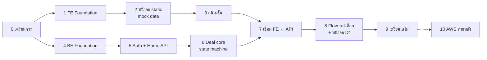

# 06 · Roadmap — ทำอะไรก่อนหลัง (1 → 10)

> หลักการ: **UI ต้องเป๊ะก่อน** (ด้วย mock data ที่ค่าตรง mockup) → ค่อยทำ backend → แล้วเชื่อมกัน
> แต่ละ Phase มี **Definition of Done (DoD)** — ติ๊กครบแล้วค่อยไป Phase ถัดไป
> เวอร์ชันของ Next.js / Fiber / Go / PostgreSQL: **ใช้ล่าสุด ณ วันที่ setup** และจดเลขเวอร์ชันจริงลง README หลังติดตั้ง (อย่าเดาจากความจำ)



> Phase 4–6 (backend) ทำขนานกับ Phase 1–3 ได้ถ้ามีเพื่อนในทีม

---

## Phase 0 · เตรียมการ & ตัดสินใจ ✅ (เอกสารชุดนี้)

- [x] อ่าน/สรุป flow ทั้งหมด → [01-user-flow.md](./01-user-flow.md)
- [x] UI spec + animation spec → [02-ui-spec.md](./02-ui-spec.md)
- [x] Architecture, DB, API → [03](./03-architecture.md) · [04](./04-database.md) · [05](./05-api.md)
- [x] เก็บรูป mockup ไว้ใน `docs/design/`
- [ ] **ตัดสินใจเรื่องแบรนด์** — ข้อความแบรนด์ทั้งหมดอยู่ใน `frontend/src/config/brand.ts` ไฟล์เดียว เปลี่ยนได้ภายหลัง
- [ ] **อนุมัติหน้าจอ D0–D12** ที่ต้องออกแบบเพิ่ม ([01 §7](./01-user-flow.md#7-หน้าจอที่-ไม่มีใน-mockup-ต้องออกแบบเพิ่มให้เข้าชุด--️-รอผู้ใช้อนุมัติ))
- [ ] หา asset ตาม [07-assets.md](./07-assets.md) (อย่างน้อย: โลโก้ SVG + ลิงก์ Figma ถ้ามี)
- [x] สร้างไฟล์ `.gitignore`, `.editorconfig`, `.env.example`

**DoD:** ทุกข้อติ๊กครบ · โฟลเดอร์ `assets/brand/` มีโลโก้ SVG

---

## Phase 1 · Frontend Foundation 🟡 (โค้ดครบ · เหลือ DoD ทดสอบบนมือถือจริง)

### 1.1 สร้างโปรเจกต์

```bash
# ที่ root ของ repo
npx create-next-app@latest frontend \
  --typescript --tailwind --eslint --app --src-dir --import-alias "@/*"
cd frontend
npm i axios @tanstack/react-query zustand motion lucide-react qrcode.react \
      zod react-hook-form @hookform/resolvers clsx tailwind-merge html-to-image
npm i -D prettier prettier-plugin-tailwindcss vitest @testing-library/react @testing-library/jest-dom jsdom
# ตรวจเวอร์ชันที่ได้จริง
npx next --version && npm ls tailwindcss motion
```

### 1.2 งาน
- [x] ลบหน้าตัวอย่างของ Next ออก · ตั้ง `<html lang="th">`
- [x] `globals.css`: ใส่ `@theme` tokens ทั้งหมดจาก [02 §1.4](./02-ui-spec.md#14-tailwind-v4-css-first) + `body { background: var(--color-bg); color: white; }`
- [x] ฟอนต์ Poppins + Noto Sans Thai ผ่าน `next/font/google` (weights 400/500/600/700)
- [x] viewport meta + `viewport-fit=cover` + `themeColor`
- [x] `config/brand.ts` (ชื่อแบรนด์, ชื่อแอปธนาคาร, ข้อความ disclaimer)
- [x] `lib/format/money.ts`, `date.ts` (พ.ศ.), `account.ts` + **unit test** (Vitest) ทุกรูปแบบใน [02 §3](./02-ui-spec.md#3-การจัดรูปแบบข้อมูล-สำคัญมากต่อความ-เป๊ะ)
- [x] Layout: `PhoneFrame` (desktop เท่านั้น), `StatusBar`, `HomeIndicator`, `AppShell`, `StickyFooter`
- [x] Copy asset จาก `assets/` → `public/`
- [x] UI พื้นฐาน: `Button`, `Card`, `Badge`, `AppHeader`, `HomeHeader`, `BottomNav`, `BottomSheet`, `Toast`, `Skeleton`
- [x] หน้า `/dev/components` — แคตตาล็อกทุก component ทุก variant
- [x] หน้า `/dev/overlay?screen=L1` — วางรูป mockup โปร่งแสงทับหน้าจริง (opacity slider) ใช้เทียบความเป๊ะ
- [x] Prettier + ESLint ผ่าน

**DoD:** `npm run dev` แล้วเปิดบนมือถือผ่าน `http://<IP เครื่อง>:3000` ได้ · desktop เห็นกรอบโทรศัพท์ · `/dev/components` แสดงปุ่ม/การ์ดสีถูกต้อง · test format ผ่าน

---

## Phase 2 · หน้าจอทั้งหมดแบบ static (mock data) ⭐ สำคัญที่สุด ✅

ตั้ง `NEXT_PUBLIC_USE_MOCK=true` · สร้าง `src/mocks/fixtures.ts` ด้วย **ค่าตรง mockup ทุกตัว** (ชื่อ, ยอด, วันที่, `KS-691014-0458`, `KS-8F4Q21` — ดู [01 §2](./01-user-flow.md#2-ตัวละครและข้อมูลเดโม-ใช้ค่าตรงกับ-mockup-เป๊ะ)) · ทำ mock api ที่ "ขยับ state ได้" ในหน่วยความจำ เพื่อกดผ่าน flow ได้จริง

ลำดับที่แนะนำ (ใช้ component ซ้ำได้มากขึ้นเรื่อยๆ):

| ลำดับ | หน้าจอ | component ใหม่ที่ได้ |
|---|---|---|
| 1 | **L1** หน้าหลักผู้ให้เช่า | BalanceCard, ServiceGrid, PromoBanner, BottomNav |
| 2 | **T1** หน้าหลักผู้เช่า | RequestCard, TipBanner |
| 3 | **L2** สร้างดีล | StepTabs, input, SplitBar, TrancheRow |
| 4 | **L3** ตรวจสอบก่อนส่ง | TrancheCard, RulesList |
| 5 | **L4** ส่งคำขอ | SegmentedControl, QrCard, CodeField, InfoNote |
| 6 | **L5** สถานะดีล | FundsSecuredCard, Timeline |
| 7 | **T2** ตรวจสอบดีล | (ใช้ซ้ำ) + Badge ชื่อตรงบัญชี |
| 8 | **T3** Face ID | FaceScanFrame (static ก่อน) |
| 9 | **T4** กันเงินสำเร็จ | SuccessHero (static), Stepper3, NextStepCard |
| 10 | **T5 / T6** ยืนยัน | CheckList, ReleaseRow |
| 11 | **T7 / L6** สำเร็จ | ReceiptCard |
| 12 | **T8** เตือนโอนนอกดีล | หน้าโอนเงิน + BottomSheet light |

ต่อหน้าจอ:
- [x] ทำตาม [02-ui-spec](./02-ui-spec.md) · ข้อความไทยตรงทุกตัว (ดึงจาก `figma-spec/*.md`)
- [x] เทียบด้วย `/dev/overlay` ที่ 393×852 — ต่างไม่เกิน ~2–3px (ข้อยกเว้นที่ตั้งใจ: ดู [design/compare/README.md](./design/compare/README.md))
- [x] ทดสอบที่ 360 / 390 / 430px ไม่มี scroll แนวนอน (ตรวจอัตโนมัติ 54 หน้า×state)
- [x] ปุ่ม/ลิงก์ทุกอันพาไปหน้าที่ถูกต้องตาม route map ([01 §8](./01-user-flow.md#8-route-map-หน้าจอ--url))

> หมายเหตุ Phase 2: หน้าที่ flow ต้องผ่านแต่ยังไม่มีดีไซน์ — **D1** (L5 ก่อนกันเงิน), **D8** (สถานะฝั่งผู้เช่า), **D9** (การ์ดดีลบนหน้าหลัก), **D4/D5** (sheet), **D6** (คำเชิญใช้ไม่ได้), **D10** (แท็บเบอร์มือถือ) — ทำเป็น placeholder ตามคำอธิบายใน [01 §7](./01-user-flow.md#7-หน้าจอที่-ไม่มีใน-mockup-ต้องออกแบบเพิ่มให้เข้าชุด--️-รอผู้ใช้อนุมัติ) รออนุมัติดีไซน์

**DoD:** กดผ่าน flow ผู้ให้เช่า L1→L6 และผู้เช่า T1→T7 + T8 ได้ครบด้วย mock · ภาพ side-by-side ทั้ง 14 หน้าจอเทียบกับ `docs/design/screens/` ผ่านการตรวจด้วยตา (เก็บ screenshot ไว้ใน `docs/design/compare/`)

---

## Phase 3 · อนิเมชัน & ความรู้สึก (polish)

ทำตาม [02 §5](./02-ui-spec.md#5-animation-spec-ค่าจริงที่ต้องใช้) ด้วยค่าที่ระบุไว้ทุกตัว

- [ ] `components/motion/`: `RippleRings`, `CheckDraw`, `CountUp`, `Sparkles`, `PulseRing`, `Shimmer`, `SuccessHero`
- [ ] Success hero บน L6, T7 (ครบทุกจังหวะ + haptic) → T4 (ล็อก) → T3 (โล่)
- [ ] Face ID จำลองครบ (สแกน → สำเร็จ → ไป T4) + โหมดล้มเหลว
- [ ] Stepper, Timeline, Funds Secured shimmer
- [ ] การ์ดคำขอเรืองแสง, badge กระดิ่ง, ซ่อนยอดเงิน
- [ ] Page transitions (`template.tsx`), micro-interactions, bottom sheet ลากปิดได้
- [ ] `prefers-reduced-motion` ปิดลูปทั้งหมด
- [ ] ทดสอบบนมือถือจริง: ลื่น 60fps (ดู Performance ใน DevTools ไม่มี long task ระหว่างอนิเมชัน)

**DoD:** อัดวิดีโอหน้าจอ L6/T7/T4/T3 บนมือถือจริง ดูแล้ว "รู้สึกเหมือนแอปธนาคาร" · reduced motion ทำงาน

---

## Phase 4 · Backend Foundation

```bash
# ที่ root ของ repo
mkdir backend && cd backend
go mod init github.com/<your-github>/ksure/backend
# ตรวจก่อนว่า Fiber v3 ออก stable แล้วหรือยัง (https://github.com/gofiber/fiber/releases)
go get github.com/gofiber/fiber/v3            # หรือ /v2 ถ้า v3 ยังไม่ stable
go get github.com/jackc/pgx/v5 github.com/golang-jwt/jwt/v5 \
       github.com/go-playground/validator/v10 github.com/google/uuid
go install github.com/pressly/goose/v3/cmd/goose@latest
go install github.com/sqlc-dev/sqlc/cmd/sqlc@latest
go install github.com/air-verse/air@latest
go version
```

- [ ] โครงโฟลเดอร์ตาม [03 §3.4](./03-architecture.md#34-backend-backend--layered-handler--service--repository)
- [ ] `docker-compose.yml` (db + api + adminer) ตาม [03 §3.5](./03-architecture.md#35-docker-compose-แนวทาง) · `.env.example`
- [ ] `config`, `slog` JSON logger, middleware `recover` / `requestid` / logger
- [ ] `GET /healthz`, `GET /readyz` (ping DB)
- [ ] migration `0001_init.sql` + `0002_seed_demo.sql` ตาม [04 §3, §5](./04-database.md) · `goose up` / `goose down` ได้ทั้งคู่
- [ ] `sqlc.yaml` + query พื้นฐาน → `sqlc generate`
- [ ] `Dockerfile` multi-stage, รันเป็น non-root
- [ ] `Makefile`: `make up`, `make down`, `make migrate`, `make seed`, `make db-reset`, `make test`, `make sqlc`

**DoD:** `docker compose up` → `curl localhost:8080/api/v1/readyz` ได้ `200` · Adminer เห็นตารางและข้อมูล seed ถูกต้อง (42,850.00 / 28,500.00)

---

## Phase 5 · Auth เดโม + Home API

- [ ] `POST /auth/demo-login`, `POST /auth/logout` (JWT cookie)
- [ ] middleware auth + role guard
- [ ] `GET /me`, `GET /home`, `GET /properties`, `GET /notifications`, `POST /notifications/read`
- [ ] `POST /demo/reset?scenario=` ทุก scenario ใน [04 §5](./04-database.md#demo-scenarios-ใช้กับ-post-demoreset-scenario) — **วันที่คำนวณจาก `now()`** (ไม่ใช่วันที่ใน mockup) และล้างด้วย `TRUNCATE ... RESTART IDENTITY CASCADE`
- [ ] `Clock` interface (+ env `DEMO_FROZEN_NOW` ถ้าต้องการ) แทนการเรียก `time.Now()` ตรงๆ
- [ ] เขียน `api/openapi.yaml` ส่วนนี้

**DoD:** ล็อกอิน 2 role ด้วย curl/Bruno/Postman ได้ · `/me` คืนยอดถูกต้อง · role ผิดได้ 403

---

## Phase 6 · Deal Core (หัวใจของระบบ)

- [ ] `domain/` enums + `AppError` (รหัส error ตาม [05 §1](./05-api.md#รูปแบบ-error))
- [ ] `service/statemachine.go` + **unit test ทุก transition** (ถูกและผิด) ตาม [04 §2](./04-database.md#deal_state-ตรงกับ-state-machine-ในสเปก)
- [ ] `platform/token`: ref no, share code, invite token + hash
- [ ] `POST /deals`, `GET /deals`, `GET /deals/{id}`, `POST /deals/{id}/invite`, `/invite/send`, `GET /users/lookup`
- [ ] `GET /invites/{codeOrToken}` + rate limit (Fiber limiter middleware)
- [ ] `POST /deals/{id}/reject`, `/lock`, `/confirm-viewing`, `/confirm-move-in` ตาม transaction ใน [04 §6](./04-database.md#6-transaction-ของแต่ละ-action)
- [ ] Idempotency middleware + การบันทึกใน tx เดียวกัน
- [ ] `allowedActions` / `nextActor` ใน `DealDTO`
- [ ] **Integration tests:**
  - [ ] flow สำเร็จเต็ม: create → lock → confirm-viewing → confirm-move-in → ยอดเงินทั้งสองบัญชีถูก (ผู้ให้เช่า 49,350.00 / ผู้เช่า 22,000.00)
  - [ ] ยิง confirm-viewing ซ้ำ 5 ครั้ง key เดียวกัน → ledger มี `RELEASE_BOOKING_FEE` 1 แถว
  - [ ] ยิง confirm-viewing 2 request พร้อมกัน (key ต่างกัน) → สำเร็จ 1, `409` 1
  - [ ] landlord เรียก confirm → `403` · ผู้ใช้อื่นอ่านดีล → `403`
  - [ ] ยอดไม่พอ → `422` และไม่มี ledger event

**DoD:** `make test` ผ่านทั้งหมด · OpenAPI ครบทุก endpoint ของ Phase นี้

---

## Phase 7 · เชื่อม Frontend ↔ Backend

- [ ] `next.config.ts` rewrites `/api/*` → `API_ORIGIN`
- [ ] `lib/api/client.ts` (Axios + interceptors + `ApiError` + แปลง code → ข้อความไทย)
- [ ] `lib/api/idempotency.ts`: สร้าง key ตอน "เริ่ม action" และใช้ key เดิมเมื่อ retry (เช่นเน็ตหลุด)
- [ ] `QueryProvider` + hooks ใน `features/*/hooks.ts`
- [ ] หน้า D0 ล็อกอินเดโม (2 ปุ่ม) + AuthGuard
- [ ] ตั้ง `NEXT_PUBLIC_USE_MOCK=false` แล้วไล่ทุกหน้า
- [ ] Polling ตาม [05 §5](./05-api.md#5-polling--real-time) + อนิเมชันเมื่อ state เปลี่ยน
- [ ] Route guard ตาม state (เปิดหน้าผิด state → redirect)
- [ ] Loading (Skeleton) + error (Toast) ทุกหน้า

**DoD:** เปิด 2 เบราว์เซอร์ (หรือมือถือ 2 เครื่อง) ทำสคริปต์เดโม [01 §9](./01-user-flow.md#9-สคริปต์เดโมบนเวที-2-เครื่อง-3-นาที) ข้อ 1–8 ได้ครบด้วยข้อมูลจริงจาก DB · L5 อัปเดตเองภายใน 3 วินาที

---

## Phase 8 · Flow ทางเลือก + หน้าจอ D*

- [ ] T8: หน้าโอนเงิน + `GET /transfers/payees`, `POST /transfers/precheck`, `POST /transfers`
- [ ] D2 PIN pad (ไม่ส่งค่า PIN) · D3 ผลลัพธ์ · D4/D5 sheet · D6 คำเชิญใช้ไม่ได้ · D7 แจ้งเตือน · D8 สถานะฝั่งผู้เช่า · D9 การ์ดดีล active · D10 แท็บเบอร์มือถือ · D11 ยกเลิก
- [ ] `POST /deals/{id}/cancel`, `/report-issue`, `GET /deals/{id}/calendar.ics`
- [ ] Expiry worker + `POST /demo/deals/{id}/expire-now`
- [ ] "บันทึก QR" / "บันทึกหลักฐาน" (html-to-image) — **ใส่ลายน้ำ `SIMULATED · Prototype` บนรูปที่ export ทุกครั้ง** (บังคับ — กันรูปถูกนำไปใช้เป็นสลิปปลอม) · ปุ่มแชร์ (Web Share API + fallback คัดลอกลิงก์)
- [ ] Integration test: cancel 2 ฝ่าย, expiry ชนกับ confirm

**DoD:** ทุกแถวในตาราง [01 §6](./01-user-flow.md#6-ตารางหลัก-หน้าจอ--state--api--ใครทำต่อ--event-ที่บันทึก) ทำได้จริงจาก UI

---

## Phase 9 · เตรียมเดโม

- [ ] D12 สแกน QR ด้วยกล้อง (ต้อง HTTPS: `next dev --experimental-https` หรือ `cloudflared tunnel`)
- [ ] Playwright E2E: `full-deal.spec.ts` (2 context), `reject.spec.ts`, `expire.spec.ts`, `off-deal-transfer.spec.ts`
- [ ] Visual regression ที่ 393×852 เทียบ `docs/design/screens/`
- [ ] PWA manifest + app icons (เปิดจากหน้าโฮมมือถือแบบเต็มจอ)
- [ ] ป้าย "Prototype only · No real funds" ตามที่ตัดสินใจใน Phase 0
- [ ] Demo tools panel บน desktop (สลับ role, reset scenario, expire now)
- [ ] ซ้อมเดโม 3 รอบ (รวมกรณีเน็ตช้า → ดูว่า idempotency + loading ทำงาน)
- [ ] จดเวอร์ชันจริงของทุก tool ลง README

**DoD:** เดโม 3 นาทีจบโดยไม่ติดขัด 3 รอบติด

---

## Phase 10 · (ภายหลัง) ขึ้น AWS ตามสเปกต้นฉบับ

ทำเมื่อผ่านรอบ Prototype แล้วเท่านั้น — Cognito, EKS, RDS, CloudFront+WAF, Terraform, Helm, GitHub Actions OIDC ตาม [reference/poc-system-spec.th.md](./reference/poc-system-spec.th.md)
