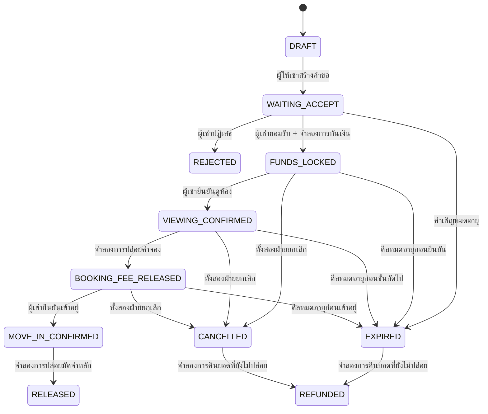

# สเปกระบบ DealSafe POC (ฉบับภาษาไทย)

> เอกสารอ้างอิงต้นฉบับ (คัดลอกมาเก็บไว้ใน repo) — แปลจาก `POC_SYSTEM_SPEC.md`
> **หมายเหตุผู้แปล:** UI v3 ตัดฟีเจอร์รูปห้องออกทั้งหมดแล้ว (ดู `prototype/ksure-ui-v3/FLOW.md` หัวข้อ 13) ส่วนที่เกี่ยวกับการอัปโหลดรูปห้องในเอกสารนี้ ถูกทำเครื่องหมาย ⚠️ ไว้ — ให้ถือว่า **ไม่ต้องทำ** เมื่อออกแบบระบบตาม UI v3
>
> **หมายเหตุสำหรับ repo นี้:** ช่วง Prototype ปัจจุบันยังไม่ทำส่วน AWS / EKS / Cognito / Terraform — ดูแผนจริงที่ [`../06-roadmap.md`](../06-roadmap.md)

## วัตถุประสงค์

สร้างเดโมสำหรับงานแฮกกาธอนที่ใช้งานได้จริง แสดงทั้งสองฝั่งของดีลมัดจำห้องเช่า: ผู้ให้เช่าสร้างคำขอและเห็นหลักฐานว่าผู้เช่าได้กันเงินไว้แล้ว ส่วนผู้เช่าตรวจสอบเงื่อนไขและเป็นผู้ควบคุมการยืนยันในแต่ละขั้น เดโมต้องให้ความรู้สึกเหมือนแอปธนาคารบนมือถือที่ขัดเกลามาอย่างดี แต่ต้องแยกจากธนาคารจริงอย่างชัดเจน

สเปกนี้อธิบาย proof of concept ที่ deploy บน AWS ได้จริง ระบบ **ไม่** เคลื่อนย้าย กัน หรือปล่อยเงินจริง "hold ledger" บันทึกเพียงการเปลี่ยนสถานะแบบจำลองเท่านั้น ให้ใช้บัญชีเดโมที่เตรียมไว้ล่วงหน้า (seeded) และรูปห้องตัวอย่าง ⚠️ ห้ามขอ PIN ธนาคารจริง, OTP, เลขบัญชี, เอกสารยืนยันตัวตน หรือข้อมูลการชำระเงินใดๆ เด็ดขาด

## ข้อจำกัดด้านผลิตภัณฑ์และกติกางาน

- ใช้ชื่อเดโมที่เป็นกลางและ UI ที่ออกแบบเอง เอกสารงานปัจจุบันห้ามใช้ชื่อ/โลโก้ KBank, KBTG และ K PLUS รวมถึงถ้อยคำที่อาจทำให้เข้าใจว่าเป็นบริการทางการ ต้องได้รับอนุมัติจากผู้จัดงานก่อนใช้ชื่อชั่วคราว "K Sure" ในเดโมสาธารณะ
- เดโมต้องแสดงข้อความ "Prototype only · No real funds" ตลอดเวลาบนหน้าล็อกอินและหน้าดีล
- ใช้ผู้ใช้จำลอง, การยืนยันตัวตนจำลอง, การยืนยันชำระเงินจำลอง และใบเสร็จการปล่อยเงินจำลอง
- ห้ามเผยแพร่ URL เดโมแบบเปิด จำกัดการเข้าถึงเฉพาะช่วงงาน/ช่วงเดโม และปิดหลังใช้งานตามกติกางาน

## แผนภาพสถาปัตยกรรม

> ไฟล์แผนภาพต้นฉบับ (`system-architecture.svg`, `tenant-landlord-flow.svg`) ยังไม่ได้รับมา — ถ้ามี ให้วางไว้ในโฟลเดอร์นี้
> แผนภาพของช่วง Prototype ดูที่ [03-architecture §2](../03-architecture.md#2-ภาพรวมระบบ-local) และ flow ดูที่ [01-user-flow §3](../01-user-flow.md#3-ภาพรวม-flow-ทั้งสองฝั่ง-เวลาจริงคู่กัน)

## แผนภาพ User flow

(ดูหมายเหตุด้านบน)

## การตัดสินใจด้านสถาปัตยกรรม

| ด้าน | การตัดสินใจ | เหตุผล |
|---|---|---|
| Web | เว็บแอป Next.js แบบ responsive (สไตล์ PWA ติดตั้งได้ เป็นตัวเลือก) | แสดงหน้าจอแบบ mobile-first บนมือถือและโปรเจกเตอร์ได้ โดยไม่ต้องติดตั้งผ่าน app store |
| API | Go REST API พร้อมสัญญา OpenAPI | ขอบเขต service เล็ก มี type ชัดเจน ทดสอบและทำ container ง่าย |
| Runtime | Amazon EKS managed node group กระจาย 2 Availability Zone; deploy ด้วย Helm | แสดง Kubernetes, rolling deploy, health probe และ horizontal scaling บน AWS จริง |
| Edge | Route 53 → CloudFront + AWS WAF → Application Load Balancer สาธารณะ | มี TLS, จุดเข้าสาธารณะจุดเดียว, กรองแบบ rate-based และแยก path ไป web/API |
| Data | Amazon RDS for PostgreSQL ใน private subnet | Transaction ปกป้องสถานะดีลและ ledger จำลองแบบ append-only จากการปล่อยเงินซ้ำ |
| ⚠️ รูปภาพ | S3 bucket แบบ private; Go API ออก presigned URL อายุสั้นสำหรับอัปโหลด/ดาวน์โหลด | เบราว์เซอร์อัปโหลดรูปห้องได้โดยไม่ต้องได้ AWS credential; bucket ไม่เปิดสาธารณะ — **UI v3 ตัดออก** |
| Identity | Amazon Cognito user pool สำหรับเดโม พร้อมผู้ใช้ผู้เช่า/ผู้ให้เช่าที่เตรียมไว้ | จัดการล็อกอิน/เซสชันจริง โดยไม่แอบอ้างว่าใช้ระบบยืนยันตัวตนของธนาคารหรือ K PLUS SSO |
| Secrets | AWS Secrets Manager เก็บ credential ฐานข้อมูล; workload identity แยกแบบสิทธิ์น้อยที่สุดสำหรับ S3 | ไม่มี credential ในซอร์สโค้ด และไม่ใช้ role ระดับ node ที่กว้างเกินไป |
| Telemetry | CloudWatch Container Insights, log แบบมีโครงสร้าง, request ID, health alarm | ทีมเห็นพฤติกรรมระบบระหว่างเดโมสด |
| Infrastructure | Terraform + Helm | โครงสร้างพื้นฐานตรวจทานและทำซ้ำได้; resource ของ Kubernetes อยู่ใกล้แอป |
| CI/CD | GitHub Actions ใช้ OIDC assume AWS role ที่จำกัดสิทธิ์; ECR เก็บ image; Helm upgrade ไป EKS | ไม่ต้องเก็บ AWS key ระยะยาวใน GitHub secrets และทุก build ตรวจย้อนได้ |

AWS ระบุว่า AWS Load Balancer Controller สร้าง ALB จาก Kubernetes Ingress ได้ และแนะนำให้ใช้สิทธิ์ IAM แบบละเอียดสำหรับ workload บน EKS ส่วน S3 presigned URL ให้สิทธิ์เข้าถึงแบบจำกัดเวลา และ CloudFront Origin Access Control ช่วยให้ S3 origin ยังเป็น private ได้ ส่วน GitHub Actions ใช้ OIDC เข้าถึง AWS ได้โดยไม่ต้องเก็บ AWS credential ระยะยาวใน repository secrets ดูเพิ่มเติม: [EKS load balancing](https://docs.aws.amazon.com/eks/latest/best-practices/load-balancing.html), [EKS workload identity](https://docs.aws.amazon.com/eks/latest/userguide/service-accounts.html), [S3 presigned URLs](https://docs.aws.amazon.com/AmazonS3/latest/userguide/using-presigned-url.html), [CloudFront access to private S3 origins](https://docs.aws.amazon.com/AmazonCloudFront/latest/DeveloperGuide/private-content-restricting-access-to-s3.html) และ [GitHub Actions OIDC for AWS](https://docs.github.com/en/actions/how-tos/secure-your-work/security-harden-deployments/oidc-in-aws)

### การจัดวางการ deploy

- **Public subnet ใน 2 AZ:** มีเฉพาะ ALB ที่หันออกอินเทอร์เน็ต CloudFront เป็น distribution ที่ผู้ใช้เข้าถึง และติด WAF ไว้ที่ edge
- **Private application subnet ใน 2 AZ:** EKS worker node และ pod ไม่มี public IP บน pod หรือ node; EKS managed node group เริ่มที่ 2 node; HPA เริ่มที่ 2 replica สำหรับ deployment ของ web และ API
- **Private data subnet:** RDS PostgreSQL รับ inbound เฉพาะจาก security group ของ API ถ้าต้องประหยัดค่าใช้จ่ายสำหรับเดโมชั่วคราว ใช้ instance เล็กแบบ single-AZ ได้; ก่อนทำ pilot กับผู้ใช้จริงต้องใช้ Multi-AZ และทดสอบการ backup แล้ว
- ⚠️ **S3:** block public access, ใช้ bucket-owner-enforced object ownership, เข้ารหัสฝั่ง server, ตั้ง lifecycle ลบรูปเดโม และ IAM policy จำกัดเฉพาะ prefix สำหรับอัปโหลดของแอป ห้ามอัปโหลดเอกสารกรรมสิทธิ์ใน POC นี้ — **UI v3 ไม่ต้องใช้ ถ้าไม่มีรูป**
- **การ scale ของ EKS:** HPA scale pod ตาม CPU/memory; cluster autoscaling เพิ่ม EC2 node ได้เมื่อ pod schedule ไม่ได้ ต้องตั้ง resource request/limit ไว้เสมอ การ scale ช่วยให้เดโมทนทานขึ้น แต่ไม่ได้พิสูจน์ความสามารถระดับ production
- **คุมค่าใช้จ่าย:** EKS มีค่าบริการต่อ cluster บวกค่า compute ของ worker และ resource อื่นที่เกี่ยวข้อง ให้สร้าง environment เฉพาะช่วง build/เดโม ตั้ง budget alert และลบทิ้งหลังใช้งาน ตรวจ [หน้าราคา EKS](https://aws.amazon.com/eks/pricing/) ล่าสุดก่อนสร้าง

## เส้นทางของ request ขณะทำงาน

1. เบราว์เซอร์ของผู้เช่าและผู้ให้เช่าโหลดแอปผ่าน HTTPS ผ่าน Route 53, CloudFront และ WAF
2. CloudFront ส่ง `/api/*` ไปยัง path API ของ ALB และ route อื่นไปยัง web service ของ Next.js
3. ALB ส่ง request ต่อไปยัง Kubernetes Ingress ที่จัดการโดย AWS Load Balancer Controller
4. Ingress ส่ง `/api/*` ไป pod ของ Go API และ `/` ไป pod ของ Next.js — Service ทั้งหมดเป็นแบบ ClusterIP ภายใน EKS เท่านั้น
5. Go API ตรวจ role ของผู้ใช้และสถานะดีล แล้วอ่าน/เขียน PostgreSQL ภายใน transaction
6. ⚠️ สำหรับการอัปโหลดรูป Go API สร้าง presigned S3 URL อายุสั้นสำหรับ object key ที่ระบบสร้างขึ้น เบราว์เซอร์อัปโหลดตรงไปยัง bucket แบบ private; API เก็บเพียง object key และคืน URL สำหรับดูรูปที่มีสิทธิ์และอายุสั้น — **UI v3 ตัดออก**
7. Container ของ API และ web ส่ง log แบบมีโครงสร้างและ metric ไปที่ CloudWatch และคืน request ID ให้เบราว์เซอร์เพื่อใช้ซัพพอร์ต/ดีบัก

## Flow ของผลิตภัณฑ์

### หน้าจอเดโม

**ทางเข้าร่วม:** ข้อความแจ้งว่าเป็นเดโม → ล็อกอินด้วยบัญชีที่เตรียมไว้ → หน้าหลักตาม role มีบัญชีเดโมแบบคลิกเดียว 2 บัญชีใน build ส่วนตัวสำหรับงาน เพื่อให้กรรมการสลับ role ได้โดยไม่ต้องสมัคร

**หน้าจอผู้ให้เช่า:** แดชบอร์ดคำขอที่ active → สร้าง/แก้ไข draft → ดูตัวอย่างเงื่อนไข → แชร์ QR/ลิงก์เชิญ → ไทม์ไลน์ดีลพร้อมสถานะ `Funds secured (simulation)` → ใบเสร็จจำลองสุดท้าย

**หน้าจอผู้เช่า:** เปิดคำเชิญ → ตรวจห้อง, ตัวตน, ยอดเงิน, วันที่, กติกาการยกเลิก/หมดอายุ → ยอมรับ/ปฏิเสธ → จำลองการกันเงิน → ไทม์ไลน์ดีล → ยืนยันดูห้อง → ยืนยันเข้าอยู่ → ใบเสร็จจำลอง

ทุกหน้าจอควรแสดงว่า **ใคร** เป็นผู้ทำขั้นถัดไปได้, **event อะไร** จะถูกบันทึก และการกระทำนั้นเปลี่ยนแค่การจำลองหรือไม่ ห้ามแสดงหน้าจอ K PLUS จริง, โลโก้ หรือหน้ายืนยันตัวตนจริง

### ผู้ให้เช่า

1. ล็อกอินด้วยบัญชีเดโมผู้ให้เช่าที่เตรียมไว้
2. สร้างคำขอห้อง ระบุชื่อ, ค่าเช่า, ค่าจอง, มัดจำหลัก, เวลานัดดูห้อง, วันเข้าอยู่ และเงื่อนไขสั้นๆ
3. ⚠️ (ไม่บังคับ) เพิ่มรูปห้องตัวอย่าง เบราว์เซอร์อัปโหลดไป S3 ผ่าน URL อายุสั้น — **UI v3 ตัดออก**
4. ตรวจสอบคำขอและสร้างลิงก์/QR เชิญสำหรับเดโม ใช้ token แบบ opaque ที่หมดอายุได้
5. เห็นว่าผู้เช่ายอมรับแล้ว และสถานะ `Funds secured (simulation)` เมื่อผู้เช่าทำขั้นกันเงินจำลองเสร็จ
6. ดูไทม์ไลน์ event เดียวกับผู้เช่า ผู้ให้เช่า **สั่งปล่อยเงินไม่ได้**
7. หลังผู้เช่ายืนยัน จะเห็นสถานะการปล่อยค่าจอง, ปล่อยมัดจำ หรือคืนเงินแบบจำลอง

### ผู้เช่า

1. เปิดลิงก์/QR เชิญ แล้วล็อกอินด้วยบัญชีเดโมผู้เช่าที่เตรียมไว้
2. ตรวจชื่อที่แสดงของผู้ให้เช่า, รายละเอียดห้อง, ยอดเงิน, วันที่ และกติกาการยกเลิก/หมดอายุทั้งหมด ก่อนยอมรับ
3. ยอมรับดีล แล้วกด `Simulate funds lock` ระบบเขียน event ลง ledger จำลอง — ไม่มีการเรียกระบบธนาคาร/ระบบชำระเงินใดๆ
4. เห็นสถานะ `Funds secured (simulation)` ชัดเจน และผู้ให้เช่าเห็นสถานะเดียวกัน
5. หลังดูห้อง กดยืนยันการดูห้องเพื่อจำลองการปล่อยค่าจองก้อนเล็ก
6. หลังเข้าอยู่/รับกุญแจ กดยืนยันการเข้าอยู่เพื่อจำลองการปล่อยมัดจำหลักที่เหลือ
7. เห็นไทม์ไลน์ event แบบใบเสร็จที่ติดป้าย `SIMULATED`

### เส้นทางทางเลือก (Alternate paths)

- ผู้เช่าปฏิเสธก่อนกันเงินจำลอง → ดีลเป็น `REJECTED`; ไม่มี event กันเงินใน ledger
- ผู้เช่าและผู้ให้เช่ายกเลิกร่วมกันก่อนปล่อยเงิน → ยอดจำลองที่ยังไม่ปล่อยเป็น `REFUNDED`
- ดีลถึงวันหมดอายุที่ตกลงไว้ก่อนปล่อยเงิน → เกิด event คืนเงินจำลอง POC ไม่ตัดสินว่าใครผิด
- การยืนยันซ้ำหรือพร้อมกัน → ตอบแบบ idempotent; ledger ต้องไม่บันทึกการปล่อยเงินซ้ำเด็ดขาด
- ข้อพิพาท → แสดง `Support required · Demo does not adjudicate`; ไม่มีการโอนอัตโนมัติ การตัดสินข้อพิพาทอยู่นอกขอบเขต POC นี้

## State machine ของดีล

ทุก transition ต้องตรวจผู้กระทำ (actor), สถานะก่อนหน้า, วันหมดอายุ และ idempotency key ภายใน database transaction เดียว API — ไม่ใช่เบราว์เซอร์ — เป็นผู้กำหนดสถานะและลำดับ event ค่าจองที่ปล่อยแล้วไม่คืนใน POC นี้; ยอดที่เหลืออาจคืนตามกติกาเดโมที่ตกลงไว้ ต้องแสดงกติกาเหล่านี้ก่อนผู้เช่ายอมรับ

## Data model

| Entity | ฟิลด์สำคัญ | หมายเหตุ |
|---|---|---|
| `users` | `id`, `cognito_sub`, `role`, `display_name`, `created_at` | Role เป็น `TENANT` หรือ `LANDLORD`; ไม่มีข้อมูล KYC จริง |
| `properties` | `id`, `landlord_id`, `title`, `location_label`, ⚠️ `photo_object_keys[]` | ใช้ป้ายตำแหน่งที่ปลอดภัยสำหรับเดโม — **UI v3 ไม่มีรูป ตัด `photo_object_keys` ออก** |
| `deals` | `id`, `public_token_hash`, `landlord_id`, `tenant_id`, `property_id`, `booking_fee`, `main_deposit`, `currency`, `viewing_at`, `move_in_at`, `expires_at`, `state`, `version` | เก็บเงินเป็นสตางค์ (integer); เก็บเฉพาะ hash ของ token ห้ามเก็บ token เชิญตัวจริง |
| `ledger_events` | `id`, `deal_id`, `event_type`, `amount_satang`, `actor_id`, `idempotency_key`, `created_at`, `metadata` | event จำลองแบบ append-only; มี unique constraint `(deal_id, idempotency_key)` |
| `audit_events` | `id`, `actor_id`, `deal_id`, `action`, `request_id`, `created_at`, `metadata` | ห้ามมี secret, PIN, token ตัวจริง หรือข้อมูลส่วนบุคคลที่ไม่จำเป็นใน log |
| `idempotency_keys` | `key`, `actor_id`, `request_hash`, `response_code`, `response_body`, `created_at` | ป้องกันผลข้างเคียงซ้ำเมื่อ retry |

## API

ทุก endpoint มีเวอร์ชันภายใต้ `/api/v1` ต้องยืนยันตัวตน ยกเว้น health check และ endpoint ดูตัวอย่างคำเชิญที่จำกัดขอบเขตแคบ ตรวจสิทธิ์ตาม role ที่ฝั่ง server เสมอ

| Method และ path | Role | หน้าที่ |
|---|---|---|
| `GET /healthz` | public | ตรวจว่าระบบยังทำงาน; ไม่เปิดเผยรายละเอียดฐานข้อมูล |
| `GET /readyz` | internal/ALB | ตรวจความพร้อม รวมถึงการเชื่อมต่อฐานข้อมูล |
| `GET /me` | ผู้ที่ล็อกอิน | คืนข้อมูลผู้ใช้เดโมและ role |
| `POST /deals` | ผู้ให้เช่า | สร้างดีล draft และเงื่อนไข |
| `POST /deals/{id}/invite` | ผู้ให้เช่า | ออก token ลิงก์/QR เชิญที่หมดอายุได้ |
| `GET /invites/{token}` | ผู้ถือคำเชิญ | ดูตัวอย่างรายละเอียดดีลแบบจำกัด; มี rate limit |
| `POST /deals/{id}/accept` | ผู้เช่า | ยอมรับดีลตามเวอร์ชันและเงื่อนไขที่ตรงกันพอดี |
| `POST /deals/{id}/simulate-lock` | ผู้เช่า | เพิ่ม event กันเงินจำลอง |
| `POST /deals/{id}/confirm-viewing` | ผู้เช่า | ยืนยันดูห้อง; เพิ่ม event ปล่อยค่าจองจำลอง |
| `POST /deals/{id}/confirm-move-in` | ผู้เช่า | ยืนยันเข้าอยู่; เพิ่ม event ปล่อยมัดจำหลักจำลอง |
| `POST /deals/{id}/cancel` | ทั้งสองฝ่าย | บันทึกความยินยอมยกเลิกของแต่ละฝ่าย; คืนเงินเมื่อทั้งสองฝ่ายยินยอมเท่านั้น |
| `GET /deals/{id}` | คู่ดีล | คืนสถานะ, เงื่อนไข และไทม์ไลน์ที่กรองตาม role |
| ⚠️ `POST /uploads/presign` | ผู้ให้เช่า | คืน URL อัปโหลดรูปอายุสั้นและ key ที่สร้างขึ้น — **UI v3 ตัดออก** |
| ⚠️ `POST /deals/{id}/photos/complete` | ผู้ให้เช่า | ตรวจ metadata ของ object และผูก key รูปกับห้อง — **UI v3 ตัดออก** |

Request ที่เปลี่ยนข้อมูลต้องมี `Idempotency-Key`, schema ของ request body, การป้องกัน CSRF (ถ้าใช้ cookie session) และ `version` ที่คาดหวังสำหรับ optimistic concurrency Error response ใช้รหัสคงที่ เช่น `DEAL_STATE_CONFLICT`, `INVITE_EXPIRED` และ `IDEMPOTENCY_CONFLICT`

## การควบคุมด้านความปลอดภัยและความเป็นส่วนตัว

- **ความปลอดภัยของแบรนด์:** ใช้อัตลักษณ์ภาพที่ออกแบบเองและข้อมูลบัญชีสมมติ; แสดงข้อความแจ้งว่าเป็นเดโมตลอด; ห้ามใช้โลโก้ธนาคารจริง, หน้าล็อกอินเลียนแบบ หรือถ้อยคำที่สื่อว่าเป็นพันธมิตรทางการ
- **ตัวตน:** ใช้บัญชีเดโมของ Cognito เท่านั้น ห้ามเก็บหรือขอ PIN ธนาคาร, OTP, ข้อมูลบัตร, รหัสผ่านของบริการอื่น หรือข้อมูลใบหน้า/ชีวมิติจริง
- **การให้สิทธิ์:** ตรวจ role ทุก action ของ API และตรวจว่าเป็นคู่ดีลทุกครั้งที่อ่าน object ผู้ให้เช่าทำการยืนยันแทนผู้เช่าไม่ได้; ผู้เช่าแก้เงื่อนไขที่ผู้ให้เช่าเขียนไม่ได้หลังยอมรับแล้ว
- **ลิงก์เชิญ:** token แบบ opaque สุ่มด้วยวิธีเข้ารหัส; เก็บเฉพาะ hash; หมดอายุเร็ว; ผูกกับดีลเดียว; จำกัดอัตราการดูตัวอย่าง; ห้ามใส่ชื่อหรือยอดเงินใน URL; ห้าม log query string ที่มี token
- **เงิน/สถานะ:** ใช้หน่วยสตางค์ (integer), PostgreSQL transaction, idempotency key ที่ไม่ซ้ำ, row lock หรือ compare-and-swap ที่ version ของดีล, ledger event แบบ append-only ห้ามใช้ floating point และห้ามให้ฝั่ง client เป็นผู้กำหนด
- ⚠️ **รูปภาพ:** รับเฉพาะ JPEG/PNG/WebP; จำกัดขนาด; key สร้างโดยระบบ; bucket แบบ private; Block Public Access; เข้ารหัสขณะจัดเก็บ; presigned URL หมดอายุเร็ว; ตรวจความเป็นเจ้าของและ metadata ก่อนผูก ปฏิเสธ SVG และไฟล์ที่รันได้ ห้ามอัปโหลดบัตรประชาชน สัญญา หรือหลักฐานการชำระเงิน — **UI v3 ตัดออก**
- **เครือข่าย:** TLS ที่ edge, node และ RDS อยู่ใน private, security group แคบ, WAF managed protection พร้อม rate limit, CORS allowlist, CSP แบบเข้มงวด, cookie แบบ secure HttpOnly SameSite, ตรวจ input, encode output, CSRF token และข้อความ error ที่ปลอดภัย
- **ตัวตนของ Kubernetes/AWS:** container ไม่รันเป็น root, root filesystem แบบ read-only เท่าที่ทำได้, ตัด Linux capability ที่ไม่จำเป็น, ตั้ง CPU/memory request และ limit, RBAC ระดับ namespace, pod security standard, workload identity หนึ่งตัวต่อ service, สิทธิ์ S3 เฉพาะ prefix แบบน้อยที่สุด ห้ามใส่ AWS key ใน pod
- **Secrets:** อ้างอิง Secrets Manager ตอน deploy; ห้ามมี secret ใน Git, container image, log หรือสไลด์เดโม GitHub Actions assume AWS role ที่จำกัดขอบเขตผ่าน OIDC ไม่ใช้ access key ระยะยาว
- **Audit/การเก็บรักษา:** บันทึกผู้กระทำ, การกระทำ, deal ID, request ID และเวลา แต่ไม่บันทึก token ลับหรือข้อมูลส่วนบุคคลที่ไม่จำเป็น ลบผู้ใช้เดโม, รูป และข้อมูลในฐานข้อมูลหลังจบงาน

## Workflow ของ CI/CD

### การตรวจใน Pull request

1. Format และ lint: `gofmt`, `golangci-lint`, ESLint, Prettier, ตรวจ type ของ TypeScript
2. Unit test: ทดสอบ service/state machine ฝั่ง Go และ component ฝั่ง Next.js
3. Integration test: Go API กับ PostgreSQL แบบใช้แล้วทิ้ง; ตรวจ migration ทั้ง up/down
4. Contract check: ตรวจ OpenAPI และทดสอบ schema ของ API response
5. End-to-end ของ UI/API: Playwright ครอบคลุม ผู้ให้เช่าสร้าง → ผู้เช่ายอมรับ → กันเงินจำลอง → ปล่อยหลังดูห้อง → ปล่อยหลังเข้าอยู่ รวมถึงการปฏิเสธ, หมดอายุ, ยกเลิก และการ retry
6. Security check: สแกน secret, สแกนช่องโหว่ของ dependency, static analysis ของ Go, สแกน container image และตรวจ Terraform/Helm แบบ static
7. Build container ของ web/API ครั้งเดียวและติด tag ด้วย commit SHA เผยแพร่ artifact เฉพาะเมื่อผ่านการตรวจที่บังคับทั้งหมด

### การ Deploy

- GitHub Actions ใช้ GitHub OIDC assume AWS deployment role ที่จำกัดสิทธิ์; จำกัด trust policy เฉพาะ repository และ deployment environment
- Push image ที่มีเวอร์ชันไป ECR แล้ว deploy ไป namespace เดโมด้วย Helm; ใช้ readiness/liveness probe ของ Kubernetes และ rolling update
- รัน migration Job แบบครั้งเดียวก่อนสลับ traffic ถ้าล้มเหลวให้หยุด deploy
- รัน smoke test ผ่าน URL เดโมสาธารณะ; เก็บ image tag ก่อนหน้าไว้สำหรับ rollback
- สำหรับการปล่อยสาธารณะ/วันเดโม ต้องมีขั้นตอนตรวจโดยคน, จำกัดเวลาของ environment, ตั้ง budget alert และลบโครงสร้างพื้นฐานหลังจบงาน

## เกณฑ์การทดสอบและการยอมรับเดโม

| ด้าน | เงื่อนไขผ่าน |
|---|---|
| Role ผู้เช่าและผู้ให้เช่า | บัญชีเดโมทั้งสองเห็นไทม์ไลน์ดีลเดียวกัน พร้อม action ที่เหมาะกับ role |
| State machine | transition ที่ถูกต้องสำเร็จ; transition ที่ไม่ถูกต้อง/ผิดลำดับคืน conflict และไม่เพิ่ม ledger event |
| Idempotency | retry คำขอปล่อยเงินกี่ครั้งก็ได้ event ปล่อยเงินเพียงครั้งเดียว |
| Concurrency | หมดอายุกับปล่อยเงินชนกัน ได้ผลลัพธ์สุดท้ายเพียงแบบเดียว |
| Authorization | ผู้เช่าแก้เงื่อนไขของผู้ให้เช่าไม่ได้; ผู้ให้เช่าสั่งยืนยันแทนผู้เช่าไม่ได้; ผู้ใช้ที่ไม่เกี่ยวข้องอ่านดีลไม่ได้ |
| ⚠️ Uploads | อัปโหลดรูปที่ถูกต้องและดูผ่าน URL อายุสั้นที่มีสิทธิ์ได้; การเข้าถึง S3 แบบสาธารณะถูกปฏิเสธ; MIME ผิดหรือไฟล์ใหญ่เกินถูกปฏิเสธ — **UI v3 ตัดออก** |
| Accessibility/responsiveness | flow หลักใช้งานได้ทั้งความกว้างมือถือและโปรเจกเตอร์/แล็ปท็อป; มี focus state และ contrast ที่อ่านง่าย |
| Reliability | `/readyz` ล้มเหลวเมื่อ DB ใช้ไม่ได้; ALB ถอด pod ที่ยังไม่พร้อมออก; restart แล้ว event ที่ commit แล้วไม่หาย |
| เป้าหมายประสิทธิภาพ | ผู้ใช้เดโมพร้อมกัน 20 คน นาน 5 นาที; p95 ของ API อ่านต่ำกว่า 500 ms และ API เขียนต่ำกว่า 800 ms ใน environment ทดสอบ; ไม่มี event ซ้ำ เป้าหมายนี้เป็นของ POC ไม่ใช่การอ้างความสามารถระดับ production |
| การกู้คืน | deploy ที่ล้มเหลว rollback ไป image ก่อนหน้าได้; มีเอกสารขั้นตอนกู้คืน backup ฐานข้อมูลและซ้อมแล้วก่อน pilot จริง |
| ความซื่อตรงของเดโม | การกันเงิน/ปล่อยเงิน/ใบเสร็จจำลองทุกจุดมีป้ายว่าเป็นการจำลองอย่างชัดเจน และไม่มีการเรียกธนาคาร/ผู้ให้บริการชำระเงินใดๆ |

## ขอบเขต

### รวมอยู่ใน POC นี้

- Flow ผู้เช่าและผู้ให้เช่าแบบ responsive
- ล็อกอินเดโมและบัญชีที่เตรียมไว้
- การสร้างดีล, ลิงก์/QR เชิญ, การยอมรับเงื่อนไข, การกันเงินจำลอง, การปล่อยเงินจำลอง 2 ขั้น, การยกเลิก, การหมดอายุ/คืนเงิน และไทม์ไลน์ audit
- ⚠️ อัปโหลดรูปห้องไป S3 แบบ private — **UI v3 ตัดออก**
- Go API, PostgreSQL, การ deploy บน EKS, observability, CI/CD, automated test และโปรไฟล์ load test

### ไม่รวมอย่างชัดเจน

- การเชื่อมต่อ K PLUS/KBank จริง, การผูกบัญชีจริง, การชำระเงิน, escrow, การกันยอดจริง หรือการโอนเงิน
- KYC จริง, สแกนใบหน้า, การกรอก PIN/OTP, การยืนยันกรรมสิทธิ์ หรือการเก็บเอกสารทางกฎหมาย
- การตัดสินข้อพิพาท, การตัดสินคืนเงินในกรณีที่มีข้อโต้แย้ง หรือการรับประกันผลลัพธ์ใดๆ
- Marketplace สาธารณะ, แชท, การจัดส่ง, การโอนข้ามธนาคาร, การทำนายการฉ้อโกง หรือข้อมูลลูกค้าจริง
- การเปิดให้เข้าถึงสาธารณะนอกช่วง mentoring/pitch ที่ได้รับอนุมัติ

## ลำดับการสร้าง

1. ตกลงชื่อเดโมที่ปลอดภัยตามกติกางาน, กติกาที่แสดงต่อผู้ใช้, state machine และสถานการณ์เดโม
2. สร้าง flow แบบ local ด้วย Next.js + Go + PostgreSQL พร้อมบัญชีผู้ให้เช่าและผู้เช่าที่เตรียมไว้
3. เพิ่ม transaction ของ state machine, idempotency, การให้สิทธิ์ และ automated test ก่อนขัดเกลาหน้าตา
4. ⚠️ เพิ่ม flow รูปบน S3 (**UI v3 ตัดออก**), Cognito demo auth และ telemetry
5. เพิ่ม Docker, Helm, Terraform, EKS และการ deploy ผ่าน GitHub Actions OIDC
6. รัน security check, E2E, สถานการณ์ล้มเหลว และ load test; จากนั้นซ้อมเดโมแบบออฟไลน์
