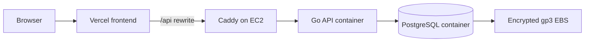

# EC2 Prototype Deployment

This Terraform package creates a low-cost prototype environment in one AWS account:



Terraform creates a dedicated VPC, public subnet, EC2 instance, Elastic IP, security group, and an IAM role for AWS Systems Manager. The instance runs Docker Compose, clones this repository, builds the Go API, and starts PostgreSQL and Caddy. Only ports 80 and 443 are public. Use Systems Manager instead of SSH.

## Before you apply

1. Use a public GitHub repository, or create a read-only GitHub deploy key for a private repository. Store its private half as `repository_ssh_private_key` in the untracked `terraform.tfvars` file. Add the public half in GitHub: **Repository Settings → Deploy keys → Add deploy key**.
2. Set `api_domain` to a hostname you own, or leave it empty to use an automatic `api.<elastic-ip>.nip.io` hostname for this prototype.
3. Confirm that AWS credentials can create EC2, VPC, IAM, and Elastic IP resources in the selected region.
4. Install Terraform and AWS CLI locally.

The default region is `ap-southeast-7` and the default instance is `t4g.small`. It uses ARM64 Amazon Linux 2023. The frontend runs on Vercel, so this instance only runs the Go API, PostgreSQL, and Caddy.

## Deploy

```bash
cd infra/terraform
cp terraform.tfvars.example terraform.tfvars
# Edit frontend_origin in terraform.tfvars. api_domain is optional.
terraform init
terraform plan
terraform apply
```

When `api_domain` is set, create an A record at the DNS provider using the `elastic_ip` output. When it is empty, Terraform uses `api.<elastic-ip>.nip.io`; `nip.io` resolves that hostname automatically. Caddy then obtains and renews its HTTPS certificate.

```bash
terraform output
curl -fsS "https://$(terraform output -raw api_domain)/api/v1/readyz"
```

Set these production environment variables in the Vercel project and redeploy it:

```env
API_ORIGIN=https://$(terraform output -raw api_domain)
NEXT_PUBLIC_USE_MOCK=false
```

The frontend already rewrites `/api/*` to `API_ORIGIN`, so browsers continue to call the Vercel domain. HTTPS also enables camera access for the QR scanner. Replace the temporary hostname with a custom domain before a long-lived public release.

## Operate

Open a shell through Systems Manager after the instance has registered:

```bash
aws ssm start-session --target "$(terraform output -raw instance_id)" --region ap-southeast-7
```

On the instance, inspect the stack and bootstrap log:

```bash
sudo systemctl status ksure
sudo docker compose --env-file /opt/ksure/deploy/.env -f /opt/ksure/deploy/docker-compose.ec2.yml ps
sudo tail -n 200 /var/log/ksure-bootstrap.log
```

To deploy a newer revision, open an SSM shell and run:

```bash
sudo -i
cd /opt/ksure
git pull --ff-only origin develop
systemctl restart ksure
```

If a deployment uses a different branch, replace `develop` with the configured `git_ref`.

## Stop and start

Stopping the EC2 instance stops billing for its compute time. The EBS volume, Elastic IP, and any snapshots continue to incur storage or address charges. PostgreSQL data remains on EBS and systemd starts the stack when the instance starts again.

```bash
aws ec2 stop-instances --region ap-southeast-7 --instance-ids "$(terraform output -raw instance_id)"
aws ec2 wait instance-stopped --region ap-southeast-7 --instance-ids "$(terraform output -raw instance_id)"

aws ec2 start-instances --region ap-southeast-7 --instance-ids "$(terraform output -raw instance_id)"
```

## Backup and recovery

The database volume survives normal stop and start operations. It does not protect against accidental termination, deletion, or account loss. Create a PostgreSQL dump before changing infrastructure, then copy it outside the instance.

```bash
aws ssm start-session --target "$(terraform output -raw instance_id)" --region ap-southeast-7
sudo mkdir -p /opt/ksure/backups
sudo sh -c 'docker compose --env-file /opt/ksure/deploy/.env -f /opt/ksure/deploy/docker-compose.ec2.yml exec -T db pg_dump -U ksure -d ksure -Fc > /opt/ksure/backups/ksure-$(date +%F).dump'
```

Store the resulting dump in a separate location. An EBS snapshot provides disk recovery but has storage cost; a PostgreSQL dump is required for database-level recovery.

## Destroy

`terraform destroy` deletes the EC2 instance and its root EBS volume. Export a database dump first. It also releases the Elastic IP, which makes the public address unavailable.

## State and secrets

Terraform generates the PostgreSQL password and JWT secret. Both values are in the Terraform state and are written to `/opt/ksure/deploy/.env` with owner-only permissions. Keep `terraform.tfstate`, backups, and `terraform.tfvars` out of source control.
